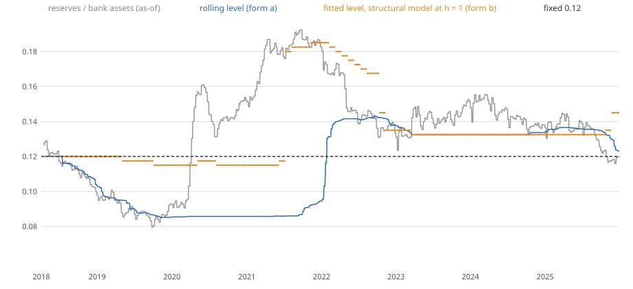

# A time-varying satiation level for the reserve-demand terms (#587, ruling on #569)

A scratch measurement under the pressure-day judge. It writes nothing into `docs/runs/`, publishes nothing, moves no published
figure, scores no day of 2026 and reads no day after 2025-12-31 (`docs/decisions/lockbox.md`; the script refuses a later panel).
The published scarcity indicator and its 0.12 band are unchanged. No rule, threshold, onset definition, cut-off rule or
availability time changes, and none of these rows is added to the frozen shortlist of #567. The two forms and every constant
were declared in [`metadata/satiation_587.json`](../../metadata/satiation_587.json) and the eight judge candidates in
`metadata/pressure_judge/candidates/` (`structural_rolling`, `structural_fitted`, `projected_hinge_fixed`, `projected_rolling`,
`projected_fitted`, `risk_gbm+combined_hinge_fixed`, `risk_gbm+combined_rolling`, `risk_gbm+combined_fitted`), all committed
(bafb768a) before the first forecast was fitted; `scripts/satiation_587.py` refuses an uncommitted declaration.

**The forms were chosen after #569 showed what the fixed 0.12 does on these same days (2018-06-29 to 2025-12-31), and the
2025 onsets are among the days scored. A better 2025 here is therefore not a confirmation: only the 2026 confirmation window
can confirm it, and it is not opened here.**

> **Note of 12 October 2026 (#621): what the rolling satiation level is.** The "rolling satiation level" of #587 (PR #596) is the 10th percentile of the row's
> own trailing 504 reserves-to-assets ratios (`metadata/satiation_587.json`; `satiation-result.md`). It is a two-year low in reserves, not a satiation level: it
> says nothing about where the demand curve's kink is. The panel starts in 2018-04, so until early 2020 the window is mostly 2018-19's own falling reserves.
> The hinge ("the ratio is below the level") is therefore on whenever reserves are at or near a two-year low, whatever their level. Share of days it is on, by year,
> on the tracked fixture panel (`scripts/satiation_distance_598.py hinge-share`; first row the weekly lag the pages were scored on, second row the per-release read
> of #622 that is now in force for the columns):
>
> | reserves read | 2018 | 2019 | 2020 | 2021 | 2022 | 2023 | 2024 | 2025 |
> |---|---|---|---|---|---|---|---|---|
> | weekly lag (the first build, #598) | 54% (96 of 178) | 67% (167 of 250) | 0% (0 of 251) | 0% (0 of 250) | 30% (75 of 249) | 19% (48 of 249) | 2% (4 of 250) | 54% (134 of 249) |
> | per H.4.1 release (#622, in force) | 55% (98 of 178) | 66% (164 of 250) | 0% (0 of 251) | 0% (0 of 250) | 30% (75 of 249) | 18% (46 of 249) | 2% (5 of 250) | 53% (133 of 249) |
>
> It is on for 30% of 2022 and 19% of 2023, years with no pressure days, which fits the false alarms the pages report for those years. Any steady run-off of the
> balance sheet (QT) would turn it on whether or not reserves are near scarce, and the one 2025 onset it adds may come from the run-off of 2024-25 rather than from
> closeness to the kink. Where the pages above say "satiation level", "moving satiation level" or "the gain in 2025 comes from the rolling form", read "two-year
> reserves low". Nothing below is edited, and no figure on it moves.

## Why: the finding of #569

The structural model multiplies every drain and calendar term by an elasticity `e = exp(-(reserves / assets - 0.12) / 0.01)`;
the projected-reserves model feeds `proj_dist = 100 * (R / A - 0.12)` to a standardised logistic, which removes the 0.12, so
the satiation level reaches no forecast. 2025's pressure came at ratios of 0.117 to 0.129. Eleonora's ruling (11 October 2026,
relayed on #569): measure a satiation level set from past data only, as of each decision.

## What was declared

| form | rule |
|---|---|
| fixed (control) | the level is 0.12, the lower end of the published band. The three models as scored on main, re-run here |
| (a) `rolling` | at a decision, the 10th percentile of the reserves-to-assets ratios that the as-of rule reads at each of the last 504 panel rows' own decisions (this one included); the fixed 0.12 until 63 ratios exist. Each leg of the ratio is read at its own latest public row. A panel column, `satiation_roll` (source `satiation_columns`, zero lag), rebuilt from the panel cut at a row and refused if it differs (`satiation.check_no_future`, `LookAheadError`) |
| (b) `fitted` | at each refit, the kink `k` of a hinge regression of the label day's spread on the ratio, `spread = a + b * max(0, k - ratio)` with `b >= 0`, least squares on a grid of 0.0025 from 0.08 to 0.20, fitted on that refit's training pairs alone (the ratio each label's own decision read, the labels the training frame covers); 0.12 on fewer than 250 pairs. One level per refit |
| `hinge_fixed` (control, not a form) | the projected model's kink kept at 0.12, to separate what the kink's shape adds from what a moving level adds |

Where the level goes. **Structural:** the level replaces 0.12 in the elasticity; every other term and the length 0.01 are
unchanged. **Projected:** the linear `proj_dist` is replaced by `hinge(projected ratio, level) = max(0, 100 * (level - ratio))`,
zero at and above the level, so the kink survives standardisation (the second half of #569); `proj_change` and the logistic
are the model's. **Combined (#563):** the same two replacements inside the combined model's ordinary-day logistic (factor
block, Platt calibration, passer `risk_gbm` with settlements dated from the announcement and the H.4.1 read per release, gate
of #532 unchanged); in form (b) one level, fitted on the structural block's as-of ratio, serves both terms.

## Result

The judge in force is the one on main: the rulings of 10 October 2026 (#536) are in it, so tier 1 counts false alarms
pooled across the horizons, and the weighted rule is in force. All tables are under it; the full set is
[`evidence/satiation/report.md`](evidence/satiation/report.md) (the judge's Tables 1, 1b and 2 for each row, the calendar-year
recall, the Brier scores and every row paired with its fixed version with 90% stationary-bootstrap intervals by regime, pressure-day
type and scarcity state). Where a figure was first produced under the earlier counting (false alarms at the worst horizon), the table below
shows both, the one in force first, as the orchestrating session's mechanical ruling on #587 asks; `evidence/satiation/compare.md` also carries the earlier
readings (a) to (e) of [`judge-readings-result.md`](judge-readings-result.md), which count at the worst horizon. Neither counting passes any new row at tier 1.

**The three control rows reproduce main.** `structural_liquidity` and `projected_reserves` warn 11 of 26 onsets each, and
`risk_gbm+combined` 10 of 26, as in [`audit-fixes-578-result.md`](audit-fixes-578-result.md).

**No row passes the full rule, and no tier 1 verdict changes.** Tier 1 (pooled, lead >= 1) is failed by the control and by every
variant, under both counts. The verdicts that do change, against the fixed version:

- `structural_rolling` loses tier 3 (calibration is tested in the regimes with at least 20 pressure days at h = 1; the fixed model is calibrated in both, the rolling form in one of the two);
- `projected_hinge_fixed`, `projected_rolling` and `projected_fitted` gain tier 5. The same gain is in the fixed hinge, so it is the
  kink's shape, not the level.

### Onsets warned, and the cost

Tier 1, pooled over h = 1 to 5, lead >= 1 (26 onsets; recall with the 90% interval; weighted false alarms per onset, limit 2),
and the onsets warned in 2025 (5 onsets; 2018, 2020 and 2024 warn none in any row):

| row | onsets flagged | recall | weighted false alarms per onset: pooled (in force) / worst horizon (earlier counting) | 2025 | tiers 1 / 3 / 5 |
|---|---|---|---|---|---|
| structural_liquidity (fixed) | 11 | 0.423 [0.250, 0.613] | 1.69 / 1.00 | 0 of 5 | no / yes / yes |
| structural_rolling | 14 | 0.538 [0.364, 0.727] | 3.12 / 2.35 | 5 of 5 | no / no / yes |
| structural_fitted | 11 | 0.423 [0.238, 0.613] | 1.69 / 1.00 | 0 of 5 | no / yes / yes |
| projected_reserves (linear, fixed) | 11 | 0.423 [0.238, 0.611] | 2.85 / 2.14 | 0 of 5 | no / no / no |
| projected_hinge_fixed | 11 | 0.423 [0.241, 0.619] | 2.82 / 2.14 | 0 of 5 | no / no / yes |
| projected_rolling | 14 | 0.538 [0.357, 0.727] | 5.02 / 3.08 | 4 of 5 | no / no / yes |
| projected_fitted | 12 | 0.462 [0.263, 0.667] | 3.19 / 2.10 | 0 of 5 | no / no / yes |
| risk_gbm+combined (fixed) | 10 | 0.385 [0.212, 0.571] | 1.72 / 1.14 | 2 of 5 | no / no / no |
| risk_gbm+combined_hinge_fixed | 10 | 0.385 [0.208, 0.571] | 1.92 / 1.24 | 2 of 5 | no / no / no |
| risk_gbm+combined_rolling | 11 | 0.423 [0.250, 0.616] | 2.89 / 1.59 | 2 of 5 | no / no / no |
| risk_gbm+combined_fitted | 10 | 0.385 [0.200, 0.583] | 1.71 / 1.10 | 2 of 5 | no / no / no |

**Form (a), the rolling level, does what #569 expected for the models that read the level.** It moves the 2025 onsets from 0 of 5
to 5 of 5 in the structural model and 4 of 5 in the projected one, and the recall averaged with equal weight over the regimes
from 0.162 to 0.382 and 0.347. **It pays for it:** the pooled weighted false alarms per onset rise from 1.69 to 3.12 and from 2.82
to 5.02, past the limit of 2, and 2019 loses onsets (11 of 13 to 9 of 13 in the structural model). The Brier score at +5 bp improves, pooled by horizon,
against the fixed structural model (+0.0052 [-0.0003, +0.0108] at h = 1, +0.0129 [+0.0013, +0.0256] at h = 5, positive meaning
the row is better) with the gain in 2018-19 and 2025-26 (+0.0236 [-0.0003, +0.0523] at h = 1 in 2025-26), and against the fixed
hinge in the projected model by less (+0.0010 [-0.0075, +0.0104] at h = 1, intervals that include 0 at every horizon). The
onset recall difference against the fixed structural model is +0.115 [-0.107, +0.345] on 26 onsets. In the combined model the
gain does not reach the warnings (2 of 5 in 2025 as before), but its Brier score improves against the fixed combined model at
h = 2 to 5.

**Form (b), the fitted kink, is the same model as the fixed one for the structural terms, and nearly so elsewhere.** A single level
for a whole refit multiplies the four elasticity terms by the constant `exp((level - 0.12) / 0.01)`, which the logistic's
standardisation removes: `structural_fitted` forecasts the same as `structural_liquidity` to rounding (the largest difference in a probability is 6e-9; `tests/test_satiation.py`, `DesignTests.test_a_constant_level_only_rescales_the_elasticity_columns`). The combined model's structural block
inherits this, so `risk_gbm+combined_fitted` differs from the fixed combined model only through the projected hinge. In the projected
model the fitted level does move the hinge: `projected_fitted` flags one more onset than the fixed hinge (12 against 11) and
warns no 2025 onset (0 of 5); its Brier score improves on the fixed hinge's in 2025-26 (+0.0047 [+0.0016, +0.0085] at h = 1) by less than the rolling form's does (+0.0211 [-0.0160, +0.0700]) and is no better pooled (-0.0004 [-0.0020, +0.0012]). The fitted
levels (levels table below, `evidence/satiation/refits.json`) wander: 0.115 to 0.1175 in 2019 to 2020, 0.17 to 0.185 in 2021 to 2022 when the
ratio was far above any pressure, and 0.1325 to 0.145 from 2023.

**The kink's shape matters in the projected model, apart from the level.** The fixed hinge, the same model with the kink kept after
standardisation, passes tier 5 where the linear distance does not, and its Brier score is a little worse pooled
(-0.0011 [-0.0021, -0.0004] at h = 1) and clearly worse at h = 5 (-0.0064 [-0.0126, -0.0015]) and in 2025-26 (-0.0070 [-0.0130, -0.0022]
at h = 1).

### The level over time

| year | median ratio | lowest ratio | rolling level (median of the year's rows) | fitted level, structural model at h = 1 (median of the year's refits) | fixed |
|---|---|---|---|---|---|
| 2018 | 0.1146 | 0.0997 | 0.1157 | 0.1200 | 0.1200 |
| 2019 | 0.0886 | 0.0797 | 0.0901 | 0.1175 | 0.1200 |
| 2020 | 0.1415 | 0.0905 | 0.0857 | 0.1150 | 0.1200 |
| 2021 | 0.1826 | 0.1483 | 0.0859 | 0.1487 | 0.1200 |
| 2022 | 0.1455 | 0.1309 | 0.1413 | 0.1713 | 0.1200 |
| 2023 | 0.1417 | 0.1234 | 0.1325 | 0.1325 | 0.1200 |
| 2024 | 0.1430 | 0.1322 | 0.1325 | 0.1325 | 0.1200 |
| 2025 | 0.1353 | 0.1160 | 0.1355 | 0.1325 | 0.1200 |

In 2025 the rolling level (median 0.1355) sits above the ratio at which the pressure came (0.117 to 0.129), so the elasticity is
above 1 there; at 0.12 it was below 1 and the structural terms were near zero.

## Not checked, or for Eleonora

- **Whether any of this is a model change.** Nothing here is published, and the published indicator and its band are untouched.
  Whether a time-varying level joins the indicator or a model, and with which quantile and window, is her decision.
- **The fitted form (b) is a no-op for the structural model as specified.** To make a fitted level matter there, the elasticity
  would have to be kinked (flat above satiation) rather than exponential everywhere, which is a change to the model's form and not one of the
  two forms the ruling names. Raised as a finding, not settled here.
- **The 10th percentile of 504 rows and the kink grid were written down once and not tuned.** The rolling form's gain in 2025 comes
  with false alarms past the judge's limit; a different quantile would trade the two differently. No other setting was run.
- **#571's pull request is not merged on main at the time of this measurement**, so the scarcity state the judge's tiers use is
  the one in force on main (read at the H.8 lag). The satiation level here does not use the scarcity state.
- The 26 onsets are 17 in 2018-19, 2 in 2020, 2 in 2024 and 5 in 2025: the intervals are wide and a difference of one onset is
  inside them.

## Reproduce

Published panel `4ddc3882…` (`verify-panel` clean, unchanged); scratch panels `AUG` to `AUG4` as in
[`combined-model-result.md`](combined-model-result.md), `AUG5` adds `satiation_roll`. `/opt/rmm-venv` (numpy 2.4.6,
scikit-learn 1.9.1), `OMP_NUM_THREADS=OPENBLAS_NUM_THREADS=MKL_NUM_THREADS=1`. The commands are the module docstring of
`scripts/satiation_587.py`: `panel`, then for h = 1 to 5 the benchmarks, the passers and the model `run`, then the judge under
both rules, `compare`, `levels` and `report`.

Evidence: [`evidence/satiation/`](evidence/satiation/) (`report.md` the tables above and more; `compare.json` and `compare.md`;
`judge-weighted.md` and `judge-unweighted.md`, the judge's full reports; `levels.json` and `levels.svg`; `refits.json` each refit's
fitted level and pairs).
