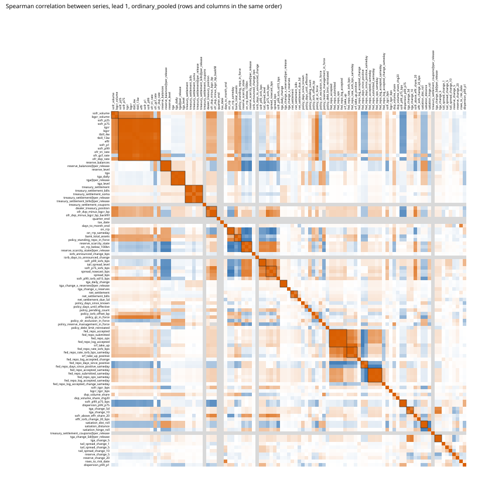

# How the sources relate to each other, and what they say on ordinary days (#629)

An exploratory screen for #624 and after, not a record and not a model. Nothing is selected, no model changes, no published figure moves, and
nothing is written into `docs/runs/`. No day after 2025-12-31 is read (the script refuses a panel past it; `docs/decisions/lockbox.md`), no
hindsight regime label is used (ruling on #515: the regimes are the period slices of `metadata/evaluation_splits.json` and the as-of scarcity
state), and the back-filled 2014-18 history is not read while its `posting_instant` is null (#572; the script refuses a panel that starts before
2018-04-03). The choices (series list, leads, targets, cluster threshold, ordinary-day rule, bootstrap) are in `metadata/source_matrix_629.json`,
committed before any statistic was computed; the script refuses to run unless that file is committed and unchanged.

**Caution.** This page runs a great many tests (Table 9) and corrects for none of them. A series that ranks high here is a candidate for a declared
model test, not evidence that it carries signal. Only 82 ordinary days are above +5 bp, 62 of them in 2018-19 and 15 in 2025-26, and the six onsets that fall on
ordinary days give 24 pre-onset days. Where a split has fewer than 3 pressure days its cell is empty.

## Why ordinary days

The main gap is pressure on days that are not known risk dates, where the risk-date part of a forecast is 0 (about 91% of the 2018-19 and 2025-26 shortfall,
PR #608 and PR #612). The source screen of #478 (`docs/pivot/source-screen-result.md`) ranked 77 series against every day, mostly risk dates, and never
looked at ordinary days alone or at how the sources relate to each other. This screen does both, on the sources we already hold.

## Method, in short

* **Days.** The 1,873 scored days of the lead-1 fold grid, 2018-06-29 to 2025-12-31, the same days at every lead. An **ordinary day** is one the risk-date part
  does not serve: its day type is `ordinary` and no coupon settlement is known for it (`treasury_settlement_coupons`, dated from the auction announcement
  as #541 reads it, at lead 1). 1,469 days are ordinary; 82 of the 140 days above +5 bp (strictly, on whole basis points) are ordinary; 6 of the
  27 onsets are (`repo_model.pressure.onsets`): 2019-05-28, 2019-06-25, 2019-08-13, 2020-03-04, 2020-03-12, 2024-12-26.
* **Series.** 101 series: every column the as-of rule reads on the joined scratch panel (the published panel, the measurement fields, the settlement,
  policy, Fed-liquidity, nowcast, DVP-segment and early-warning columns of #478, with the OFR real-time guard of #522, and the satiation-distance columns of #598),
  the spread's own as-of lag, eight columns read a second time per release (`@per_release`: the settlement columns dated from the auction announcement and the
  H.4.1 levels from their release, #541), and the 14 inputs of the every-day part of #601 (tail-spread level and changes, satiation distance, reserve and TGA paths,
  days to the next risk date, dispersion), formed from the per-release masked frames. Six `nowcast_*` columns are refused by the as-of rule and are listed in the declaration.
* **Reading.** Each series is read as of each decision instant through `repo_model.asof.InformationRule` at leads of 1, 2, 3, 5 and 10 panel days. A scheduled input
  announced for the scored day itself (the published settlements, the announced IORB change) is public at lead 1 only and is a hole at a longer lead, not a leak.
* **Matrix.** Spearman on the days both series are present, at lead 1, for all scored days and for ordinary days pooled, by period regime and by as-of scarcity state.
  Series fall into **groups** in which every pair has |rho| >= 0.8 (complete linkage, so a chain does not make one group); a group's **representative** is the member with the
  largest mean |rho| to the others, chosen without the target.
* **Against the target, on ordinary days.** Spearman with the +5 bp indicator, the spread level and the spread change at each lead; the AUROC for pressure days
  against other ordinary days; the pre-onset contrast (the series read at lead 1 on the 1 to 5 panel days before each ordinary onset, against the other ordinary days).
  90% intervals by the stationary bootstrap over the days in date order (mean block 10, 1,000 resamples, seed 629, one draw per split shared by every series).
* **Incremental.** For the 15 series with the largest absolute pooled ordinary-day correlation with the pressure indicator (the two controls and the spread's own lag left out), the
  rank correlation after the as-of scarcity state and the tail spread (`sofr_p99_iorb_bps`, #601) are regressed out of both, at the same lead.

## Reproduce

```
# the scratch panels are those of docs/pivot/source-screen-result.md (Reproduce), plus satiation_distance_598.py's
PYTHONPATH=src python3 scripts/source_screen.py panel --panel AUG6.csv --extra DVP.csv EW.csv AUG2D.csv --output SCREEN.csv     # sha256 8299bac3…
PYTHONPATH=src python3 scripts/source_matrix_629.py run --panel SCREEN.csv --output OUT/source_matrix.json --matrices OUT/matrices
PYTHONPATH=src python3 scripts/source_matrix_629.py report OUT/source_matrix.json --output OUT
```

The published panel `4ddc3882…` verifies (`verify-panel` clean). Evidence is in `docs/pivot/evidence/source-matrix/`: `source_matrix.json` (every cell), `tables.md` (these tables),
`matrix_*.csv` and `matrices.json` (the matrices), `heatmap_ordinary_pooled.svg` and `heatmap_all_pooled.svg`.

## 1. How the sources relate

The 101 series carry far fewer separate things: at |rho| >= 0.8 on ordinary days they form 21 groups of more than one series and 34 series with no partner, so
55 series stand for all of them. The largest group is the money-market rate levels: the SOFR percentiles, TGCR, BGCR, EFFR, the 4- and 13-week bill rates and the OFR
tri-party, GCF and DVP rates move together (its representative is `sofr_p25`). The all-days matrix gives 22 groups of more than one and a largest group of the same size. Of the 160 pairs at |rho| >= 0.8
pooled, 71 of the 108 measurable in 2018-19 and 107 of the 159 in 2025-26 hold within the regime, so the redundancy is not the same in every period; the regime and scarcity matrices are in the evidence folder.

Three groups matter for what follows. (a) The spread itself, `sofr_p75_iorb_bps` and the nowcast form one group, so the persistence benchmark and these inputs are one signal. (b) The reserve level, `reserve_balances`, `reserve_balances@per_release` and
`reserve_level` form a group, as do the TGA series (`tga`, `tga@per_release`, `tga_daily`, `tga_level`): the per-release reading changes little against the published weekly one. (c) The scarcity state and `on_rrp_below_100bn`
form a group, so the RRP indicator largely repeats the scarcity state.

Table 1. Groups of redundant series (every pair |rho| >= 0.8, complete linkage), ordinary days pooled, lead 1. A series with no partner is not listed.

| representative | members | series |
|---|---|---|
| `sofr_p25` | 12 | `sofr_p75`, `tgcr`, `bgcr`, `tbill_4w`, `tbill_13w`, `effr`, `sofr_p1`, `sofr_p99`, `ofr_tri_rate`, `ofr_gcf_rate`, `ofr_dvp_rate` |
| `fed_repo_submitted` | 5 | `fed_repo_accepted`, `fed_repo_ops`, `fed_repo_log_accepted`, `srf_take_up` |
| `treasury_settlement` | 5 | `treasury_settlement_bills`, `treasury_settlement_soma`, `treasury_settlement@per_release`, `treasury_settlement_bills@per_release` |
| `fed_repo_submitted_sameday` | 4 | `fed_repo_accepted_sameday`, `fed_repo_ops_sameday`, `fed_repo_log_accepted_sameday` |
| `tga@per_release` | 4 | `tga`, `tga_daily`, `tga_level` |
| `fed_repo_rate_iorb_bps` | 3 | `fed_repo_rate_iorb_bps_sameday`, `srf_take_up_positive` |
| `ofr_dvp_minus_bgcr_bp` | 3 | `dealer_treasury_position`, `ofr_dvp_minus_bgcr_bp_backfill` |
| `reserve_balances@per_release` | 3 | `reserve_balances`, `reserve_level` |
| `reserve_scarcity_state` | 3 | `on_rrp_below_100bn`, `reserve_scarcity_state@per_release` |
| `spread_bps` | 3 | `sofr_p75_iorb_bps`, `spread_nowcast_bps` |
| `bank_total_assets` | 2 | `policy_standing_repo_in_force` |
| `fed_repo_days_since_positive` | 2 | `fed_repo_days_since_positive_sameday` |
| `net_settlement` | 2 | `net_settlement_bills` |
| `on_rrp` | 2 | `on_rrp_sameday` |
| `satiation_dist_roll` | 2 | `satiation_distance` |
| `sofr_p99_iorb_bps` | 2 | `tail_spread_level` |
| `sofr_p99_p75_bps` | 2 | `dispersion_p99_p75` |
| `sofr_volume` | 2 | `bgcr_volume` |
| `tga_change_5d` | 2 | `tga_change_10` |
| `tga_change_5d@per_release` | 2 | `tga_change_5` |
| `tga_daily_change` | 2 | `tga_change_x_reserves@per_release` |

34 series have no partner at this threshold; with the representatives, 55 series carry what the 101 do.



## 2. Against the target on ordinary days

The pooled correlations are modest, and the table is dominated by the spread's own persistence: the spread, `sofr_p75_iorb_bps` and the tail spread (`sofr_p99_iorb_bps`, which `tail_spread_level` repeats) have an AUROC of 0.94
for pressure days against other ordinary days. Table 2 is the pooled view; Table 4 shows how much of it survives inside a regime.

Table 2. Ordinary days, pooled: the 25 series with the largest absolute Spearman correlation with the +5 bp indicator over leads 1 to 10. Group representative in the last column.

| series | lead 1 | lead 2 | lead 3 | lead 5 | lead 10 | AUROC at lead 1 [90%] | days at lead 1 | group |
|---|---|---|---|---|---|---|---|---|
| `policy_reserve_management_in_force` | -0.319 | -0.326 | -0.333 | -0.347 | -0.365 | 0.24 [0.14, 0.35] | 1469 | `policy_reserve_management_in_force` |
| `sofr_p75_iorb_bps` | +0.353 | +0.342 | +0.337 | +0.337 | +0.338 | 0.94 [0.92, 0.96] | 1467 | `spread_bps` |
| `spread_bps` | +0.352 | +0.339 | +0.332 | +0.334 | +0.335 | 0.94 [0.91, 0.96] | 1469 | `spread_bps` |
| `sofr_p99_iorb_bps` | +0.349 | +0.335 | +0.336 | +0.330 | +0.330 | 0.94 [0.91, 0.96] | 1469 | `sofr_p99_iorb_bps` |
| `tail_spread_level` | +0.349 | +0.335 | +0.336 | +0.330 | +0.330 | 0.94 [0.91, 0.96] | 1469 | `sofr_p99_iorb_bps` |
| `spread_nowcast_bps` | +0.323 | +0.310 | +0.298 | +0.300 | +0.300 | 0.91 [0.87, 0.93] | 1469 | `spread_bps` |
| `reserve_scarcity_state` | +0.321 | +0.319 | +0.319 | +0.320 | +0.318 | 0.86 [0.82, 0.90] | 1469 | `reserve_scarcity_state` |
| `reserve_scarcity_state@per_release` | +0.321 | +0.319 | +0.319 | +0.320 | +0.318 | 0.86 [0.82, 0.90] | 1469 | `reserve_scarcity_state` |
| `reserve_balances@per_release` | -0.320 | -0.318 | -0.315 | -0.313 | -0.307 | 0.10 [0.05, 0.16] | 1469 | `reserve_balances@per_release` |
| `reserve_level` | -0.320 | -0.318 | -0.315 | -0.314 | -0.308 | 0.10 [0.05, 0.16] | 1469 | `reserve_balances@per_release` |
| `reserve_balances` | -0.315 | -0.314 | -0.313 | -0.312 | -0.307 | 0.10 [0.06, 0.16] | 1469 | `reserve_balances@per_release` |
| `sofr_above_effr_share_20` | +0.308 | +0.303 | +0.298 | +0.290 | +0.269 | 0.88 [0.83, 0.92] | 1469 | `sofr_above_effr_share_20` |
| `ofr_gcf_rate` | -0.233 | -0.241 | -0.280 | -0.305 | -0.217 | 0.25 [0.13, 0.37] | 127 | `sofr_p25` |
| `satiation_hinge_roll` | +0.300 | +0.298 | +0.291 | +0.294 | +0.240 | 0.80 [0.74, 0.85] | 1469 | `satiation_hinge_roll` |
| `sofr_p99_iorb_sd15_bps` | +0.298 | +0.282 | +0.272 | +0.268 | +0.246 | 0.87 [0.83, 0.91] | 1469 | `sofr_p99_iorb_sd15_bps` |
| `satiation_dist_roll` | -0.276 | -0.272 | -0.270 | -0.268 | -0.257 | 0.15 [0.11, 0.20] | 1469 | `satiation_dist_roll` |
| `satiation_distance` | -0.272 | -0.270 | -0.269 | -0.263 | -0.260 | 0.16 [0.11, 0.21] | 1469 | `satiation_dist_roll` |
| `on_rrp_below_100bn` | +0.264 | +0.270 | +0.265 | +0.265 | +0.263 | 0.79 [0.74, 0.82] | 1469 | `reserve_scarcity_state` |
| `policy_debt_limit_reinstated` | +0.209 | +0.209 | +0.209 | +0.209 | +0.217 | 0.66 [0.54, 0.78] | 1469 | `policy_debt_limit_reinstated` |
| `on_rrp` | -0.200 | -0.206 | -0.211 | -0.199 | -0.190 | 0.25 [0.18, 0.32] | 1469 | `on_rrp` |
| `on_rrp_sameday` | -0.198 | -0.197 | -0.207 | -0.209 | -0.197 | 0.25 [0.18, 0.32] | 1459 | `on_rrp` |
| `dispersion_p99_p1` | +0.203 | +0.197 | +0.202 | +0.166 | +0.173 | 0.76 [0.69, 0.82] | 1469 | `dispersion_p99_p1` |
| `dvp_volume_share` | -0.185 | -0.193 | -0.196 | -0.192 | -0.181 | 0.27 [0.18, 0.37] | 1469 | `dvp_volume_share` |
| `effr_iorb_change_20_bps` | +0.195 | +0.190 | +0.182 | +0.166 | +0.129 | 0.71 [0.58, 0.83] | 1469 | `effr_iorb_change_20_bps` |
| `srf_take_up` | +0.133 | +0.148 | +0.195 | +0.145 | +0.191 | 0.74 [0.59, 0.84] | 865 | `fed_repo_submitted` |

Table 3. Ordinary days, pooled: the 12 series with the largest absolute Spearman correlation with the spread level and with the spread change, best lead of 1, 2, 3, 5, 10.

| target | series | best lead | rho | days |
|---|---|---|---|---|
| level | `spread_bps` | 1 | +0.920 | 1469 |
| level | `sofr_p75_iorb_bps` | 1 | +0.871 | 1467 |
| level | `spread_nowcast_bps` | 1 | +0.862 | 1469 |
| level | `on_rrp_sameday` | 1 | -0.809 | 1459 |
| level | `on_rrp` | 5 | -0.806 | 1469 |
| level | `reserve_scarcity_state` | 1 | +0.798 | 1469 |
| level | `reserve_scarcity_state@per_release` | 1 | +0.798 | 1469 |
| level | `on_rrp_below_100bn` | 1 | +0.792 | 1469 |
| level | `sofr_p99_iorb_bps` | 1 | +0.768 | 1469 |
| level | `tail_spread_level` | 1 | +0.768 | 1469 |
| level | `sofr_above_effr_share_20` | 1 | +0.729 | 1469 |
| level | `reserve_balances@per_release` | 1 | -0.659 | 1469 |
| change | `tail_spread_change_5` | 1 | -0.225 | 1469 |
| change | `sofr_p99_iorb_bps` | 1 | -0.212 | 1469 |
| change | `tail_spread_level` | 1 | -0.212 | 1469 |
| change | `sofr_p75_iorb_bps` | 1 | -0.206 | 1467 |
| change | `spread_bps` | 1 | -0.200 | 1469 |
| change | `net_settlement_due_5d` | 1 | +0.198 | 1469 |
| change | `dispersion_p99_p1` | 1 | -0.177 | 1469 |
| change | `spread_nowcast_bps` | 1 | -0.172 | 1469 |
| change | `treasury_settlement@per_release` | 2 | +0.172 | 1469 |
| change | `treasury_settlement_bills@per_release` | 2 | +0.172 | 1469 |
| change | `treasury_settlement` | 1 | +0.171 | 1469 |
| change | `treasury_settlement_bills` | 1 | +0.171 | 1469 |

The level and change correlations are dominated by persistence: the spread's lag has rho +0.92 with the level, and the best series for the change is the change in the tail spread, with the opposite sign
(which suggests the spread falls back after a rise). Beyond the spread and its tail, the ON RRP amount (rho -0.81) and the scarcity state (+0.80) track the level. Persistence of this size says little about the day before a pressure day.

Table 4. Ordinary days, lead 1: the 15 series whose AUROC for pressure days is furthest from 0.5, with the 90% interval, pooled and by split. A split with too few pressure days is empty.

| series | pooled | regime:2018-19 | regime:2020 | regime:2021-23 | regime:2024 | regime:2025-26 | scarcity:ample | scarcity:scarce | scarcity:unknown |
|---|---|---|---|---|---|---|---|---|---|
| `sofr_p75_iorb_bps` | 0.94 [0.92, 0.96] | 0.84 [0.78, 0.89] | 0.88 [0.77, 0.95] | - | - | 0.91 [0.84, 0.97] | - | 0.82 [0.76, 0.87] | - |
| `spread_bps` | 0.94 [0.91, 0.96] | 0.83 [0.77, 0.88] | 0.77 [0.54, 0.90] | - | - | 0.92 [0.86, 0.97] | - | 0.82 [0.76, 0.86] | - |
| `sofr_p99_iorb_bps` | 0.94 [0.91, 0.96] | 0.86 [0.80, 0.90] | 0.95 [0.89, 0.98] | - | - | 0.91 [0.84, 0.96] | - | 0.82 [0.75, 0.87] | - |
| `tail_spread_level` | 0.94 [0.91, 0.96] | 0.86 [0.80, 0.90] | 0.95 [0.89, 0.98] | - | - | 0.91 [0.84, 0.96] | - | 0.82 [0.75, 0.87] | - |
| `spread_nowcast_bps` | 0.91 [0.87, 0.93] | 0.81 [0.74, 0.87] | 0.59 [0.48, 0.77] | - | - | 0.92 [0.84, 0.98] | - | 0.75 [0.68, 0.82] | - |
| `reserve_balances@per_release` | 0.10 [0.05, 0.16] | 0.21 [0.14, 0.30] | 0.16 [0.04, 0.32] | - | - | 0.10 [0.03, 0.21] | - | 0.33 [0.20, 0.50] | - |
| `reserve_level` | 0.10 [0.05, 0.16] | 0.21 [0.14, 0.30] | 0.16 [0.04, 0.32] | - | - | 0.10 [0.03, 0.21] | - | 0.33 [0.20, 0.50] | - |
| `reserve_balances` | 0.10 [0.06, 0.16] | 0.23 [0.15, 0.33] | 0.16 [0.04, 0.31] | - | - | 0.11 [0.02, 0.23] | - | 0.34 [0.21, 0.51] | - |
| `sofr_above_effr_share_20` | 0.88 [0.83, 0.92] | 0.63 [0.51, 0.74] | 0.69 [0.50, 0.83] | - | - | 0.91 [0.83, 0.97] | - | 0.67 [0.57, 0.75] | - |
| `sofr_p99_iorb_sd15_bps` | 0.87 [0.83, 0.91] | 0.71 [0.60, 0.80] | 0.80 [0.64, 0.91] | - | - | 0.76 [0.60, 0.88] | - | 0.67 [0.56, 0.76] | - |
| `ofr_dvp_minus_bgcr_bp` | 0.87 [0.75, 0.93] | - | - | - | - | 0.69 [0.59, 0.82] | - | 0.44 [0.25, 0.62] | - |
| `ofr_dvp_minus_bgcr_bp_backfill` | 0.87 [0.75, 0.93] | - | - | - | - | 0.69 [0.59, 0.82] | - | 0.44 [0.25, 0.62] | - |
| `reserve_scarcity_state` | 0.86 [0.82, 0.90] | 0.50 [0.50, 0.51] | 0.86 [0.74, 0.94] | - | - | 0.89 [0.78, 0.97] | - | 0.47 [0.40, 0.52] | - |
| `reserve_scarcity_state@per_release` | 0.86 [0.82, 0.90] | 0.50 [0.50, 0.51] | 0.86 [0.74, 0.94] | - | - | 0.89 [0.78, 0.97] | - | 0.47 [0.40, 0.52] | - |
| `satiation_dist_roll` | 0.15 [0.11, 0.20] | 0.38 [0.28, 0.47] | 0.12 [0.01, 0.24] | - | - | 0.09 [0.02, 0.20] | - | 0.33 [0.25, 0.41] | - |

Pressure days and ordinary days per split, lead 1: pooled 82 of 1469; regime:2018-19 62 of 294; regime:2020 3 of 195; regime:2021-23 0 of 586; regime:2024 2 of 197; regime:2025-26 15 of 197; scarcity:ample 2 of 1065; scarcity:scarce 80 of 404; scarcity:unknown 0 of 0.

The pooled figures hide where the pressure is. Ordinary pressure days sit in 2018-19 (62 days of 294), 2025-26 (15 of 197), 2020 (3) and 2024 (2), and in the scarce state (80 of 404; 2 of 1,065 in the ample state). Inside 2018-19 the tail spread still has an AUROC of 0.86 [0.80, 0.90],
the reserve level 0.21 [0.14, 0.30]; the scarcity state itself has 0.50 there, because it is scarce throughout. 2021-23 has no ordinary pressure day, so nothing can be said of it.

Table 5. Pre-onset contrast on ordinary days, lead 1: the 15 series whose pre-onset AUROC is furthest from 0.5. 6 of the 27 onsets fall on ordinary days; 24 pre-onset days (1 to 5 panel days before them).

| series | pre-onset days | AUROC [90%] | std. diff. [90%] |
|---|---|---|---|
| `reserve_balances` | 24 | 0.16 [0.05, 0.32] | -1.44 [-1.99, -0.77] |
| `reserve_balances@per_release` | 24 | 0.17 [0.06, 0.33] | -1.43 [-1.98, -0.75] |
| `reserve_level` | 24 | 0.17 [0.06, 0.33] | -1.43 [-1.98, -0.75] |
| `sofr_p99_iorb_bps` | 24 | 0.81 [0.69, 0.90] | +0.25 [0.07, 0.70] |
| `tail_spread_level` | 24 | 0.81 [0.69, 0.90] | +0.25 [0.07, 0.70] |
| `sofr_p75_iorb_bps` | 24 | 0.79 [0.67, 0.88] | +0.51 [0.19, 1.08] |
| `spread_nowcast_bps` | 24 | 0.79 [0.68, 0.88] | +0.60 [0.28, 1.08] |
| `policy_days_since_known` | 24 | 0.21 [0.10, 0.35] | -0.93 [-1.22, -0.55] |
| `sofr_above_effr_share_20` | 24 | 0.79 [0.67, 0.89] | +1.01 [0.43, 1.61] |
| `reserve_scarcity_state` | 24 | 0.78 [0.59, 0.90] | +1.24 [0.50, 1.83] |
| `reserve_scarcity_state@per_release` | 24 | 0.78 [0.59, 0.90] | +1.24 [0.50, 1.83] |
| `spread_bps` | 24 | 0.77 [0.61, 0.89] | +0.50 [0.16, 1.15] |
| `policy_iorb_offset_bp` | 24 | 0.24 [0.13, 0.37] | -0.89 [-1.33, -0.42] |
| `tga_daily` | 24 | 0.26 [0.11, 0.47] | -0.71 [-1.05, -0.26] |
| `tga@per_release` | 24 | 0.27 [0.12, 0.46] | -0.70 [-1.02, -0.28] |

Six onsets are too few to rank series. The intervals for the reserve level (0.16 [0.05, 0.32]), the days since a policy was known (0.21 [0.10, 0.35]), the tail spread (0.81 [0.69, 0.90]) and the scarcity state (0.78 [0.59, 0.90]) exclude 0.5, which describes those six episodes and does not predict a seventh. The tail-spread series are lower here than in Table 4.

## 3. After the scarcity state and the tail spread

Table 6. Incremental: Spearman with the +5 bp indicator on ordinary days, raw and after the as-of scarcity state and the tail spread are taken out, for the top series, by lead.

| series | lead 1 raw / partial | lead 2 raw / partial | lead 3 raw / partial | lead 5 raw / partial | lead 10 raw / partial |
|---|---|---|---|---|---|
| `policy_reserve_management_in_force` | -0.32 / -0.15 | -0.33 / -0.16 | -0.33 / -0.17 | -0.35 / -0.19 | -0.37 / -0.21 |
| `sofr_p75_iorb_bps` | +0.35 / +0.11 | +0.34 / +0.10 | +0.34 / +0.09 | +0.34 / +0.10 | +0.34 / +0.11 |
| `tail_spread_level` | +0.35 / - | +0.33 / - | +0.34 / - | +0.33 / - | +0.33 / - |
| `spread_nowcast_bps` | +0.32 / +0.07 | +0.31 / +0.05 | +0.30 / +0.03 | +0.30 / +0.03 | +0.30 / +0.04 |
| `reserve_scarcity_state@per_release` | +0.32 / - | +0.32 / - | +0.32 / - | +0.32 / - | +0.32 / - |
| `reserve_balances@per_release` | -0.32 / -0.08 | -0.32 / -0.08 | -0.31 / -0.08 | -0.31 / -0.07 | -0.31 / -0.07 |
| `reserve_level` | -0.32 / -0.08 | -0.32 / -0.08 | -0.31 / -0.08 | -0.31 / -0.08 | -0.31 / -0.07 |
| `reserve_balances` | -0.32 / -0.07 | -0.31 / -0.08 | -0.31 / -0.08 | -0.31 / -0.08 | -0.31 / -0.07 |
| `sofr_above_effr_share_20` | +0.31 / +0.11 | +0.30 / +0.11 | +0.30 / +0.10 | +0.29 / +0.09 | +0.27 / +0.06 |
| `ofr_gcf_rate` | -0.23 / +0.03 | -0.24 / +0.02 | -0.28 / +0.01 | -0.30 / +0.04 | -0.22 / -0.02 |
| `satiation_hinge_roll` | +0.30 / +0.19 | +0.30 / +0.19 | +0.29 / +0.18 | +0.29 / +0.18 | +0.24 / +0.12 |
| `sofr_p99_iorb_sd15_bps` | +0.30 / +0.16 | +0.28 / +0.15 | +0.27 / +0.13 | +0.27 / +0.13 | +0.25 / +0.12 |
| `satiation_dist_roll` | -0.28 / -0.16 | -0.27 / -0.16 | -0.27 / -0.15 | -0.27 / -0.15 | -0.26 / -0.14 |
| `satiation_distance` | -0.27 / -0.15 | -0.27 / -0.15 | -0.27 / -0.15 | -0.26 / -0.15 | -0.26 / -0.14 |
| `on_rrp_below_100bn` | +0.26 / -0.07 | +0.27 / -0.05 | +0.27 / -0.06 | +0.27 / -0.06 | +0.26 / -0.07 |

Table 7. Ordinary days, lead 1: Spearman with the +5 bp indicator in each split, for the top series of Table 6. A split with under 30 days or 3 pressure days is empty. The first row gives the pressure days in the split.

| series | pooled | regime:2018-19 | regime:2020 | regime:2021-23 | regime:2024 | regime:2025-26 | scarcity:ample | scarcity:scarce | scarcity:unknown |
|---|---|---|---|---|---|---|---|---|---|
| pressure days | 82 | 62 | 3 | 0 | 2 | 15 | 2 | 80 | 0 |
| `policy_reserve_management_in_force` | -0.32 | -0.03 | - | - | - | - | - | -0.06 | - |
| `sofr_p75_iorb_bps` | +0.35 | +0.48 | +0.16 | - | - | +0.38 | - | +0.44 | - |
| `tail_spread_level` | +0.35 | +0.50 | +0.19 | - | - | +0.37 | - | +0.44 | - |
| `spread_nowcast_bps` | +0.32 | +0.44 | +0.04 | - | - | +0.39 | - | +0.35 | - |
| `reserve_scarcity_state@per_release` | +0.32 | +0.03 | +0.19 | - | - | +0.39 | - | -0.08 | - |
| `reserve_balances@per_release` | -0.32 | -0.41 | -0.14 | - | - | -0.36 | - | -0.24 | - |
| `reserve_level` | -0.32 | -0.41 | -0.14 | - | - | -0.36 | - | -0.24 | - |
| `reserve_balances` | -0.32 | -0.39 | -0.15 | - | - | -0.36 | - | -0.23 | - |
| `sofr_above_effr_share_20` | +0.31 | +0.19 | +0.08 | - | - | +0.38 | - | +0.23 | - |
| `ofr_gcf_rate` | -0.23 | - | - | - | - | -0.29 | - | +0.37 | - |
| `satiation_hinge_roll` | +0.30 | +0.16 | - | - | - | +0.39 | - | +0.22 | - |
| `sofr_p99_iorb_sd15_bps` | +0.30 | +0.30 | +0.13 | - | - | +0.24 | - | +0.24 | - |
| `satiation_dist_roll` | -0.28 | -0.18 | -0.16 | - | - | -0.37 | - | -0.23 | - |
| `satiation_distance` | -0.27 | -0.15 | -0.14 | - | - | -0.38 | - | -0.22 | - |
| `on_rrp_below_100bn` | +0.26 | - | +0.02 | - | - | +0.29 | - | +0.06 | - |

Four things stand out. First, nearly everything that looks like a signal in Table 2 shrinks once the scarcity state and the tail spread are out: the reserve level goes from -0.32 to -0.08, `sofr_above_effr_share_20` from +0.31 to +0.11, `on_rrp_below_100bn` from +0.26 to -0.07 (it changes sign), and `ofr_gcf_rate` from -0.23 to about 0.
Second, the satiation columns keep the most: `satiation_hinge_roll` from +0.30 to +0.19 and `satiation_dist_roll` from -0.28 to -0.16, and the tail-spread dispersion `sofr_p99_iorb_sd15_bps` from +0.30 to +0.16. They keep the same sign inside 2018-19 and 2025-26 (Table 7), but neither can be checked in 2021-23 or 2024 for lack of ordinary pressure days, and #621 says the rolling level works as a two-year reserves low.
Third, `policy_reserve_management_in_force` has the largest absolute pooled correlation (-0.32), but inside 2018-19 it is -0.03 and inside the scarce state -0.06. It is off until 2019-10-15 and on from then to the end of the sample, so it separates the early part of 2018-19, where most ordinary pressure days are, from everything after; the correlation is the period's, not the day's.
Fourth, the incremental correlations are small throughout: no series exceeds 0.21 in absolute value at any lead after the controls, so none of these would on its own carry a model; they can only add to the tail spread.

## 4. Due diligence, per existing source

The publisher, frequency and publication instant are those in `metadata/sources.json` and `metadata/sources_measurement.json`; the start of history and the gaps are measured on the scratch panel (gaps are rows without a value after the column's first, for the column with
most; they include holes by design, such as a scheduled input at a longer lead). Caveats cite the findings that record them (#508, #522, #572, #576, #621, #622) and the decisions behind the readings (#541, #445, #442).

Table 8. Due diligence, one row per source group.

| source | publisher | start of history | frequency | publication instant used | vintages and revisions | gaps after the start | caveats |
|---|---|---|---|---|---|---|---|
| NY Fed SOFR, with percentiles and volume | Federal Reserve Bank of New York | 2018-04-03 to 2018-04-23, by column | business daily | `nyfed_sofr`: 15:00 ET, reference date + 1 day | first published about 08:00 ET on the next business day and may be revised about 14:30 ET that day; the registry dates a value at the finalized 15:00 ET. The snapshot is one retrieval, so a later revision is not tracked | 2 of 1935 rows (`sofr_p75_iorb_bps`) | panel history starts at the first publication, 2018-04-03; the back-filled 2014-18 history is not read while its posting instant is null (#572) |
| NY Fed TGCR and BGCR, with percentiles and volume | Federal Reserve Bank of New York | 2018-04-03 | business daily | `nyfed_tgcr`: 15:00 ET, reference date + 1 day; `nyfed_bgcr`: 15:00 ET, reference date + 1 day | first published on the next business day; 15:00 ET is the conservative finalized instant the adapter uses for all the secured rates | none | same start and the same back-fill posting question as SOFR (#572) |
| NY Fed EFFR | Federal Reserve Bank of New York | 2018-04-03 to 2018-05-01, by column | business daily | `nyfed_effr`: 15:00 ET, reference date + 1 day | first published about 09:00 ET on the next business day; 15:00 ET is declared. Taken from the New York Fed as published, not from FRED's DFF copy | none | EFFR less IORB is a different market and target from SOFR less IORB (registry note on frb_ddp, #129) |
| FRED: reserve balances (WRESBAL) and Treasury General Account (WTREGEN), weekly | Federal Reserve Bank of St. Louis FRED | 2018-04-03 to 2018-04-10, by column | mixed daily and weekly | `fred_macro_latest_vintage`: snapshot retrieved at | FRED serves the latest revised vintage only; observations inherit the snapshot's retrieval instant, so a re-fetch does not reproduce an old snapshot's bytes. The published reading applies a declared weekly lag; the `@per_release` reading dates each Wednesday level at its H.4.1 release (#541) | none | the per-release calendar assumes a Thursday print for any week not in its exception list and never checks its declared coverage (#576); ALFRED pulls exist at a few dates as revision studies, not as a daily series |
| H.8 total assets and the reserve-scarcity state | Board of Governors of the Federal Reserve System | 2018-04-03 | weekly | `frb_h8`: 16:15 ET, reference date + 12 days | the H.8 is revised after its first print; the first print of a week is used, released the second Friday after the week ends at 16:15 ET | none | the scarcity state is reserves over total assets against a published 0.12 band, so it carries the weekly steps of both legs |
| NY Fed overnight reverse repo (ON RRP) | Federal Reserve Bank of New York | 2018-04-03 | business daily | `nyfed_on_rrp`: 16:00 ET, reference date + 1 day; `nyfed_on_rrp_sameday`: 15:00 ET, reference date + 0 days | the sum of amounts accepted over the day's operations; dated at 16:00 ET on the next business day because the Desk states no publication time. The same-day reading (#445) carries a value only on dates whose records were last written on the day itself before 15:00 | 10 of 1935 rows (`on_rrp_sameday`) | an amount accepted that day, not the balance outstanding (registry note on nyfed_on_rrp); the same-day column has holes on dates without evidence |
| NY Fed standing repo facility and repo operations | Federal Reserve Bank of New York | 2018-04-03 to 2021-07-29, by column | business daily | `nyfed_srf`: 16:00 ET, reference date + 1 day; `nyfed_repo_ops`: 16:00 ET, reference date + 1 day; `nyfed_repo_ops_sameday`: 16:00 ET, reference date + 0 days | results are dated at 16:00 ET on the next business day: the Desk states no publication time and `lastUpdated` is a write time that was rewritten days later. The same-day sensitivity (#442) withholds the dates written after their own 16:00 | none | `srf_take_up` starts with the facility's first operation on 2021-07-29, the `fed_repo_*` columns are present from the start of the panel; a day on which nothing was taken is 0.0 |
| Treasury auctions: gross settlements | U.S. Department of the Treasury Fiscal Data | 2018-04-03 | event | `treasury_auctions`: 23:59 ET, reference date + 0 days | dated from the settlement by the published registry; the `@per_release` reading dates each settlement from the auction announcement at 12:00 ET (#541). Records carry no revision history | none | one aggregate across security types; SOMA add-ons are not in it; an auction with 'null' total_accepted at retrieval has no result instant; `treasury_settlement_soma` is a hole under announcement dating |
| Treasury auctions: net settlement | U.S. Department of the Treasury, Bureau of the Fiscal Service | 2018-04-03 | business daily | `treasury_auction_net_settlement`: 12:00 ET, reference date + 0 days | counts the auctions announced on or before the day, at 12:00 ET; the announcement clock time is declared conservatively, not verified | none | the maturing amount is an estimate of the publicly held share (registry limitation) |
| Treasury daily bill rates | U.S. Department of the Treasury | 2018-04-03 | business daily | `treasury_bill_rates`: 16:30 ET, reference date + 0 days | one export per year; the quote date is the record date and availability is declared at 16:30 ET on it | none | the export header is not stable across years (17-week from 2022, 6-week from 2025); the page's quote time is the subject of #445, and a same-day reading is excluded |
| Treasury Daily Treasury Statement: TGA close | U.S. Department of the Treasury, Bureau of the Fiscal Service | 2018-04-03 to 2018-04-04, by column | business daily | `treasury_dts_tga`: 16:30 ET, reference date + 1 day | the statement for a business day is published at 4:00 PM ET on the next business day; 16:30 ET that day is declared. The API keeps no vintages | none | a daily series beside FRED's weekly WTREGEN; the two are near-duplicates in the matrix |
| OFR short-term funding monitor: DVP, tri-party and GCF repo rates | Office of Financial Research | 2018-04-03 to 2020-10-23, by column | business daily | `ofr_stfm_repo`: 16:00 ET, reference date + 2 days; `ofr_stfm_repo_segments`: 16:00 ET, reference date + 2 days | the API states no publication time and keeps no vintages; its one timestamp is a last-write time. A day's value is dated at 16:00 ET two business days after it | 1150 of 1294 rows (`ofr_gcf_rate`) | history before 2020-09-09 was filled in after the OFR began publishing in real time and is blanked by a guard (#508, #522), so these series start in September 2020; the `_backfill` column therefore equals the real-time one here |
| NY Fed primary dealer statistics (FR 2004) | Federal Reserve Bank of New York | 2018-04-03 | weekly | `nyfed_fr2004`: 16:30 ET, reference date + 6 days | weekly, dated six days after the as-of date at 16:30 ET. The lag rests on the published release schedule and not on the snapshot | none | a '*' marks a figure withheld for confidentiality and yields no observation; the tracked export mixes as-of dates, so no date is taken from the file as a whole |
| Fed IORB implementation notes | Board of Governors of the Federal Reserve System | 2018-04-04 to 2018-06-14, by column | event | `fed_iorb_announcements`: 23:59 ET, reference date + 0 days | an event table of every note that changed the rate since 2018-04; each note is read only at or after its announcement instant. No revisions | 1857 of 1884 rows (`iorb_days_to_announced_change`) | scheduled: public at lead 1 only, a hole at longer leads; `iorb_days_to_announced_change` is a hole on days with no change scheduled, so its gaps are by design; a 0.0 change is a computed value, not a missing one |
| Policy register (hand-kept) | Board of Governors of the Federal Reserve System; Federal Reserve Bank of New York; U.S. Congress | 2018-04-03 | event | `policy_register`: 16:00 ET, reference date + 0 days | computed from `metadata/policy_events.json` entries announced at or before 16:00 ET on the row's own date; no vintages | none | a register built by hand, not fetched; the in-force flags are step functions of the calendar, so a correlation with them is also a correlation with the period (this screen's reading, Tables 6 and 7) |
| Constructed from the sources above (no source of their own) | Board of Governors of the Federal Reserve System (H.4.1, H.8), as read through the registry; U.S. Department of the Treasury, Bureau of the Fiscal Service; repo-market-model | 2018-04-03 to 2018-04-16, by column | business daily | `spread_nowcast`: 15:00 ET, reference date + 0 days; `satiation_columns`: 16:00 ET, reference date + 0 days; `satiation_distance_columns`: 16:00 ET, reference date + 0 days; `projected_reserves_columns`: 16:00 ET, reference date + 0 days | zero lag by construction: each row uses only reads the as-of rule allows at 16:00 ET on that day. The calendar columns are known in advance | none | the rolling satiation level works as a two-year reserves low and its hinge is on in 2022-23 (#621); the distance columns read reserves on the old weekly lag, one release behind the `+h41` rows they join (#622); the nowcast is the naive previous spread wherever its model is not fitted |
| sec_nmfp | - | not read | - | - | - | - | monthly as-filed bulk extracts with the extract's retrieval instant as availability; no panel column is built from it (`metadata/sec_nmfp_archives.json`) |
| frb_ddp | - | not read | - | - | - | - | not a panel source: read only by the pre-SOFR history study (#129) |
| treasury_bill_rates_sameday | - | not read | - | - | - | - | excluded: no publication time before 16:00 ET is evidenced (#445) |
| back-filled 2014-18 history | - | not read | - | - | - | - | stamped as public in real time from 2014 although its posting instant is null; not read (#572) |

Two points from reading the sources together. The panel's history for every source starts at 2018-04-03 or later; the earlier NY Fed repo history is not read (#572), so the number of ordinary pressure days is what the 2018-2025 history holds and cannot be enlarged here.
The OFR series begin in September 2020 (the GCF rate is present on only 127 ordinary days), so they say nothing about 2018-19, where most ordinary pressure days are.

## 5. Ranked leads for a declared model test (#624 or after)

Ranked by what survives the controls and the regime split, not by pooled size. Each is a candidate for a test the model work declares first; none is selected here.

1. **`satiation_hinge_roll` and `satiation_dist_roll`** (partial rho +0.19 and -0.16 at lead 1; AUROC 0.80 [0.74, 0.85] and 0.15 [0.11, 0.20] pooled, same sign in 2018-19 and 2025-26). *Risk of noise: high.* The level is a two-year reserves low (#621), the columns read reserves one release behind the per-release rows they join (#622), and the same sign in two regimes is the only replication available. Fix the timing before testing.
2. **`sofr_p99_iorb_sd15_bps`**, the spread of the tail spread over 15 days (partial +0.16, AUROC 0.87 [0.83, 0.91]; +0.30 and +0.24 inside 2018-19 and 2025-26). *Risk: medium.* It is built from the series that is the control, so what is left is volatility of the tail rather than a new source.
3. **`sofr_above_effr_share_20`**, the share of the last 20 days on which SOFR is above EFFR (partial +0.11, AUROC 0.88 [0.83, 0.92]; positive in every measurable split: +0.19, +0.08, +0.38). *Risk: medium.* Two reference rates from the same publisher, with their percentile moves in the same group as the tail spread's inputs.
4. **The reserve level** (`reserve_balances@per_release`, partial -0.08 at lead 1, -0.41 in 2018-19, -0.36 in 2025-26; pre-onset AUROC 0.16). *Risk: medium.* The scarcity state is a function of it, and its sign follows the long fall of reserves in 2018-19 and 2025; a level is a trend and a trend is easy to fit by accident.
5. **`tga@per_release` / `tga_daily`** (pre-onset AUROC 0.26-0.27 on 24 days, interval reaching 0.46; pooled pressure correlation not in the top). *Risk: high.* A lead from six onsets only.

Not leads: `policy_reserve_management_in_force` and the other policy flags (a period, not a day; Table 7), `ofr_gcf_rate` and the other OFR series (zero after the controls and absent from 2018-19), `on_rrp_below_100bn` (changes sign), `sofr_p75_iorb_bps` and `spread_nowcast_bps` (the spread's own persistence: partial +0.11 and +0.07 at lead 1).

## 6. Tests run

Table 9. Tests run. None is corrected for the number of tests.

| quantity | computed |
|---|---|
| series | 101 |
| pairwise Spearman cells (series pairs, in each of 9 matrices) | 45450 |
| Spearman cells against a target (series x leads x targets x splits) | 13635 |
| AUROC cells with a bootstrap interval (series x leads x splits) | 4545 |
| pre-onset cells with a bootstrap interval (series x splits, lead 1) | 909 |
| partial-correlation cells (top series x leads x targets) | 225 |

This is the count of the cells computed, not a count of independent tests; the series within a group are one signal. Nothing here is corrected for multiplicity, and with this many cells several would look strong by chance alone.
The intervals are the stationary bootstrap's, resampling days within a split; they do not account for the choice of which series to show, which is by size.

## Not checked, or for Eleonora

* **Nothing is selected or published.** Whether any lead above joins a model is a declared test in #624 or after, and hers to decide.
* **No multiplicity correction.** See Table 9.
* **Thin pressure.** 82 ordinary pressure days, concentrated in two regimes; 2021-23 has none. Replication across regimes is possible for 2018-19 and 2025-26 only. Onsets: six.
* **Linear and rank-based.** Spearman and the partial rank correlation see monotone relations; an interaction, a threshold or a lag structure is not tested. The partial correlation removes two controls, not a full model.
* **The two readings of the settlements and H.4.1 are not compared statistically.** `@per_release` series are shown beside the published ones; their correlations differ little, but no test of the difference is run.
* **The derived inputs are read under the per-release arm only**, as the every-day part of #601 reads them.
* **Not re-run:** the full model comparisons of #479; the published panel and every record in `docs/runs/` are as they were.
* **Findings, not fixed here.** #621, #622, #576 and #572 are open and are cited as caveats; this screen does not change what they describe.
