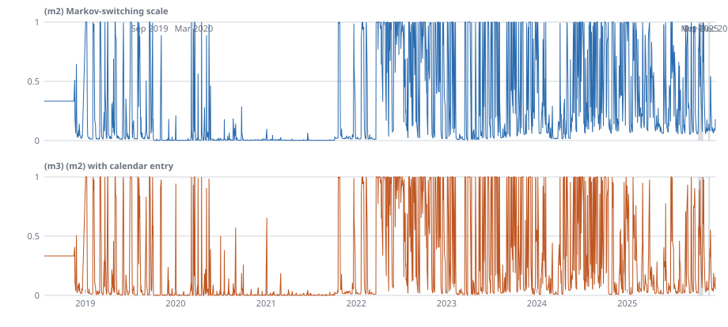

# The H5 candidate with calm and stress spells (#1182)

**Hypothesis and step:** H5 (primary goal), step 3 (fix), the clustered misses of the scaled mean reversion, after #1153 and #1175 (Eleonora, 24 October 2026: "queue it"). **Development, not a verdict**: development days to 2025-12-31, no verdict (scoring protocol v1, #640). Any change to the candidate is Eleonora's decision. Generated by `scripts/regime_spells_1182.py page` from `docs/research/regime-spells-1182/result.json`, not edited by hand; declared in `metadata/regime_spells_1182.json` before any score.

Panel digest `4ddc3882…`. Studentized stationary bootstrap (ruling 1), mean block 10 business days, 10,000 draws, seed 1182, two-sided 90% interval. Skill is `mean(d) / mean(S(comparator))` with `d = S(comparator) - S(candidate)`, positive favours the candidate; beside it the studentized interval of mean(d) itself (the mean-d bound of #1009), on which the reading is made: a gain when the interval is above zero, a loss when below, otherwise undecided. Where a benchmark scores zero on a resample, skill is undefined but the mean-d bound is still computed (#1215): the row shows "skill undefined" and is read on the bound; a row with no mean-d bound reads "no reading" with the reason, not "undecided". Lens C's caveat (#958, #1009): the lag-10 HAC standard error behind a studentized interval is understated by about 2x after 2020, so an interval after 2020 is narrower than it should be. Coverage intervals are 90% stationary-bootstrap percentile intervals (2,000 resamples), pooled. Scored decision days: 1,849 (2018-07-19 to 2025-12-23); every model is scored on the same days.

**What this is.** The base is (s3) of #1145: #941's scaled mean reversion with state-scaled calendar terms, a Huber fit and ridge 5, the calendar read at the target day on direct pairs. The misses of its bands come in runs (Christoffersen independence p = 0.000 at every lead, mean run about 2.0 against 1.1 if independent), and a faster, miss-fed or dispersion-scaled band did not fix it (#1153, #1175). These arms ask whether the market moves between calm and stress spells that one law cannot represent: (m1) an observable episode state (a miss of (s3)'s own 90% band within the last 3 or 5 rows), whose own pool and scale the law takes; (m2) a two-state Markov-switching scale, fitted by EM on the training window and filtered by Hamilton's filter on public residuals only; (m3) (m2) with the entry to stress a logistic function of the calendar type of the day entered, read at that day. The terms, the centre and the refit cadence are (s3)'s. (a) is #941's variant, beside. The base was chosen after seeing 2018-2025. `gbm_funding` is not compared (its walks are a long run for Eleonora's Mac and the directive does not ask for it).

## Against the kill rule

The kill rule (the issue's, read in the declaration): if no arm moves independence off p = 0.000 at any lead, and no arm cuts the mean run by more than 15%, the clustering is not a two-state phenomenon either, and the recommendation is to report it as a known limit in the use limitation. 'Off 0.000' is a pooled independence p of the 90% band of at least 0.0005, at any lead, under any hit rule; the cut is of the mean run (closed rule, pooled over leads) against (s3)'s (2.126).

| model | leads off 0.000, `above` | leads off 0.000, `at_or_above` | mean run, `above` (longest) | mean run, `at_or_above` (longest) | cut of the mean run |
|---|---|---|---|---|---|
| (s3) base (#1145) | none | none | 2.126 (10) | 2.126 (10) |  |
| (m1) episode, last 3 rows | none | none | 1.903 (9) | 1.900 (9) | +10.5% |
| (m1) episode, last 5 rows | none | none | 1.891 (9) | 1.885 (9) | +11.1% |
| (m2) Markov-switching scale | none | none | 2.283 (12) | 2.283 (12) | -7.4% |
| (m3) (m2) with calendar entry | none | none | 2.233 (10) | 2.233 (10) | -5.0% |

Arms with a lead off 0.000: none. Arms that cut the mean run by more than 15%: none. **The kill rule is met.**

No arm moves independence off 0.000 and none cuts the mean run by more than the threshold: the clustering of the misses is not a two-state phenomenon either, on this evidence. The issue's recommendation follows: report it as a known limit in the use limitation, and do not try another arm. Whether to do so is Eleonora's decision.

**A limit on that reading.** The 90% band of (m2) Markov-switching scale (0.187), (m3) (m2) with calendar entry (0.186) misses more than 0.15 of outcomes (mean over leads, closed rule; nominal 0.10, (s3) about 0.12): these bands are too narrow, so a run length measured on them is a property of a miscalibrated band, and the Markov arms' failure to cut the runs is weaker evidence against a two-state account than the (m1) arms' is. See amendment 1 of the declaration.

## The facts behind the adoption rule (her decision)

The issue: an arm replaces (s3) only if independence is no longer rejected at the leads, or the mean miss run falls clearly towards 1.1, without losing CRPS beyond the interval. This page states the facts and decides nothing.

| arm | leads off 0.000 (`above`) | mean run (`above`) | cut against (s3) | pooled grid CRPS vs (s3), mean-d bound | regimes read as a loss | day types read as a loss |
|---|---|---|---|---|---|---|
| (m1) episode, last 3 rows | none | 1.903 | +10.5% | gain | none | none |
| (m1) episode, last 5 rows | none | 1.891 | +11.1% | undecided | none | none |
| (m2) Markov-switching scale | none | 2.283 | -7.4% | undecided | 2024 | quarter_end, month_end, tax_date |
| (m3) (m2) with calendar entry | none | 2.233 | -5.0% | undecided | none | month_end |

## The clustering of the 90% band's misses (the headline of this fix)

Per lead, pooled over the scored days: the miss rate (nominal 0.10), then Christoffersen's independence p and the conditional coverage p. A p of 0.000 is below 0.0005. Reporting only: no p-value is a gate.

Rule `above` (closed band, a miss is `y` outside `[q05, q95]`); rate (independence p / conditional coverage p):

| | h=1 | h=2 | h=3 | h=4 | h=5 |
|---|---|---|---|---|---|
| (s3) base (#1145) | 0.125 (0.000 / 0.000) | 0.120 (0.000 / 0.000) | 0.123 (0.000 / 0.000) | 0.127 (0.000 / 0.000) | 0.123 (0.000 / 0.000) |
| (a) #941 mad20 | 0.110 (0.000 / 0.000) | 0.116 (0.000 / 0.000) | 0.115 (0.000 / 0.000) | 0.111 (0.000 / 0.000) | 0.112 (0.000 / 0.000) |
| (m1) episode, last 3 rows | 0.124 (0.000 / 0.000) | 0.120 (0.000 / 0.000) | 0.121 (0.000 / 0.000) | 0.130 (0.000 / 0.000) | 0.123 (0.000 / 0.000) |
| (m1) episode, last 5 rows | 0.120 (0.000 / 0.000) | 0.120 (0.000 / 0.000) | 0.122 (0.000 / 0.000) | 0.124 (0.000 / 0.000) | 0.123 (0.000 / 0.000) |
| (m2) Markov-switching scale | 0.226 (0.000 / 0.000) | 0.188 (0.000 / 0.000) | 0.178 (0.000 / 0.000) | 0.173 (0.000 / 0.000) | 0.168 (0.000 / 0.000) |
| (m3) (m2) with calendar entry | 0.191 (0.000 / 0.000) | 0.189 (0.000 / 0.000) | 0.183 (0.000 / 0.000) | 0.188 (0.000 / 0.000) | 0.181 (0.000 / 0.000) |

Rule `at_or_above` (open band, a miss includes `y` equal to a bound); rate (independence p / conditional coverage p):

| | h=1 | h=2 | h=3 | h=4 | h=5 |
|---|---|---|---|---|---|
| (s3) base (#1145) | 0.125 (0.000 / 0.000) | 0.120 (0.000 / 0.000) | 0.123 (0.000 / 0.000) | 0.127 (0.000 / 0.000) | 0.123 (0.000 / 0.000) |
| (a) #941 mad20 | 0.110 (0.000 / 0.000) | 0.117 (0.000 / 0.000) | 0.116 (0.000 / 0.000) | 0.111 (0.000 / 0.000) | 0.112 (0.000 / 0.000) |
| (m1) episode, last 3 rows | 0.125 (0.000 / 0.000) | 0.120 (0.000 / 0.000) | 0.121 (0.000 / 0.000) | 0.130 (0.000 / 0.000) | 0.123 (0.000 / 0.000) |
| (m1) episode, last 5 rows | 0.121 (0.000 / 0.000) | 0.120 (0.000 / 0.000) | 0.122 (0.000 / 0.000) | 0.124 (0.000 / 0.000) | 0.124 (0.000 / 0.000) |
| (m2) Markov-switching scale | 0.226 (0.000 / 0.000) | 0.188 (0.000 / 0.000) | 0.178 (0.000 / 0.000) | 0.173 (0.000 / 0.000) | 0.168 (0.000 / 0.000) |
| (m3) (m2) with calendar entry | 0.191 (0.000 / 0.000) | 0.189 (0.000 / 0.000) | 0.183 (0.000 / 0.000) | 0.188 (0.000 / 0.000) | 0.181 (0.000 / 0.000) |

Rule `randomised` (a tie is a hit with the forecast's own tie probability, 0 here: the same sequence as `above`); rate (independence p / conditional coverage p):

| | h=1 | h=2 | h=3 | h=4 | h=5 |
|---|---|---|---|---|---|
| (s3) base (#1145) | 0.125 (0.000 / 0.000) | 0.120 (0.000 / 0.000) | 0.123 (0.000 / 0.000) | 0.127 (0.000 / 0.000) | 0.123 (0.000 / 0.000) |
| (a) #941 mad20 | 0.110 (0.000 / 0.000) | 0.116 (0.000 / 0.000) | 0.115 (0.000 / 0.000) | 0.111 (0.000 / 0.000) | 0.112 (0.000 / 0.000) |
| (m1) episode, last 3 rows | 0.124 (0.000 / 0.000) | 0.120 (0.000 / 0.000) | 0.121 (0.000 / 0.000) | 0.130 (0.000 / 0.000) | 0.123 (0.000 / 0.000) |
| (m1) episode, last 5 rows | 0.120 (0.000 / 0.000) | 0.120 (0.000 / 0.000) | 0.122 (0.000 / 0.000) | 0.124 (0.000 / 0.000) | 0.123 (0.000 / 0.000) |
| (m2) Markov-switching scale | 0.226 (0.000 / 0.000) | 0.188 (0.000 / 0.000) | 0.178 (0.000 / 0.000) | 0.173 (0.000 / 0.000) | 0.168 (0.000 / 0.000) |
| (m3) (m2) with calendar entry | 0.191 (0.000 / 0.000) | 0.189 (0.000 / 0.000) | 0.183 (0.000 / 0.000) | 0.188 (0.000 / 0.000) | 0.181 (0.000 / 0.000) |

The randomised tie rule of #1156: implemented (coverage_tests.randomised_hit_sequence, draws seeded with 1182); the forecast is 23 quantiles of a continuous law, so the tie probability is 0 at every quantile and the rule coincides with `above`.

Independence p of the 90% band's misses within a regime (consecutive days of the regime), by lead, closed rule (`above`):

**2018-19**

| | h=1 | h=2 | h=3 | h=4 | h=5 |
|---|---|---|---|---|---|
| (s3) base (#1145) | 0.000 | 0.000 | 0.000 | 0.000 | 0.000 |
| (a) #941 mad20 | 0.000 | 0.000 | 0.000 | 0.000 | 0.000 |
| (m1) episode, last 3 rows | 0.000 | 0.000 | 0.000 | 0.000 | 0.000 |
| (m1) episode, last 5 rows | 0.000 | 0.000 | 0.000 | 0.000 | 0.000 |
| (m2) Markov-switching scale | 0.000 | 0.000 | 0.000 | 0.000 | 0.000 |
| (m3) (m2) with calendar entry | 0.000 | 0.000 | 0.000 | 0.000 | 0.000 |

**2020**

| | h=1 | h=2 | h=3 | h=4 | h=5 |
|---|---|---|---|---|---|
| (s3) base (#1145) | 0.001 | 0.000 | 0.000 | 0.000 | 0.000 |
| (a) #941 mad20 | 0.000 | 0.000 | 0.000 | 0.000 | 0.000 |
| (m1) episode, last 3 rows | 0.008 | 0.000 | 0.000 | 0.000 | 0.000 |
| (m1) episode, last 5 rows | 0.009 | 0.000 | 0.000 | 0.000 | 0.000 |
| (m2) Markov-switching scale | 0.000 | 0.000 | 0.000 | 0.000 | 0.000 |
| (m3) (m2) with calendar entry | 0.000 | 0.000 | 0.000 | 0.000 | 0.000 |

**2021-23**

| | h=1 | h=2 | h=3 | h=4 | h=5 |
|---|---|---|---|---|---|
| (s3) base (#1145) | 0.000 | 0.000 | 0.000 | 0.000 | 0.000 |
| (a) #941 mad20 | 0.000 | 0.000 | 0.000 | 0.000 | 0.000 |
| (m1) episode, last 3 rows | 0.000 | 0.000 | 0.000 | 0.000 | 0.000 |
| (m1) episode, last 5 rows | 0.000 | 0.000 | 0.000 | 0.000 | 0.000 |
| (m2) Markov-switching scale | 0.000 | 0.000 | 0.000 | 0.000 | 0.000 |
| (m3) (m2) with calendar entry | 0.000 | 0.000 | 0.000 | 0.000 | 0.000 |

**2024**

| | h=1 | h=2 | h=3 | h=4 | h=5 |
|---|---|---|---|---|---|
| (s3) base (#1145) | 0.001 | 0.000 | 0.000 | 0.000 | 0.000 |
| (a) #941 mad20 | 0.001 | 0.000 | 0.000 | 0.000 | 0.000 |
| (m1) episode, last 3 rows | 0.007 | 0.001 | 0.000 | 0.000 | 0.000 |
| (m1) episode, last 5 rows | 0.134 | 0.002 | 0.000 | 0.000 | 0.000 |
| (m2) Markov-switching scale | 0.005 | 0.000 | 0.000 | 0.000 | 0.000 |
| (m3) (m2) with calendar entry | 0.036 | 0.000 | 0.000 | 0.000 | 0.000 |

**2025-26**

| | h=1 | h=2 | h=3 | h=4 | h=5 |
|---|---|---|---|---|---|
| (s3) base (#1145) | 0.002 | 0.000 | 0.000 | 0.000 | 0.000 |
| (a) #941 mad20 | 0.000 | 0.000 | 0.000 | 0.000 | 0.000 |
| (m1) episode, last 3 rows | 0.004 | 0.000 | 0.000 | 0.000 | 0.000 |
| (m1) episode, last 5 rows | 0.001 | 0.000 | 0.000 | 0.000 | 0.000 |
| (m2) Markov-switching scale | 0.005 | 0.000 | 0.000 | 0.000 | 0.000 |
| (m3) (m2) with calendar entry | 0.000 | 0.000 | 0.000 | 0.000 | 0.000 |

### Miss runs

A run is a block of consecutive misses in a lead's sequence of consecutive decision days. Pooled over the five leads: the number of runs, the mean run length (misses per run; about 1.11 for independent misses at a 10% rate) and the longest run, for the 90% band and for q95 (above its quantile).

Rule `above`:

| | 90% band: runs | mean | longest | q95: runs | mean | longest |
|---|---|---|---|---|---|---|
| (s3) base (#1145) | 538 | 2.126 | 10 | 270 | 1.944 | 10 |
| (a) #941 mad20 | 461 | 2.265 | 13 | 239 | 2.071 | 10 |
| (m1) episode, last 3 rows | 601 | 1.903 | 9 | 300 | 1.827 | 7 |
| (m1) episode, last 5 rows | 596 | 1.891 | 9 | 309 | 1.741 | 6 |
| (m2) Markov-switching scale | 756 | 2.283 | 12 | 406 | 2.017 | 10 |
| (m3) (m2) with calendar entry | 772 | 2.233 | 10 | 427 | 2.009 | 10 |

Rule `at_or_above`:

| | 90% band: runs | mean | longest | q95: runs | mean | longest |
|---|---|---|---|---|---|---|
| (s3) base (#1145) | 538 | 2.126 | 10 | 270 | 1.944 | 10 |
| (a) #941 mad20 | 463 | 2.261 | 13 | 240 | 2.071 | 10 |
| (m1) episode, last 3 rows | 603 | 1.900 | 9 | 301 | 1.824 | 7 |
| (m1) episode, last 5 rows | 600 | 1.885 | 9 | 312 | 1.734 | 6 |
| (m2) Markov-switching scale | 756 | 2.283 | 12 | 406 | 2.017 | 10 |
| (m3) (m2) with calendar entry | 772 | 2.233 | 10 | 427 | 2.009 | 10 |

Rule `randomised`:

| | 90% band: runs | mean | longest | q95: runs | mean | longest |
|---|---|---|---|---|---|---|
| (s3) base (#1145) | 538 | 2.126 | 10 | 270 | 1.944 | 10 |
| (a) #941 mad20 | 461 | 2.265 | 13 | 239 | 2.071 | 10 |
| (m1) episode, last 3 rows | 601 | 1.903 | 9 | 300 | 1.827 | 7 |
| (m1) episode, last 5 rows | 596 | 1.891 | 9 | 309 | 1.741 | 6 |
| (m2) Markov-switching scale | 756 | 2.283 | 12 | 406 | 2.017 | 10 |
| (m3) (m2) with calendar entry | 772 | 2.233 | 10 | 427 | 2.009 | 10 |

## The filtered stress probability

The probability of the stress state at the anchor (the last public row) of each scored decision day, from the Hamilton filter of the refit in force, for (m2) and (m3). The drawing stops at the last scored decision day: days after 2025-12-31 are not read by this study. The episodes are marked: September 2019, March 2020 (the event windows of `metadata/events.json`) and the 2025 episodes the declaration lists.

## grid CRPS, mean over leads 1 to 5, pooled

| | mean | vs B1: skill [90%] | vs B1': skill [90%] | vs B2: skill [90%] | vs (a): skill [90%]; mean d [90%] | vs (s3): skill [90%]; mean d [90%]; reading |
|---|---|---|---|---|---|---|
| B1 | 2.217 | | | | | |
| B1' (#960) | 1.777 | | | | | |
| B2 | 2.521 | | | | | |
| (a) #941 mad20 | 1.638 | +26.1% [+19.2%, +44.5%] | +7.8% [+4.2%, +11.6%] | +35.0% [+24.1%, +45.2%] |  | -4.4% [-6.8%, -1.8%]; -0.068 [-0.102, -0.032]; loss |
| (s3) base (#1145) | 1.569 | +29.2% [+22.8%, +44.0%] | +11.7% [+6.8%, +16.0%] | +37.7% [+26.4%, +47.5%] | +4.2% [+1.7%, +6.4%]; +0.068 [+0.032, +0.102] |  |
| (m1) episode, last 3 rows | 1.558 | +29.7% [+23.4%, +44.3%] | +12.3% [+7.4%, +16.6%] | +38.2% [+26.9%, +47.9%] | +4.9% [+2.5%, +7.0%]; +0.080 [+0.045, +0.112] | +0.7% [+0.3%, +1.2%]; +0.011 [+0.004, +0.020]; gain |
| (m1) episode, last 5 rows | 1.562 | +29.5% [+23.2%, +44.3%] | +12.1% [+7.2%, +16.4%] | +38.0% [+26.7%, +47.7%] | +4.6% [+2.3%, +6.7%]; +0.076 [+0.043, +0.108] | +0.5% [-0.0%, +1.1%]; +0.007 [-0.001, +0.017]; undecided |
| (m2) Markov-switching scale | 1.580 | +28.7% [+22.2%, +43.4%] | +11.1% [+5.9%, +15.5%] | +37.3% [+25.8%, +47.1%] | +3.5% [+0.7%, +6.0%]; +0.058 [+0.016, +0.094] | -0.7% [-1.4%, +0.0%]; -0.011 [-0.025, +0.000]; undecided |
| (m3) (m2) with calendar entry | 1.571 | +29.1% [+22.7%, +43.5%] | +11.6% [+6.3%, +16.0%] | +37.7% [+25.9%, +47.4%] | +4.1% [+1.1%, +6.7%]; +0.067 [+0.026, +0.105] | -0.1% [-1.1%, +0.9%]; -0.001 [-0.019, +0.012]; undecided |

## upper-tail twCRPS, mean over leads 1 to 5, pooled

| | mean | vs B1: skill [90%] | vs B1': skill [90%] | vs B2: skill [90%] | vs (a): skill [90%]; mean d [90%] | vs (s3): skill [90%]; mean d [90%]; reading |
|---|---|---|---|---|---|---|
| B1 | 1.300 | | | | | |
| B1' (#960) | 0.923 | | | | | |
| B2 | 1.128 | | | | | |
| (a) #941 mad20 | 0.832 | +36.1% [+27.0%, +55.8%] | +9.9% [+2.6%, +17.8%] | +26.3% [+10.1%, +46.6%] |  | -4.2% [-8.1%, -1.0%]; -0.034 [-0.062, -0.011]; loss |
| (s3) base (#1145) | 0.798 | +38.7% [+30.2%, +55.7%] | +13.6% [+4.4%, +22.0%] | +29.3% [+11.5%, +48.3%] | +4.1% [+1.0%, +7.5%]; +0.034 [+0.011, +0.062] |  |
| (m1) episode, last 3 rows | 0.797 | +38.7% [+30.2%, +55.7%] | +13.7% [+4.5%, +22.1%] | +29.3% [+11.7%, +48.2%] | +4.1% [+1.2%, +7.4%]; +0.034 [+0.013, +0.062] | +0.1% [-0.3%, +0.6%]; +0.001 [-0.003, +0.005]; undecided |
| (m1) episode, last 5 rows | 0.799 | +38.6% [+30.0%, +55.7%] | +13.5% [+4.4%, +21.8%] | +29.1% [+11.6%, +48.0%] | +3.9% [+1.1%, +7.1%]; +0.032 [+0.011, +0.060] | -0.2% [-0.7%, +0.5%]; -0.001 [-0.006, +0.004]; undecided |
| (m2) Markov-switching scale | 0.798 | +38.6% [+29.9%, +55.0%] | +13.5% [+3.5%, +22.3%] | +29.2% [+10.7%, +48.5%] | +4.0% [+0.1%, +8.1%]; +0.033 [+0.009, +0.062] | -0.1% [-1.3%, +1.2%]; -0.001 [-0.012, +0.007]; undecided |
| (m3) (m2) with calendar entry | 0.793 | +39.0% [+30.2%, +54.8%] | +14.1% [+3.6%, +23.0%] | +29.7% [+10.6%, +49.0%] | +4.7% [-0.1%, +9.2%]; +0.039 [+0.013, +0.069] | +0.6% [-1.8%, +2.4%]; +0.005 [-0.012, +0.015]; undecided |

## scaled grid CRPS (#967), mean over leads 1 to 5, pooled

| | mean | vs B1: skill [90%] | vs B1': skill [90%] | vs B2: skill [90%] | vs (a): skill [90%]; mean d [90%] | vs (s3): skill [90%]; mean d [90%]; reading |
|---|---|---|---|---|---|---|
| B1 | 1.794 | | | | | |
| B1' (#960) | 1.467 | | | | | |
| B2 | 1.961 | | | | | |
| (a) #941 mad20 | 1.376 | +23.3% [+16.0%, +41.2%] | +6.2% [+1.9%, +11.1%] | +29.8% [+20.0%, +39.1%] |  | -5.3% [-7.5%, -2.8%]; -0.070 [-0.100, -0.041]; loss |
| (s3) base (#1145) | 1.307 | +27.1% [+20.4%, +43.8%] | +10.9% [+6.4%, +15.4%] | +33.3% [+23.4%, +42.1%] | +5.1% [+2.8%, +7.0%]; +0.070 [+0.041, +0.100] |  |
| (m1) episode, last 3 rows | 1.295 | +27.8% [+21.2%, +44.3%] | +11.7% [+7.3%, +16.1%] | +33.9% [+24.2%, +42.7%] | +5.9% [+3.8%, +7.8%]; +0.081 [+0.054, +0.112] | +0.9% [+0.3%, +1.6%]; +0.012 [+0.004, +0.021]; gain |
| (m1) episode, last 5 rows | 1.299 | +27.6% [+20.9%, +44.1%] | +11.5% [+7.1%, +15.9%] | +33.8% [+24.0%, +42.5%] | +5.7% [+3.7%, +7.5%]; +0.078 [+0.051, +0.108] | +0.6% [-0.0%, +1.4%]; +0.008 [-0.000, +0.019]; undecided |
| (m2) Markov-switching scale | 1.317 | +26.6% [+19.8%, +43.4%] | +10.2% [+5.8%, +14.7%] | +32.8% [+22.8%, +41.8%] | +4.3% [+2.0%, +6.4%]; +0.060 [+0.030, +0.088] | -0.8% [-1.4%, -0.1%]; -0.010 [-0.020, -0.001]; loss |
| (m3) (m2) with calendar entry | 1.312 | +26.9% [+20.0%, +43.6%] | +10.6% [+6.2%, +14.9%] | +33.1% [+23.1%, +42.1%] | +4.7% [+2.3%, +6.8%]; +0.065 [+0.035, +0.094] | -0.4% [-1.2%, +0.5%]; -0.005 [-0.017, +0.006]; undecided |

## Skill of each arm over (s3), by lead [90%]; mean d [90%]

grid CRPS:

| | h=1 | h=2 | h=3 | h=4 | h=5 |
|---|---|---|---|---|---|
| (m1) episode, last 3 rows | +1.2% [+0.6%, +1.9%]; +0.017 [+0.008, +0.027] | +1.1% [+0.6%, +1.7%]; +0.018 [+0.010, +0.026] | +0.7% [+0.2%, +1.3%]; +0.012 [+0.004, +0.020] | +0.4% [-0.1%, +1.0%]; +0.007 [-0.002, +0.017] | +0.2% [-0.3%, +0.8%]; +0.003 [-0.005, +0.013] |
| (m1) episode, last 5 rows | +1.2% [+0.5%, +1.9%]; +0.016 [+0.007, +0.027] | +0.9% [+0.3%, +1.7%]; +0.014 [+0.005, +0.026] | +0.4% [-0.2%, +1.1%]; +0.006 [-0.003, +0.017] | +0.0% [-0.5%, +0.7%]; +0.000 [-0.009, +0.011] | -0.0% [-0.6%, +0.6%]; -0.000 [-0.010, +0.010] |
| (m2) Markov-switching scale | -0.6% [-1.5%, +0.3%]; -0.008 [-0.022, +0.004] | -0.5% [-1.2%, +0.3%]; -0.008 [-0.022, +0.004] | -0.7% [-1.4%, -0.0%]; -0.012 [-0.026, -0.000] | -0.9% [-1.5%, -0.1%]; -0.014 [-0.029, -0.002] | -0.8% [-1.5%, -0.0%]; -0.013 [-0.028, -0.000] |
| (m3) (m2) with calendar entry | +0.3% [-0.5%, +1.2%]; +0.005 [-0.007, +0.017] | +0.0% [-0.9%, +0.9%]; +0.000 [-0.015, +0.012] | -0.1% [-1.3%, +0.9%]; -0.002 [-0.022, +0.012] | -0.2% [-1.6%, +0.9%]; -0.003 [-0.029, +0.013] | -0.4% [-1.8%, +0.8%]; -0.006 [-0.033, +0.011] |

upper-tail twCRPS:

| | h=1 | h=2 | h=3 | h=4 | h=5 |
|---|---|---|---|---|---|
| (m1) episode, last 3 rows | +0.8% [-0.0%, +1.7%]; +0.006 [-0.001, +0.015] | +0.7% [+0.1%, +1.7%]; +0.006 [+0.001, +0.014] | -0.0% [-0.4%, +0.4%]; -0.000 [-0.004, +0.003] | -0.4% [-0.9%, +0.1%]; -0.003 [-0.007, +0.000] | -0.6% [-1.3%, -0.0%]; -0.005 [-0.010, -0.001] |
| (m1) episode, last 5 rows | +0.8% [+0.1%, +1.6%]; +0.006 [+0.000, +0.013] | +0.4% [-0.4%, +1.8%]; +0.003 [-0.003, +0.013] | -0.5% [-1.2%, +0.3%]; -0.004 [-0.009, +0.002] | -0.9% [-1.6%, -0.1%]; -0.007 [-0.013, -0.002] | -0.7% [-1.4%, -0.1%]; -0.006 [-0.012, -0.001] |
| (m2) Markov-switching scale | +0.0% [-1.0%, +1.1%]; +0.000 [-0.009, +0.008] | +0.1% [-1.4%, +1.6%]; +0.001 [-0.012, +0.010] | -0.2% [-1.4%, +1.1%]; -0.002 [-0.014, +0.007] | -0.2% [-1.5%, +1.2%]; -0.002 [-0.015, +0.007] | -0.1% [-1.5%, +1.3%]; -0.001 [-0.015, +0.008] |
| (m3) (m2) with calendar entry | +1.4% [+0.3%, +2.5%]; +0.011 [+0.002, +0.021] | +0.8% [-1.2%, +2.5%]; +0.006 [-0.006, +0.015] | +0.4% [-2.2%, +2.4%]; +0.003 [-0.017, +0.015] | +0.4% [-2.9%, +2.8%]; +0.003 [-0.023, +0.017] | +0.1% [-3.0%, +2.5%]; +0.001 [-0.027, +0.015] |

## grid CRPS by regime (target day)

**2018-19** (359 days)

| | mean | vs B1: skill [90%] | vs B1': skill [90%] | vs B2: skill [90%] | vs (a): skill [90%]; mean d [90%] | vs (s3): skill [90%]; mean d [90%]; reading |
|---|---|---|---|---|---|---|
| B1 | 5.671 | | | | | |
| B1' (#960) | 3.739 | | | | | |
| B2 | 4.319 | | | | | |
| (a) #941 mad20 | 3.522 | +37.9% [+25.2%, +69.3%] | +5.8% [-1.1%, +12.7%] | +18.5% [+2.4%, +38.0%] |  | -2.5% [-5.6%, +0.2%]; -0.086 [-0.179, +0.009]; undecided |
| (s3) base (#1145) | 3.436 | +39.4% [+27.0%, +67.3%] | +8.1% [-0.9%, +15.9%] | +20.5% [+2.0%, +39.0%] | +2.4% [-0.3%, +5.3%]; +0.086 [-0.009, +0.179] |  |
| (m1) episode, last 3 rows | 3.422 | +39.7% [+27.1%, +67.0%] | +8.5% [-0.8%, +16.4%] | +20.8% [+2.1%, +39.4%] | +2.8% [+0.1%, +5.7%]; +0.100 [+0.006, +0.189] | +0.4% [-0.1%, +1.0%]; +0.013 [-0.004, +0.034]; undecided |
| (m1) episode, last 5 rows | 3.430 | +39.5% [+26.9%, +67.4%] | +8.3% [-0.8%, +16.2%] | +20.6% [+2.1%, +39.1%] | +2.6% [-0.1%, +5.4%]; +0.092 [-0.000, +0.181] | +0.2% [-0.4%, +0.9%]; +0.006 [-0.017, +0.030]; undecided |
| (m2) Markov-switching scale | 3.466 | +38.9% [+26.2%, +66.8%] | +7.3% [-2.3%, +15.6%] | +19.8% [+0.7%, +38.6%] | +1.6% [-1.5%, +4.7%]; +0.056 [-0.048, +0.153] | -0.9% [-1.6%, +0.0%]; -0.030 [-0.073, +0.002]; undecided |
| (m3) (m2) with calendar entry | 3.438 | +39.4% [+26.4%, +66.6%] | +8.1% [-2.5%, +16.8%] | +20.4% [+0.3%, +39.3%] | +2.4% [-1.4%, +6.1%]; +0.084 [-0.021, +0.181] | -0.1% [-1.9%, +1.6%]; -0.002 [-0.069, +0.039]; undecided |

**2020** (251 days)

| | mean | vs B1: skill [90%] | vs B1': skill [90%] | vs B2: skill [90%] | vs (a): skill [90%]; mean d [90%] | vs (s3): skill [90%]; mean d [90%]; reading |
|---|---|---|---|---|---|---|
| B1 | 1.648 | | | | | |
| B1' (#960) | 1.615 | | | | | |
| B2 | 3.141 | | | | | |
| (a) #941 mad20 | 1.428 | +13.4% [+4.7%, +21.6%] | +11.6% [+0.4%, +26.5%] | +54.6% [+30.5%, +72.7%] |  | +1.9% [-4.6%, +23.0%]; +0.028 [-0.062, +0.349]; undecided |
| (s3) base (#1145) | 1.456 | +11.7% [-11.3%, +21.8%] | +9.8% [-11.5%, +23.7%] | +53.7% [+30.5%, +72.6%] | -2.0% [-25.6%, +4.3%]; -0.028 [-0.349, +0.062] |  |
| (m1) episode, last 3 rows | 1.438 | +12.7% [-8.2%, +23.0%] | +10.9% [-9.3%, +25.5%] | +54.2% [+32.0%, +72.5%] | -0.8% [-20.3%, +5.1%]; -0.011 [-0.265, +0.072] | +1.2% [-0.2%, +3.3%]; +0.017 [-0.004, +0.063]; undecided |
| (m1) episode, last 5 rows | 1.444 | +12.4% [-7.0%, +22.5%] | +10.6% [-8.5%, +25.2%] | +54.0% [+31.6%, +72.2%] | -1.1% [-17.9%, +4.4%]; -0.016 [-0.242, +0.061] | +0.8% [-1.0%, +4.1%]; +0.012 [-0.013, +0.068]; undecided |
| (m2) Markov-switching scale | 1.484 | +10.0% [-15.6%, +20.4%] | +8.1% [-14.9%, +20.7%] | +52.8% [+27.8%, +72.2%] | -3.9% [-27.6%, +3.7%]; -0.056 [-0.461, +0.058] | -1.9% [-5.3%, +1.8%]; -0.028 [-0.108, +0.023]; undecided |
| (m3) (m2) with calendar entry | 1.481 | +10.1% [-13.1%, +20.1%] | +8.2% [-12.5%, +20.3%] | +52.8% [+27.2%, +71.9%] | -3.8% [-22.8%, +3.6%]; -0.054 [-0.393, +0.057] | -1.8% [-6.7%, +2.4%]; -0.026 [-0.128, +0.031]; undecided |

**2021-23** (748 days)

| | mean | vs B1: skill [90%] | vs B1': skill [90%] | vs B2: skill [90%] | vs (a): skill [90%]; mean d [90%] | vs (s3): skill [90%]; mean d [90%]; reading |
|---|---|---|---|---|---|---|
| B1 | 0.697 | | | | | |
| B1' (#960) | 0.664 | | | | | |
| B2 | 1.490 | | | | | |
| (a) #941 mad20 | 0.663 | +4.9% [-1.6%, +10.3%] | +0.1% [-6.6%, +6.0%] | +55.5% [+41.9%, +68.0%] |  | -4.0% [-6.3%, -1.9%]; -0.025 [-0.045, -0.009]; loss |
| (s3) base (#1145) | 0.638 | +8.6% [+2.6%, +13.5%] | +4.0% [-2.2%, +9.2%] | +57.2% [+44.6%, +68.6%] | +3.8% [+1.8%, +6.0%]; +0.025 [+0.009, +0.045] |  |
| (m1) episode, last 3 rows | 0.625 | +10.4% [+5.0%, +14.9%] | +5.9% [-0.1%, +11.1%] | +58.1% [+45.7%, +69.3%] | +5.7% [+3.4%, +8.0%]; +0.038 [+0.017, +0.063] | +2.0% [+0.1%, +4.1%]; +0.013 [+0.001, +0.029]; gain |
| (m1) episode, last 5 rows | 0.626 | +10.3% [+5.1%, +14.8%] | +5.8% [-0.2%, +11.1%] | +58.0% [+45.7%, +69.3%] | +5.6% [+3.3%, +7.9%]; +0.037 [+0.017, +0.063] | +1.9% [-0.1%, +4.0%]; +0.012 [-0.000, +0.028]; undecided |
| (m2) Markov-switching scale | 0.630 | +9.6% [+3.5%, +14.9%] | +5.0% [-1.4%, +10.8%] | +57.7% [+44.9%, +69.4%] | +4.9% [+3.2%, +6.8%]; +0.033 [+0.018, +0.050] | +1.1% [-0.1%, +2.6%]; +0.007 [-0.001, +0.016]; undecided |
| (m3) (m2) with calendar entry | 0.629 | +9.8% [+3.7%, +15.2%] | +5.3% [-1.3%, +11.1%] | +57.8% [+44.9%, +69.5%] | +5.2% [+3.3%, +7.2%]; +0.034 [+0.019, +0.053] | +1.4% [-0.0%, +3.1%]; +0.009 [-0.000, +0.019]; undecided |

**2024** (250 days)

| | mean | vs B1: skill [90%] | vs B1': skill [90%] | vs B2: skill [90%] | vs (a): skill [90%]; mean d [90%] | vs (s3): skill [90%]; mean d [90%]; reading |
|---|---|---|---|---|---|---|
| B1 | 1.613 | | | | | |
| B1' (#960) | 1.376 | | | | | |
| B2 | 1.382 | | | | | |
| (a) #941 mad20 | 1.196 | +25.9% [+19.3%, +35.5%] | +13.1% [+4.6%, +26.9%] | +13.5% [+1.8%, +24.0%] |  | -7.9% [-10.8%, -4.9%]; -0.087 [-0.152, -0.042]; loss |
| (s3) base (#1145) | 1.108 | +31.3% [+24.6%, +40.8%] | +19.5% [+10.8%, +31.5%] | +19.8% [+8.0%, +29.7%] | +7.3% [+4.7%, +9.7%]; +0.087 [+0.042, +0.152] |  |
| (m1) episode, last 3 rows | 1.110 | +31.2% [+24.5%, +41.5%] | +19.4% [+11.0%, +31.1%] | +19.7% [+8.2%, +29.5%] | +7.2% [+4.5%, +9.5%]; +0.086 [+0.042, +0.148] | -0.1% [-1.1%, +1.2%]; -0.001 [-0.012, +0.011]; undecided |
| (m1) episode, last 5 rows | 1.111 | +31.1% [+24.3%, +41.5%] | +19.3% [+10.8%, +31.4%] | +19.6% [+8.3%, +29.4%] | +7.1% [+4.3%, +9.6%]; +0.085 [+0.040, +0.150] | -0.2% [-1.2%, +1.0%]; -0.002 [-0.013, +0.010]; undecided |
| (m2) Markov-switching scale | 1.130 | +30.0% [+23.3%, +39.2%] | +17.9% [+9.4%, +29.7%] | +18.3% [+6.5%, +28.3%] | +5.5% [+3.2%, +7.6%]; +0.066 [+0.031, +0.109] | -1.9% [-2.9%, -0.7%]; -0.021 [-0.045, -0.006]; loss |
| (m3) (m2) with calendar entry | 1.127 | +30.1% [+23.2%, +38.9%] | +18.1% [+10.2%, +29.0%] | +18.4% [+7.0%, +28.3%] | +5.7% [+3.2%, +8.0%]; +0.068 [+0.036, +0.109] | -1.7% [-4.2%, +0.1%]; -0.019 [-0.062, +0.002]; undecided |

**2025-26** (249 days)

| | mean | vs B1: skill [90%] | vs B1': skill [90%] | vs B2: skill [90%] | vs (a): skill [90%]; mean d [90%] | vs (s3): skill [90%]; mean d [90%]; reading |
|---|---|---|---|---|---|---|
| B1 | 3.357 | | | | | |
| B1' (#960) | 2.993 | | | | | |
| B2 | 3.716 | | | | | |
| (a) #941 mad20 | 2.589 | +22.9% [+16.0%, +29.8%] | +13.5% [+8.0%, +18.8%] | +30.3% [+3.8%, +51.9%] |  | -12.2% [-20.0%, -4.6%]; -0.281 [-0.440, -0.138]; loss |
| (s3) base (#1145) | 2.308 | +31.2% [+23.8%, +38.4%] | +22.9% [+15.8%, +29.6%] | +37.9% [+14.6%, +56.2%] | +10.9% [+4.5%, +16.7%]; +0.281 [+0.138, +0.440] |  |
| (m1) episode, last 3 rows | 2.297 | +31.6% [+24.2%, +38.6%] | +23.2% [+16.4%, +29.9%] | +38.2% [+15.3%, +56.3%] | +11.3% [+5.3%, +17.0%]; +0.292 [+0.154, +0.448] | +0.5% [-0.2%, +1.3%]; +0.011 [-0.004, +0.033]; undecided |
| (m1) episode, last 5 rows | 2.305 | +31.3% [+23.9%, +38.4%] | +23.0% [+16.1%, +29.6%] | +38.0% [+14.9%, +56.1%] | +11.0% [+5.1%, +16.6%]; +0.284 [+0.148, +0.437] | +0.1% [-0.7%, +1.4%]; +0.003 [-0.016, +0.032]; undecided |
| (m2) Markov-switching scale | 2.311 | +31.1% [+23.0%, +38.9%] | +22.8% [+15.3%, +30.1%] | +37.8% [+14.2%, +55.9%] | +10.7% [+3.8%, +17.3%]; +0.278 [+0.115, +0.451] | -0.1% [-1.8%, +1.8%]; -0.003 [-0.043, +0.036]; undecided |
| (m3) (m2) with calendar entry | 2.291 | +31.7% [+23.5%, +39.5%] | +23.4% [+15.9%, +30.7%] | +38.3% [+15.3%, +56.2%] | +11.5% [+4.3%, +18.0%]; +0.298 [+0.131, +0.472] | +0.7% [-1.3%, +2.6%]; +0.017 [-0.029, +0.059]; undecided |

## upper-tail twCRPS by regime (target day)

**2018-19** (359 days)

| | mean | vs B1: skill [90%] | vs B1': skill [90%] | vs B2: skill [90%] | vs (a): skill [90%]; mean d [90%] | vs (s3): skill [90%]; mean d [90%]; reading |
|---|---|---|---|---|---|---|
| B1 | 5.160 | | | | | |
| B1' (#960) | 3.278 | | | | | |
| B2 | 3.661 | | | | | |
| (a) #941 mad20 | 3.109 | +39.8% [+25.5%, +70.8%] | +5.2% [-2.4%, +12.9%] | +15.1% [+0.1%, +36.4%] |  | -4.0% [-7.8%, -0.1%]; -0.119 [-0.199, -0.040]; loss |
| (s3) base (#1145) | 2.990 | +42.1% [+28.0%, +69.0%] | +8.8% [-2.2%, +17.9%] | +18.3% [-0.3%, +38.6%] | +3.8% [+0.1%, +7.3%]; +0.119 [+0.040, +0.199] |  |
| (m1) episode, last 3 rows | 2.988 | +42.1% [+28.0%, +68.8%] | +8.9% [-1.9%, +17.9%] | +18.4% [-0.0%, +38.6%] | +3.9% [+0.3%, +7.2%]; +0.121 [+0.045, +0.198] | +0.1% [-0.4%, +0.8%]; +0.002 [-0.014, +0.026]; undecided |
| (m1) episode, last 5 rows | 2.997 | +41.9% [+27.9%, +69.2%] | +8.6% [-2.0%, +17.6%] | +18.1% [+0.0%, +38.1%] | +3.6% [+0.2%, +6.7%]; +0.112 [+0.038, +0.189] | -0.2% [-0.9%, +0.7%]; -0.007 [-0.028, +0.021]; undecided |
| (m2) Markov-switching scale | 3.019 | +41.5% [+27.1%, +68.4%] | +7.9% [-3.6%, +17.7%] | +17.5% [-1.6%, +38.3%] | +2.9% [-1.4%, +6.8%]; +0.090 [+0.001, +0.172] | -1.0% [-1.7%, -0.1%]; -0.029 [-0.073, +0.002]; undecided |
| (m3) (m2) with calendar entry | 2.995 | +42.0% [+27.2%, +68.3%] | +8.7% [-4.3%, +19.1%] | +18.2% [-2.3%, +39.3%] | +3.7% [-2.0%, +8.2%]; +0.114 [+0.026, +0.199] | -0.2% [-2.3%, +1.7%]; -0.005 [-0.076, +0.033]; undecided |

**2020** (251 days)

| | mean | vs B1: skill [90%] | vs B1': skill [90%] | vs B2: skill [90%] | vs (a): skill [90%]; mean d [90%] | vs (s3): skill [90%]; mean d [90%]; reading |
|---|---|---|---|---|---|---|
| B1 | 0.740 | | | | | |
| B1' (#960) | 0.764 | | | | | |
| B2 | 1.547 | | | | | |
| (a) #941 mad20 | 0.516 | +30.3% [+16.9%, +54.4%] | +32.5% [+20.2%, +59.3%] | +66.6% [-5.1%, +91.7%] |  | +7.4% [-2.2%, +34.6%]; +0.041 [+0.001, +0.194]; gain |
| (s3) base (#1145) | 0.557 | +24.7% [+10.4%, +45.4%] | +27.1% [+12.5%, +51.6%] | +64.0% [+1.2%, +90.6%] | -7.9% [-42.5%, +1.4%]; -0.041 [-0.194, -0.001] |  |
| (m1) episode, last 3 rows | 0.555 | +25.0% [+10.3%, +47.3%] | +27.4% [+12.2%, +53.6%] | +64.1% [+3.3%, +90.4%] | -7.5% [-37.9%, +2.4%]; -0.039 [-0.169, -0.000] | +0.4% [-0.7%, +2.7%]; +0.002 [-0.004, +0.020]; undecided |
| (m1) episode, last 5 rows | 0.555 | +25.0% [+10.5%, +47.4%] | +27.3% [+12.5%, +53.8%] | +64.1% [+1.5%, +90.3%] | -7.6% [-32.6%, +1.2%]; -0.039 [-0.155, -0.004] | +0.3% [-1.2%, +3.3%]; +0.002 [-0.006, +0.017]; undecided |
| (m2) Markov-switching scale | 0.531 | +28.3% [+8.8%, +45.2%] | +30.5% [+15.0%, +48.4%] | +65.7% [-10.2%, +93.1%] | -2.9% [-21.9%, +5.3%]; -0.015 [-0.158, +0.034] | +4.7% [-10.4%, +17.0%]; +0.026 [-0.034, +0.054]; undecided |
| (m3) (m2) with calendar entry | 0.533 | +28.0% [+6.0%, +45.1%] | +30.3% [+13.3%, +47.7%] | +65.6% [-18.2%, +93.3%] | -3.3% [-23.3%, +5.9%]; -0.017 [-0.173, +0.038] | +4.3% [-19.0%, +18.9%]; +0.024 [-0.079, +0.061]; undecided |

**2021-23** (748 days)

| | mean | vs B1: skill [90%] | vs B1': skill [90%] | vs B2: skill [90%] | vs (a): skill [90%]; mean d [90%] | vs (s3): skill [90%]; mean d [90%]; reading |
|---|---|---|---|---|---|---|
| B1 | 0.009 | | | | | |
| B1' (#960) | 0.007 | | | | | |
| B2 | 0.003 | | | | | |
| (a) #941 mad20 | 0.007 | +18.3% [-45.9%, +47.3%] | -3.7% [-64.1%, +21.6%] | -149.0% [-661.8%, -42.4%] |  | -14.7% [-40.1%, -3.3%]; -0.001 [-0.008, -0.000]; loss |
| (s3) base (#1145) | 0.006 | +28.8% [-17.6%, +54.2%] | +9.6% [-27.4%, +30.8%] | -117.0% [-454.5%, -37.3%] | +12.8% [+3.2%, +30.0%]; +0.001 [+0.000, +0.008] |  |
| (m1) episode, last 3 rows | 0.006 | +28.3% [-22.1%, +53.7%] | +9.0% [-28.0%, +31.3%] | -118.6% [-475.0%, -37.5%] | +12.2% [-0.2%, +28.9%]; +0.001 [-0.000, +0.006] | -0.7% [-4.0%, +2.4%]; -0.000 [-0.000, +0.000]; undecided |
| (m1) episode, last 5 rows | 0.006 | +28.6% [-21.6%, +56.1%] | +9.4% [-28.3%, +33.4%] | -117.6% [-484.8%, -37.2%] | +12.6% [+0.3%, +33.7%]; +0.001 [-0.000, +0.006] | -0.3% [-5.8%, +5.6%]; -0.000 [-0.000, +0.000]; undecided |
| (m2) Markov-switching scale | 0.004 | +59.0% [+39.6%, +71.0%] | +47.9% [+30.3%, +58.6%] | -25.1% [-111.5%, +6.3%] | +49.8% [+32.1%, +84.4%]; +0.004 [+0.000, +0.034] | +42.4% [+27.5%, +64.6%]; +0.003 [+0.000, +0.023]; gain |
| (m3) (m2) with calendar entry | 0.003 | +65.0% [+34.6%, +76.2%] | +55.5% [+30.1%, +66.4%] | -6.8% [-85.1%, +26.8%] | +57.1% [+26.8%, +73.3%]; +0.004 [+0.000, +0.030] | +50.8% [+20.8%, +63.0%]; +0.003 [+0.000, +0.020]; gain |

**2024** (250 days)

| | mean | vs B1: skill [90%] | vs B1': skill [90%] | vs B2: skill [90%] | vs (a): skill [90%]; mean d [90%] | vs (s3): skill [90%]; mean d [90%]; reading |
|---|---|---|---|---|---|---|
| B1 | 0.280 | | | | | |
| B1' (#960) | 0.208 | | | | | |
| B2 | 0.204 | | | | | |
| (a) #941 mad20 | 0.184 | +34.5% [+15.7%, +109.7%] | +11.5% [-4.2%, +27.3%] | skill undefined |  | -5.4% [-17.9%, +11.7%]; -0.009 [-0.067, -0.002]; loss |
| (s3) base (#1145) | 0.174 | +37.9% [+19.8%, +88.8%] | +16.1% [-1.8%, +45.4%] | skill undefined | +5.1% [-16.6%, +15.9%]; +0.009 [+0.002, +0.067] |  |
| (m1) episode, last 3 rows | 0.178 | +36.6% [+16.8%, +94.4%] | +14.3% [+0.6%, +41.4%] | skill undefined | +3.1% [-14.0%, +8.8%]; +0.006 [+0.001, +0.025] | -2.1% [-6.1%, +5.0%]; -0.004 [-0.036, +0.000]; undecided |
| (m1) episode, last 5 rows | 0.176 | +37.4% [+18.3%, +91.9%] | +15.4% [+0.5%, +43.1%] | skill undefined | +4.3% [-9.0%, +11.1%]; +0.008 [+0.002, +0.042] | -0.9% [-3.0%, +2.1%]; -0.001 [-0.007, +0.001]; undecided |
| (m2) Markov-switching scale | 0.178 | +36.6% [+15.8%, +96.4%] | +14.3% [-2.1%, +46.3%] | skill undefined | +3.2% [-30.0%, +10.7%]; +0.006 [-0.000, +0.016] | -2.1% [-12.0%, +0.6%]; -0.004 [-0.060, +0.002]; undecided |
| (m3) (m2) with calendar entry | 0.179 | +36.1% [+12.5%, +100.0%] | +13.6% [+2.2%, +36.9%] | skill undefined | +2.4% [-28.7%, +7.9%]; +0.004 [-0.005, +0.011] | -2.9% [-16.5%, +2.4%]; -0.005 [-0.096, +0.002]; undecided |

**2025-26** (249 days)

| | mean | vs B1: skill [90%] | vs B1': skill [90%] | vs B2: skill [90%] | vs (a): skill [90%]; mean d [90%] | vs (s3): skill [90%]; mean d [90%]; reading |
|---|---|---|---|---|---|---|
| B1 | 1.603 | | | | | |
| B1' (#960) | 1.309 | | | | | |
| B2 | 1.527 | | | | | |
| (a) #941 mad20 | 1.086 | +32.2% [+26.0%, +39.0%] | +17.0% [+9.8%, +25.3%] | +28.9% [+11.6%, +48.6%] |  | -14.8% [-30.8%, -1.1%]; -0.140 [-0.364, -0.031]; loss |
| (s3) base (#1145) | 0.946 | +40.9% [+31.1%, +50.1%] | +27.7% [+17.1%, +41.2%] | +38.0% [+26.1%, +52.2%] | +12.9% [+1.3%, +24.0%]; +0.140 [+0.031, +0.364] |  |
| (m1) episode, last 3 rows | 0.943 | +41.2% [+31.6%, +50.3%] | +28.0% [+17.4%, +41.5%] | +38.3% [+26.4%, +52.4%] | +13.2% [+1.8%, +24.3%]; +0.143 [+0.036, +0.370] | +0.4% [-0.3%, +1.1%]; +0.004 [-0.001, +0.011]; undecided |
| (m1) episode, last 5 rows | 0.947 | +40.9% [+30.9%, +50.0%] | +27.7% [+16.9%, +41.1%] | +38.0% [+26.3%, +51.6%] | +12.8% [+1.6%, +24.1%]; +0.139 [+0.033, +0.364] | -0.0% [-0.9%, +0.7%]; -0.000 [-0.008, +0.006]; undecided |
| (m2) Markov-switching scale | 0.935 | +41.7% [+28.7%, +51.7%] | +28.6% [+15.6%, +43.7%] | +38.8% [+27.8%, +51.8%] | +13.9% [-1.9%, +27.0%]; +0.151 [+0.027, +0.383] | +1.2% [-3.0%, +4.9%]; +0.011 [-0.023, +0.037]; undecided |
| (m3) (m2) with calendar entry | 0.928 | +42.1% [+28.2%, +52.2%] | +29.1% [+15.9%, +44.1%] | +39.2% [+28.5%, +52.8%] | +14.5% [-2.4%, +27.3%]; +0.158 [+0.030, +0.381] | +1.9% [-3.6%, +5.9%]; +0.018 [-0.027, +0.047]; undecided |

## scaled grid CRPS (#967) by regime (target day)

**2018-19** (98 days)

| | mean | vs B1: skill [90%] | vs B1': skill [90%] | vs B2: skill [90%] | vs (a): skill [90%]; mean d [90%] | vs (s3): skill [90%]; mean d [90%]; reading |
|---|---|---|---|---|---|---|
| B1 | 5.226 | | | | | |
| B1' (#960) | 2.601 | | | | | |
| B2 | 2.942 | | | | | |
| (a) #941 mad20 | 2.608 | +50.1% [+32.5%, +127.6%] | -0.3% [-14.2%, +12.2%] | +11.4% [-15.5%, +59.5%] |  | -0.6% [-5.2%, +3.3%]; -0.016 [-0.144, +0.110]; undecided |
| (s3) base (#1145) | 2.592 | +50.4% [+32.5%, +114.0%] | +0.4% [-14.4%, +13.0%] | +11.9% [-16.2%, +51.7%] | +0.6% [-3.4%, +4.9%]; +0.016 [-0.110, +0.144] |  |
| (m1) episode, last 3 rows | 2.565 | +50.9% [+33.3%, +111.7%] | +1.4% [-13.6%, +14.4%] | +12.8% [-15.4%, +53.3%] | +1.7% [-2.1%, +5.9%]; +0.043 [-0.080, +0.174] | +1.0% [+0.0%, +2.0%]; +0.027 [+0.009, +0.053]; gain |
| (m1) episode, last 5 rows | 2.566 | +50.9% [+33.2%, +110.9%] | +1.4% [-13.8%, +14.4%] | +12.8% [-15.6%, +53.4%] | +1.6% [-2.3%, +6.0%]; +0.042 [-0.085, +0.174] | +1.0% [-0.2%, +2.2%]; +0.026 [+0.007, +0.053]; gain |
| (m2) Markov-switching scale | 2.604 | +50.2% [+32.3%, +108.0%] | -0.1% [-15.7%, +13.4%] | +11.5% [-16.9%, +52.4%] | +0.2% [-4.1%, +4.6%]; +0.004 [-0.130, +0.128] | -0.5% [-1.4%, +0.9%]; -0.012 [-0.045, +0.023]; undecided |
| (m3) (m2) with calendar entry | 2.564 | +50.9% [+33.5%, +104.8%] | +1.5% [-15.4%, +15.9%] | +12.9% [-16.7%, +56.0%] | +1.7% [-2.4%, +6.4%]; +0.044 [-0.072, +0.164] | +1.1% [-1.9%, +4.6%]; +0.028 [-0.026, +0.082]; undecided |

**2020** (251 days)

| | mean | vs B1: skill [90%] | vs B1': skill [90%] | vs B2: skill [90%] | vs (a): skill [90%]; mean d [90%] | vs (s3): skill [90%]; mean d [90%]; reading |
|---|---|---|---|---|---|---|
| B1 | 0.806 | | | | | |
| B1' (#960) | 0.786 | | | | | |
| B2 | 1.405 | | | | | |
| (a) #941 mad20 | 0.692 | +14.1% [+6.6%, +22.9%] | +11.9% [+1.0%, +28.7%] | +50.7% [+26.0%, +71.4%] |  | -2.1% [-6.1%, +5.0%]; -0.014 [-0.040, +0.027]; undecided |
| (s3) base (#1145) | 0.678 | +15.9% [+5.0%, +24.6%] | +13.8% [+1.3%, +29.0%] | +51.8% [+28.0%, +72.1%] | +2.1% [-5.1%, +5.7%]; +0.014 [-0.027, +0.040] |  |
| (m1) episode, last 3 rows | 0.670 | +16.9% [+6.4%, +26.6%] | +14.8% [+2.4%, +31.4%] | +52.3% [+29.4%, +71.8%] | +3.2% [-2.8%, +6.8%]; +0.022 [-0.011, +0.052] | +1.2% [-0.4%, +3.5%]; +0.008 [-0.002, +0.029]; undecided |
| (m1) episode, last 5 rows | 0.674 | +16.5% [+6.5%, +26.2%] | +14.3% [+2.2%, +31.2%] | +52.1% [+28.9%, +71.6%] | +2.7% [-2.6%, +6.2%]; +0.019 [-0.012, +0.047] | +0.6% [-1.2%, +3.8%]; +0.004 [-0.007, +0.027]; undecided |
| (m2) Markov-switching scale | 0.687 | +14.7% [+2.1%, +23.1%] | +12.5% [+0.1%, +24.6%] | +51.1% [+25.9%, +72.1%] | +0.7% [-9.1%, +6.5%]; +0.005 [-0.062, +0.043] | -1.4% [-5.4%, +3.2%]; -0.009 [-0.046, +0.017]; undecided |
| (m3) (m2) with calendar entry | 0.690 | +14.5% [+1.8%, +22.8%] | +12.3% [+0.3%, +23.8%] | +50.9% [+24.7%, +71.9%] | +0.4% [-9.6%, +6.9%]; +0.003 [-0.067, +0.044] | -1.7% [-7.2%, +4.0%]; -0.012 [-0.063, +0.020]; undecided |

**2021-23** (748 days)

| | mean | vs B1: skill [90%] | vs B1': skill [90%] | vs B2: skill [90%] | vs (a): skill [90%]; mean d [90%] | vs (s3): skill [90%]; mean d [90%]; reading |
|---|---|---|---|---|---|---|
| B1 | 0.825 | | | | | |
| B1' (#960) | 0.760 | | | | | |
| B2 | 1.409 | | | | | |
| (a) #941 mad20 | 0.789 | +4.4% [-0.4%, +8.5%] | -3.8% [-9.4%, +1.6%] | +44.0% [+29.7%, +56.4%] |  | -5.3% [-7.7%, -3.1%]; -0.040 [-0.063, -0.020]; loss |
| (s3) base (#1145) | 0.749 | +9.3% [+4.3%, +13.4%] | +1.5% [-4.4%, +6.6%] | +46.9% [+33.6%, +58.2%] | +5.1% [+3.0%, +7.2%]; +0.040 [+0.020, +0.063] |  |
| (m1) episode, last 3 rows | 0.736 | +10.8% [+6.5%, +14.8%] | +3.2% [-2.6%, +8.5%] | +47.8% [+35.0%, +59.0%] | +6.7% [+4.2%, +9.0%]; +0.053 [+0.027, +0.084] | +1.7% [-0.1%, +3.8%]; +0.013 [-0.001, +0.032]; undecided |
| (m1) episode, last 5 rows | 0.739 | +10.4% [+6.3%, +14.3%] | +2.7% [-3.0%, +8.2%] | +47.5% [+34.6%, +58.8%] | +6.3% [+3.9%, +8.5%]; +0.050 [+0.025, +0.079] | +1.3% [-0.7%, +3.3%]; +0.010 [-0.005, +0.027]; undecided |
| (m2) Markov-switching scale | 0.751 | +9.1% [+4.3%, +13.2%] | +1.3% [-4.7%, +6.7%] | +46.7% [+33.2%, +58.6%] | +4.9% [+2.9%, +6.7%]; +0.038 [+0.021, +0.057] | -0.2% [-1.3%, +1.0%]; -0.002 [-0.011, +0.007]; undecided |
| (m3) (m2) with calendar entry | 0.750 | +9.1% [+4.4%, +13.3%] | +1.3% [-4.7%, +6.7%] | +46.7% [+33.1%, +58.6%] | +4.9% [+2.8%, +6.9%]; +0.039 [+0.021, +0.058] | -0.2% [-1.5%, +1.3%]; -0.001 [-0.012, +0.009]; undecided |

**2024** (250 days)

| | mean | vs B1: skill [90%] | vs B1': skill [90%] | vs B2: skill [90%] | vs (a): skill [90%]; mean d [90%] | vs (s3): skill [90%]; mean d [90%]; reading |
|---|---|---|---|---|---|---|
| B1 | 3.397 | | | | | |
| B1' (#960) | 2.842 | | | | | |
| B2 | 3.057 | | | | | |
| (a) #941 mad20 | 2.555 | +24.8% [+18.0%, +35.1%] | +10.1% [+1.5%, +22.1%] | +16.4% [+2.5%, +31.3%] |  | -7.1% [-9.9%, -4.2%]; -0.169 [-0.273, -0.082]; loss |
| (s3) base (#1145) | 2.386 | +29.7% [+23.0%, +39.0%] | +16.0% [+7.2%, +25.7%] | +21.9% [+8.6%, +35.0%] | +6.6% [+4.0%, +9.0%]; +0.169 [+0.082, +0.273] |  |
| (m1) episode, last 3 rows | 2.382 | +29.9% [+23.1%, +40.0%] | +16.2% [+7.7%, +25.5%] | +22.1% [+8.8%, +35.5%] | +6.8% [+4.2%, +9.2%]; +0.173 [+0.090, +0.278] | +0.2% [-0.9%, +1.5%]; +0.004 [-0.020, +0.033]; undecided |
| (m1) episode, last 5 rows | 2.386 | +29.7% [+22.9%, +39.9%] | +16.0% [+7.5%, +25.7%] | +21.9% [+9.0%, +35.0%] | +6.6% [+3.9%, +9.1%]; +0.169 [+0.083, +0.274] | +0.0% [-1.1%, +1.2%]; +0.000 [-0.026, +0.029]; undecided |
| (m2) Markov-switching scale | 2.425 | +28.6% [+21.9%, +37.9%] | +14.7% [+6.1%, +24.2%] | +20.7% [+7.3%, +34.6%] | +5.1% [+2.7%, +7.4%]; +0.130 [+0.062, +0.206] | -1.6% [-2.7%, -0.3%]; -0.038 [-0.081, -0.006]; loss |
| (m3) (m2) with calendar entry | 2.424 | +28.6% [+21.7%, +38.0%] | +14.7% [+6.4%, +23.6%] | +20.7% [+7.3%, +34.8%] | +5.1% [+2.3%, +7.7%]; +0.131 [+0.061, +0.208] | -1.6% [-3.6%, +0.1%]; -0.038 [-0.108, +0.004]; undecided |

**2025-26** (249 days)

| | mean | vs B1: skill [90%] | vs B1': skill [90%] | vs B2: skill [90%] | vs (a): skill [90%]; mean d [90%] | vs (s3): skill [90%]; mean d [90%]; reading |
|---|---|---|---|---|---|---|
| B1 | 2.744 | | | | | |
| B1' (#960) | 2.462 | | | | | |
| B2 | 2.703 | | | | | |
| (a) #941 mad20 | 2.169 | +21.0% [+11.7%, +29.5%] | +11.9% [+4.1%, +18.5%] | +19.8% [-13.2%, +48.2%] |  | -7.2% [-15.8%, +3.2%]; -0.146 [-0.273, +0.012]; undecided |
| (s3) base (#1145) | 2.022 | +26.3% [+15.7%, +34.1%] | +17.9% [+6.7%, +25.7%] | +25.2% [-11.4%, +51.1%] | +6.7% [-3.0%, +13.7%]; +0.146 [-0.012, +0.273] |  |
| (m1) episode, last 3 rows | 2.009 | +26.8% [+16.3%, +34.5%] | +18.4% [+7.9%, +25.9%] | +25.7% [-9.4%, +51.3%] | +7.4% [-0.6%, +13.9%]; +0.160 [+0.030, +0.277] | +0.7% [-0.3%, +2.7%]; +0.014 [-0.005, +0.066]; undecided |
| (m1) episode, last 5 rows | 2.012 | +26.7% [+16.4%, +34.4%] | +18.3% [+8.0%, +25.6%] | +25.6% [-9.0%, +51.0%] | +7.2% [-0.1%, +13.5%]; +0.156 [+0.036, +0.270] | +0.5% [-0.9%, +3.5%]; +0.010 [-0.014, +0.078]; undecided |
| (m2) Markov-switching scale | 2.028 | +26.1% [+15.3%, +34.3%] | +17.6% [+6.8%, +25.8%] | +25.0% [-11.2%, +50.5%] | +6.5% [-2.6%, +13.7%]; +0.141 [-0.016, +0.273] | -0.3% [-1.6%, +1.3%]; -0.006 [-0.033, +0.024]; undecided |
| (m3) (m2) with calendar entry | 2.011 | +26.7% [+15.8%, +35.0%] | +18.3% [+7.5%, +26.3%] | +25.6% [-9.8%, +50.7%] | +7.3% [-1.3%, +14.3%]; +0.158 [+0.011, +0.286] | +0.6% [-1.3%, +2.5%]; +0.011 [-0.025, +0.050]; undecided |

## grid CRPS by pressure-day type (target day)

**quarter_end** (29 days)

| | mean | vs B1: skill [90%] | vs B1': skill [90%] | vs B2: skill [90%] | vs (a): skill [90%]; mean d [90%] | vs (s3): skill [90%]; mean d [90%]; reading |
|---|---|---|---|---|---|---|
| B1 | 5.316 | | | | | |
| B1' (#960) | 5.179 | | | | | |
| B2 | 8.568 | | | | | |
| (a) #941 mad20 | 4.864 | +8.5% [+5.0%, +11.3%] | +6.1% [+1.4%, +9.8%] | +43.2% [-10.1%, +86.2%] |  | -29.2% [-76.5%, +21.6%]; -1.098 [-3.820, +0.366]; undecided |
| (s3) base (#1145) | 3.766 | +29.2% [-7.5%, +48.5%] | +27.3% [-12.4%, +47.6%] | +56.0% [+38.8%, +75.8%] | +22.6% [-14.2%, +42.8%]; +1.098 [-0.366, +3.820] |  |
| (m1) episode, last 3 rows | 3.762 | +29.2% [-6.7%, +48.4%] | +27.4% [-11.7%, +47.5%] | +56.1% [+38.6%, +76.1%] | +22.7% [-13.3%, +42.8%]; +1.102 [-0.345, +3.828] | +0.1% [-0.3%, +0.5%]; +0.004 [-0.016, +0.019]; undecided |
| (m1) episode, last 5 rows | 3.733 | +29.8% [-4.2%, +48.3%] | +27.9% [-9.2%, +47.4%] | +56.4% [+38.5%, +76.6%] | +23.2% [-10.8%, +42.6%]; +1.131 [-0.301, +3.852] | +0.9% [-0.5%, +2.2%]; +0.033 [-0.012, +0.105]; undecided |
| (m2) Markov-switching scale | 3.937 | +25.9% [-14.5%, +46.8%] | +24.0% [-19.9%, +46.1%] | +54.1% [+36.2%, +73.5%] | +19.1% [-21.6%, +40.9%]; +0.927 [-0.486, +3.356] | -4.5% [-7.4%, -2.7%]; -0.171 [-0.620, -0.001]; loss |
| (m3) (m2) with calendar entry | 3.694 | +30.5% [-2.4%, +50.2%] | +28.7% [-7.0%, +49.4%] | +56.9% [+39.8%, +77.6%] | +24.1% [-8.4%, +44.9%]; +1.170 [-0.314, +4.104] | +1.9% [+0.8%, +4.6%]; +0.072 [+0.011, +0.216]; gain |

**month_end** (150 days)

| | mean | vs B1: skill [90%] | vs B1': skill [90%] | vs B2: skill [90%] | vs (a): skill [90%]; mean d [90%] | vs (s3): skill [90%]; mean d [90%]; reading |
|---|---|---|---|---|---|---|
| B1 | 2.249 | | | | | |
| B1' (#960) | 2.145 | | | | | |
| B2 | 2.874 | | | | | |
| (a) #941 mad20 | 1.926 | +14.3% [+8.6%, +20.7%] | +10.2% [+4.9%, +15.6%] | +33.0% [+13.2%, +51.9%] |  | -7.8% [-22.9%, +5.5%]; -0.139 [-0.441, +0.070]; undecided |
| (s3) base (#1145) | 1.787 | +20.5% [+7.2%, +39.8%] | +16.7% [+4.9%, +33.0%] | +37.8% [+17.3%, +57.0%] | +7.2% [-5.4%, +18.9%]; +0.139 [-0.070, +0.441] |  |
| (m1) episode, last 3 rows | 1.801 | +19.9% [+6.1%, +39.3%] | +16.1% [+3.8%, +32.5%] | +37.3% [+16.2%, +56.6%] | +6.5% [-6.9%, +18.4%]; +0.126 [-0.092, +0.416] | -0.8% [-1.4%, -0.1%]; -0.014 [-0.033, +0.000]; undecided |
| (m1) episode, last 5 rows | 1.803 | +19.8% [+6.0%, +39.9%] | +16.0% [+3.6%, +32.9%] | +37.3% [+16.0%, +56.8%] | +6.4% [-6.6%, +18.7%]; +0.123 [-0.086, +0.419] | -0.9% [-1.9%, -0.1%]; -0.016 [-0.048, +0.000]; undecided |
| (m2) Markov-switching scale | 1.846 | +17.9% [+3.0%, +39.1%] | +14.0% [+0.6%, +31.7%] | +35.8% [+13.2%, +56.0%] | +4.2% [-10.5%, +17.2%]; +0.081 [-0.151, +0.356] | -3.3% [-5.7%, -1.8%]; -0.059 [-0.171, -0.016]; loss |
| (m3) (m2) with calendar entry | 1.820 | +19.0% [+4.3%, +40.4%] | +15.1% [+2.1%, +33.3%] | +36.7% [+15.1%, +56.8%] | +5.5% [-8.4%, +18.9%]; +0.106 [-0.115, +0.414] | -1.9% [-3.8%, -0.7%]; -0.034 [-0.108, -0.007]; loss |

**tax_date** (89 days)

| | mean | vs B1: skill [90%] | vs B1': skill [90%] | vs B2: skill [90%] | vs (a): skill [90%]; mean d [90%] | vs (s3): skill [90%]; mean d [90%]; reading |
|---|---|---|---|---|---|---|
| B1 | 5.496 | | | | | |
| B1' (#960) | 5.402 | | | | | |
| B2 | 7.738 | | | | | |
| (a) #941 mad20 | 5.149 | +6.3% [-5.6%, +13.4%] | +4.7% [+1.6%, +7.8%] | +33.5% [-62.9%, +57.4%] |  | +0.5% [-1.5%, +3.0%]; +0.028 [-0.050, +0.137]; undecided |
| (s3) base (#1145) | 5.177 | +5.8% [-2.2%, +11.1%] | +4.2% [+1.7%, +6.3%] | +33.1% [-56.0%, +56.7%] | -0.5% [-3.0%, +1.4%]; -0.028 [-0.137, +0.050] |  |
| (m1) episode, last 3 rows | 5.171 | +5.9% [-3.1%, +12.1%] | +4.3% [+1.8%, +6.6%] | +33.2% [-61.2%, +57.0%] | -0.4% [-2.0%, +0.8%]; -0.021 [-0.109, +0.041] | +0.1% [-0.8%, +1.4%]; +0.007 [-0.024, +0.045]; undecided |
| (m1) episode, last 5 rows | 5.181 | +5.7% [-2.7%, +11.7%] | +4.1% [+1.7%, +6.4%] | +33.0% [-60.4%, +56.8%] | -0.6% [-2.3%, +0.7%]; -0.032 [-0.112, +0.029] | -0.1% [-0.7%, +0.8%]; -0.004 [-0.041, +0.032]; undecided |
| (m2) Markov-switching scale | 5.284 | +3.9% [-2.7%, +9.2%] | +2.2% [+0.3%, +4.1%] | +31.7% [-55.8%, +56.1%] | -2.6% [-6.2%, -0.3%]; -0.135 [-0.466, -0.011] | -2.1% [-3.0%, -1.4%]; -0.107 [-0.687, -0.003]; loss |
| (m3) (m2) with calendar entry | 5.325 | +3.1% [-4.0%, +9.0%] | +1.4% [-0.6%, +3.4%] | +31.2% [-59.4%, +56.0%] | -3.4% [-6.7%, -1.5%]; -0.176 [-0.819, -0.013] | -2.9% [-4.2%, -2.2%]; -0.148 [-1.491, +0.002]; undecided |

**ordinary** (1589 days)

| | mean | vs B1: skill [90%] | vs B1': skill [90%] | vs B2: skill [90%] | vs (a): skill [90%]; mean d [90%] | vs (s3): skill [90%]; mean d [90%]; reading |
|---|---|---|---|---|---|---|
| B1 | 2.033 | | | | | |
| B1' (#960) | 1.498 | | | | | |
| B2 | 2.112 | | | | | |
| (a) #941 mad20 | 1.368 | +32.7% [+21.2%, +66.9%] | +8.7% [+4.1%, +13.1%] | +35.2% [+25.8%, +44.2%] |  | -4.0% [-6.5%, -1.4%]; -0.053 [-0.084, -0.021]; loss |
| (s3) base (#1145) | 1.315 | +35.3% [+24.6%, +65.9%] | +12.2% [+7.0%, +16.9%] | +37.7% [+28.3%, +46.3%] | +3.9% [+1.4%, +6.1%]; +0.053 [+0.021, +0.084] |  |
| (m1) episode, last 3 rows | 1.301 | +36.0% [+25.3%, +66.1%] | +13.2% [+8.0%, +17.8%] | +38.4% [+29.1%, +46.9%] | +4.9% [+2.5%, +7.1%]; +0.067 [+0.036, +0.098] | +1.1% [+0.5%, +1.7%]; +0.014 [+0.007, +0.023]; gain |
| (m1) episode, last 5 rows | 1.305 | +35.8% [+25.1%, +66.2%] | +12.9% [+7.8%, +17.5%] | +38.2% [+28.9%, +46.7%] | +4.6% [+2.2%, +6.8%]; +0.063 [+0.032, +0.093] | +0.8% [+0.1%, +1.4%]; +0.010 [+0.002, +0.020]; gain |
| (m2) Markov-switching scale | 1.312 | +35.5% [+24.5%, +65.6%] | +12.4% [+7.3%, +17.0%] | +37.9% [+28.5%, +46.5%] | +4.1% [+1.3%, +6.7%]; +0.056 [+0.020, +0.090] | +0.2% [-0.7%, +1.2%]; +0.003 [-0.010, +0.015]; undecided |
| (m3) (m2) with calendar entry | 1.306 | +35.8% [+24.8%, +65.4%] | +12.9% [+7.8%, +17.4%] | +38.2% [+28.8%, +46.8%] | +4.6% [+1.7%, +7.3%]; +0.062 [+0.025, +0.099] | +0.7% [-0.6%, +2.0%]; +0.009 [-0.008, +0.025]; undecided |

## upper-tail twCRPS by pressure-day type (target day)

**quarter_end** (29 days)

| | mean | vs B1: skill [90%] | vs B1': skill [90%] | vs B2: skill [90%] | vs (a): skill [90%]; mean d [90%] | vs (s3): skill [90%]; mean d [90%]; reading |
|---|---|---|---|---|---|---|
| B1 | 3.691 | | | | | |
| B1' (#960) | 3.628 | | | | | |
| B2 | 6.224 | | | | | |
| (a) #941 mad20 | 3.350 | +9.2% [-0.3%, +13.6%] | +7.7% [-4.8%, +12.6%] | skill undefined |  | skill undefined; -0.875 [-4.027, +0.047]; undecided |
| (s3) base (#1145) | 2.475 | +32.9% [+5.2%, +51.2%] | +31.8% [+2.8%, +50.3%] | skill undefined | skill undefined; +0.875 [-0.047, +4.027] |  |
| (m1) episode, last 3 rows | 2.478 | +32.9% [+5.4%, +51.9%] | +31.7% [+3.2%, +51.0%] | skill undefined | skill undefined; +0.873 [-0.052, +4.055] | skill undefined; -0.002 [-0.011, +0.007]; undecided |
| (m1) episode, last 5 rows | 2.458 | +33.4% [+8.2%, +52.3%] | +32.3% [+5.8%, +51.2%] | skill undefined | skill undefined; +0.892 [-0.027, +4.231] | skill undefined; +0.017 [-0.012, +0.136]; undecided |
| (m2) Markov-switching scale | 2.620 | +29.0% [-2.5%, +49.3%] | +27.8% [-5.0%, +48.6%] | skill undefined | +21.8% [-10.9%, +41.3%]; +0.730 [-0.099, +3.323] | skill undefined; -0.144 [-0.929, +0.016]; undecided |
| (m3) (m2) with calendar entry | 2.454 | +33.5% [+5.4%, +52.4%] | +32.4% [+3.2%, +51.5%] | skill undefined | skill undefined; +0.896 [-0.046, +4.173] | skill undefined; +0.021 [-0.000, +0.074]; undecided |

**month_end** (150 days)

| | mean | vs B1: skill [90%] | vs B1': skill [90%] | vs B2: skill [90%] | vs (a): skill [90%]; mean d [90%] | vs (s3): skill [90%]; mean d [90%]; reading |
|---|---|---|---|---|---|---|
| B1 | 1.165 | | | | | |
| B1' (#960) | 1.165 | | | | | |
| B2 | 1.457 | | | | | |
| (a) #941 mad20 | 1.010 | +13.3% [+2.6%, +22.5%] | +13.3% [+2.4%, +21.1%] | +30.7% [-16.4%, +67.1%] |  | -5.1% [-31.0%, +16.0%]; -0.049 [-0.301, +0.092]; undecided |
| (s3) base (#1145) | 0.961 | +17.6% [-5.3%, +44.0%] | +17.6% [-7.0%, +41.1%] | +34.1% [-31.5%, +73.7%] | +4.9% [-17.7%, +23.9%]; +0.049 [-0.092, +0.301] |  |
| (m1) episode, last 3 rows | 0.975 | +16.3% [-7.0%, +42.5%] | +16.3% [-8.5%, +39.6%] | +33.1% [-34.2%, +72.8%] | +3.5% [-20.1%, +22.4%]; +0.035 [-0.112, +0.259] | -1.5% [-2.1%, -0.9%]; -0.014 [-0.047, -0.003]; loss |
| (m1) episode, last 5 rows | 0.978 | +16.0% [-7.2%, +43.1%] | +16.0% [-9.2%, +40.0%] | +32.8% [-35.9%, +73.7%] | +3.1% [-19.3%, +21.8%]; +0.032 [-0.107, +0.248] | -1.8% [-2.7%, -1.2%]; -0.018 [-0.066, -0.002]; loss |
| (m2) Markov-switching scale | 0.993 | +14.8% [-12.5%, +45.9%] | +14.8% [-17.7%, +41.4%] | +31.8% [-48.0%, +73.5%] | +1.7% [-26.1%, +21.9%]; +0.017 [-0.140, +0.212] | -3.4% [-6.0%, -1.1%]; -0.032 [-0.180, +0.008]; undecided |
| (m3) (m2) with calendar entry | 0.976 | +16.2% [-8.4%, +47.7%] | +16.2% [-11.8%, +43.7%] | +33.0% [-37.8%, +75.3%] | +3.3% [-19.7%, +24.5%]; +0.034 [-0.107, +0.269] | -1.6% [-4.6%, -0.1%]; -0.016 [-0.107, +0.005]; undecided |

**tax_date** (89 days)

| | mean | vs B1: skill [90%] | vs B1': skill [90%] | vs B2: skill [90%] | vs (a): skill [90%]; mean d [90%] | vs (s3): skill [90%]; mean d [90%]; reading |
|---|---|---|---|---|---|---|
| B1 | 4.662 | | | | | |
| B1' (#960) | 4.646 | | | | | |
| B2 | 5.660 | | | | | |
| (a) #941 mad20 | 4.401 | +5.6% [-11.5%, +16.0%] | +5.3% [-2.1%, +11.8%] | skill undefined |  | +0.3% [-1.2%, +2.3%]; +0.014 [-0.027, +0.089]; undecided |
| (s3) base (#1145) | 4.416 | +5.3% [-7.2%, +12.7%] | +5.0% [-1.0%, +8.7%] | skill undefined | -0.3% [-2.4%, +1.0%]; -0.014 [-0.089, +0.027] |  |
| (m1) episode, last 3 rows | 4.424 | +5.1% [-8.1%, +13.0%] | +4.8% [-1.6%, +8.9%] | skill undefined | -0.5% [-2.3%, +0.7%]; -0.023 [-0.105, +0.018] | -0.2% [-0.5%, +0.0%]; -0.009 [-0.073, +0.004]; undecided |
| (m1) episode, last 5 rows | 4.429 | +5.0% [-7.7%, +13.1%] | +4.7% [-1.5%, +8.8%] | skill undefined | -0.6% [-2.4%, +0.6%]; -0.028 [-0.115, +0.013] | -0.3% [-0.6%, -0.1%]; -0.013 [-0.120, +0.003]; undecided |
| (m2) Markov-switching scale | 4.505 | +3.4% [-5.3%, +10.5%] | +3.0% [-1.0%, +6.2%] | skill undefined | -2.3% [-6.7%, -0.2%]; -0.103 [-0.816, +0.013] | -2.0% [-3.4%, -1.1%]; -0.089 [-1.019, +0.015]; undecided |
| (m3) (m2) with calendar entry | 4.552 | +2.4% [-6.1%, +9.5%] | +2.0% [-1.7%, +5.4%] | skill undefined | -3.4% [-7.6%, -1.1%]; -0.151 [-1.727, +0.009] | -3.1% [-4.6%, -2.0%]; -0.136 [-2.023, +0.012]; undecided |

**ordinary** (1589 days)

| | mean | vs B1: skill [90%] | vs B1': skill [90%] | vs B2: skill [90%] | vs (a): skill [90%]; mean d [90%] | vs (s3): skill [90%]; mean d [90%]; reading |
|---|---|---|---|---|---|---|
| B1 | 1.144 | | | | | |
| B1' (#960) | 0.666 | | | | | |
| B2 | 0.776 | | | | | |
| (a) #941 mad20 | 0.583 | +49.0% [+33.2%, +86.0%] | +12.4% [+2.4%, +21.4%] | +24.8% [+10.8%, +40.9%] |  | -4.4% [-8.7%, +0.1%]; -0.024 [-0.048, -0.001]; loss |
| (s3) base (#1145) | 0.559 | +51.1% [+36.4%, +83.3%] | +16.1% [+4.5%, +25.4%] | +28.0% [+13.4%, +43.0%] | +4.2% [-0.1%, +8.0%]; +0.024 [+0.001, +0.048] |  |
| (m1) episode, last 3 rows | 0.556 | +51.3% [+36.5%, +83.6%] | +16.5% [+5.5%, +25.7%] | +28.3% [+14.2%, +43.3%] | +4.6% [+0.9%, +8.1%]; +0.027 [+0.006, +0.050] | +0.5% [-0.4%, +1.5%]; +0.003 [-0.002, +0.009]; undecided |
| (m1) episode, last 5 rows | 0.558 | +51.2% [+36.3%, +83.6%] | +16.2% [+5.2%, +25.4%] | +28.1% [+13.9%, +42.9%] | +4.3% [+0.6%, +7.7%]; +0.025 [+0.004, +0.047] | +0.1% [-0.8%, +1.1%]; +0.001 [-0.004, +0.006]; undecided |
| (m2) Markov-switching scale | 0.548 | +52.1% [+37.2%, +81.9%] | +17.7% [+6.4%, +26.9%] | +29.4% [+15.0%, +44.4%] | +6.0% [+1.0%, +10.5%]; +0.035 [+0.009, +0.062] | +1.9% [+0.2%, +3.6%]; +0.011 [+0.002, +0.019]; gain |
| (m3) (m2) with calendar entry | 0.544 | +52.4% [+37.4%, +81.6%] | +18.3% [+7.6%, +27.3%] | +29.9% [+15.6%, +44.8%] | +6.7% [+1.5%, +11.5%]; +0.039 [+0.013, +0.068] | +2.7% [+0.1%, +4.9%]; +0.015 [+0.002, +0.026]; gain |

## scaled grid CRPS (#967) by pressure-day type (target day)

**quarter_end** (26 days)

| | mean | vs B1: skill [90%] | vs B1': skill [90%] | vs B2: skill [90%] | vs (a): skill [90%]; mean d [90%] | vs (s3): skill [90%]; mean d [90%]; reading |
|---|---|---|---|---|---|---|
| B1 | 2.063 | | | | | |
| B1' (#960) | 2.023 | | | | | |
| B2 | 3.664 | | | | | |
| (a) #941 mad20 | 1.744 | +15.4% [+12.4%, +17.8%] | +13.8% [+11.0%, +15.8%] | +52.4% [+11.8%, +101.0%] |  | -53.1% [-165.8%, -25.5%]; -0.605 [-3.491, -0.077]; loss |
| (s3) base (#1145) | 1.139 | +44.8% [+31.3%, +72.8%] | +43.7% [+30.2%, +71.4%] | +68.9% [+31.6%, +104.8%] | +34.7% [+21.2%, +70.0%]; +0.605 [+0.077, +3.491] |  |
| (m1) episode, last 3 rows | 1.145 | +44.5% [+30.8%, +75.3%] | +43.4% [+29.7%, +73.7%] | +68.7% [+29.0%, +104.1%] | +34.3% [+20.6%, +74.7%]; +0.599 [+0.083, +3.645] | -0.6% [-2.1%, +0.5%]; -0.006 [-0.033, +0.006]; undecided |
| (m1) episode, last 5 rows | 1.129 | +45.3% [+31.1%, +77.1%] | +44.2% [+30.1%, +75.5%] | +69.2% [+29.2%, +104.8%] | +35.3% [+21.2%, +77.5%]; +0.615 [+0.089, +3.749] | +0.9% [-5.4%, +3.7%]; +0.010 [-0.012, +0.037]; undecided |
| (m2) Markov-switching scale | 1.197 | +42.0% [+28.9%, +71.9%] | +40.8% [+27.7%, +70.5%] | +67.3% [+29.0%, +102.5%] | +31.4% [+18.1%, +70.6%]; +0.547 [+0.071, +3.362] | -5.1% [-8.4%, -1.5%]; -0.058 [-0.287, +0.001]; undecided |
| (m3) (m2) with calendar entry | 1.136 | +44.9% [+31.1%, +73.7%] | +43.9% [+29.9%, +72.2%] | +69.0% [+31.5%, +104.8%] | +34.9% [+21.0%, +71.1%]; +0.608 [+0.074, +3.583] | +0.3% [-0.3%, +1.5%]; +0.003 [-0.003, +0.016]; undecided |

**month_end** (128 days)

| | mean | vs B1: skill [90%] | vs B1': skill [90%] | vs B2: skill [90%] | vs (a): skill [90%]; mean d [90%] | vs (s3): skill [90%]; mean d [90%]; reading |
|---|---|---|---|---|---|---|
| B1 | 1.477 | | | | | |
| B1' (#960) | 1.365 | | | | | |
| B2 | 1.871 | | | | | |
| (a) #941 mad20 | 1.272 | +13.9% [+6.1%, +24.4%] | +6.8% [-4.7%, +17.5%] | +32.0% [+8.8%, +54.5%] |  | -11.6% [-24.6%, -2.2%]; -0.132 [-0.362, +0.004]; undecided |
| (s3) base (#1145) | 1.140 | +22.8% [+11.7%, +42.2%] | +16.5% [+4.7%, +38.3%] | +39.1% [+22.0%, +61.3%] | +10.4% [+2.3%, +19.9%]; +0.132 [-0.004, +0.362] |  |
| (m1) episode, last 3 rows | 1.145 | +22.5% [+11.3%, +41.6%] | +16.1% [+4.3%, +37.4%] | +38.8% [+21.6%, +60.5%] | +10.0% [+1.6%, +19.4%]; +0.127 [-0.010, +0.345] | -0.5% [-1.2%, +0.7%]; -0.005 [-0.014, +0.007]; undecided |
| (m1) episode, last 5 rows | 1.146 | +22.4% [+11.1%, +42.1%] | +16.0% [+4.0%, +37.7%] | +38.8% [+21.3%, +60.9%] | +9.9% [+1.8%, +19.5%]; +0.126 [-0.007, +0.350] | -0.5% [-1.2%, +0.3%]; -0.006 [-0.016, +0.003]; undecided |
| (m2) Markov-switching scale | 1.171 | +20.7% [+9.1%, +40.8%] | +14.2% [+1.7%, +36.4%] | +37.4% [+19.8%, +60.2%] | +7.9% [-1.0%, +18.1%]; +0.101 [-0.029, +0.315] | -2.8% [-4.0%, -1.8%]; -0.031 [-0.057, -0.012]; loss |
| (m3) (m2) with calendar entry | 1.154 | +21.9% [+9.9%, +42.5%] | +15.4% [+2.8%, +38.6%] | +38.3% [+21.0%, +61.5%] | +9.3% [+0.6%, +19.7%]; +0.118 [-0.019, +0.352] | -1.2% [-2.3%, -0.2%]; -0.014 [-0.028, -0.003]; loss |

**tax_date** (77 days)

| | mean | vs B1: skill [90%] | vs B1': skill [90%] | vs B2: skill [90%] | vs (a): skill [90%]; mean d [90%] | vs (s3): skill [90%]; mean d [90%]; reading |
|---|---|---|---|---|---|---|
| B1 | 1.892 | | | | | |
| B1' (#960) | 1.828 | | | | | |
| B2 | 2.635 | | | | | |
| (a) #941 mad20 | 1.740 | +8.0% [-5.7%, +23.5%] | +4.8% [+1.1%, +9.9%] | +33.9% [-47.1%, +56.5%] |  | -0.3% [-2.2%, +1.4%]; -0.005 [-0.062, +0.032]; undecided |
| (s3) base (#1145) | 1.736 | +8.3% [-4.6%, +24.0%] | +5.0% [+0.7%, +11.2%] | +34.1% [-46.9%, +55.9%] | +0.3% [-1.4%, +2.1%]; +0.005 [-0.032, +0.062] |  |
| (m1) episode, last 3 rows | 1.741 | +8.0% [-4.4%, +24.1%] | +4.7% [+1.0%, +10.4%] | +33.9% [-51.0%, +55.8%] | -0.1% [-1.4%, +1.2%]; -0.001 [-0.024, +0.031] | -0.3% [-1.0%, +0.6%]; -0.006 [-0.023, +0.015]; undecided |
| (m1) episode, last 5 rows | 1.747 | +7.7% [-4.2%, +23.0%] | +4.4% [+0.8%, +9.8%] | +33.7% [-49.9%, +55.5%] | -0.4% [-2.0%, +1.0%]; -0.006 [-0.029, +0.024] | -0.6% [-1.6%, +0.5%]; -0.011 [-0.031, +0.012]; undecided |
| (m2) Markov-switching scale | 1.771 | +6.4% [-5.3%, +20.9%] | +3.1% [-0.7%, +8.3%] | +32.8% [-49.0%, +54.9%] | -1.7% [-3.7%, +0.3%]; -0.030 [-0.060, -0.001] | -2.0% [-3.3%, -0.5%]; -0.035 [-0.143, -0.002]; loss |
| (m3) (m2) with calendar entry | 1.779 | +6.0% [-7.3%, +23.1%] | +2.7% [-1.6%, +9.2%] | +32.5% [-53.8%, +55.2%] | -2.2% [-3.8%, -0.6%]; -0.038 [-0.111, -0.003] | -2.5% [-3.3%, -1.8%]; -0.043 [-0.278, -0.001]; loss |

**ordinary** (1365 days)

| | mean | vs B1: skill [90%] | vs B1': skill [90%] | vs B2: skill [90%] | vs (a): skill [90%]; mean d [90%] | vs (s3): skill [90%]; mean d [90%]; reading |
|---|---|---|---|---|---|---|
| B1 | 1.814 | | | | | |
| B1' (#960) | 1.448 | | | | | |
| B2 | 1.901 | | | | | |
| (a) #941 mad20 | 1.360 | +25.0% [+16.0%, +46.6%] | +6.1% [+1.3%, +11.5%] | +28.5% [+17.9%, +38.1%] |  | -4.5% [-7.1%, -1.6%]; -0.059 [-0.092, -0.025]; loss |
| (s3) base (#1145) | 1.301 | +28.3% [+20.0%, +49.2%] | +10.2% [+5.2%, +14.8%] | +31.6% [+20.7%, +40.6%] | +4.3% [+1.6%, +6.7%]; +0.059 [+0.025, +0.092] |  |
| (m1) episode, last 3 rows | 1.286 | +29.1% [+20.8%, +50.3%] | +11.2% [+6.4%, +15.7%] | +32.3% [+21.6%, +41.4%] | +5.4% [+2.7%, +7.7%]; +0.074 [+0.042, +0.107] | +1.1% [+0.5%, +1.8%]; +0.015 [+0.006, +0.025]; gain |
| (m1) episode, last 5 rows | 1.290 | +28.9% [+20.6%, +49.7%] | +10.9% [+6.1%, +15.5%] | +32.1% [+21.5%, +41.2%] | +5.1% [+2.6%, +7.3%]; +0.070 [+0.039, +0.103] | +0.8% [+0.1%, +1.6%]; +0.011 [+0.001, +0.022]; gain |
| (m2) Markov-switching scale | 1.306 | +28.0% [+19.6%, +49.1%] | +9.8% [+4.9%, +14.3%] | +31.3% [+20.2%, +40.6%] | +3.9% [+1.1%, +6.4%]; +0.054 [+0.019, +0.085] | -0.4% [-1.2%, +0.3%]; -0.006 [-0.017, +0.004]; undecided |
| (m3) (m2) with calendar entry | 1.303 | +28.2% [+19.6%, +49.3%] | +10.0% [+5.3%, +14.4%] | +31.5% [+20.4%, +40.8%] | +4.2% [+1.3%, +6.7%]; +0.057 [+0.022, +0.089] | -0.2% [-1.3%, +0.9%]; -0.002 [-0.017, +0.011]; undecided |

## Reading under the declared rule

On the grid CRPS against (s3), the mean-d bound: a gain is a studentized interval of mean(d) above zero, a loss below zero, otherwise undecided. The skill interval is shown beside and not read.

- **(m1) episode, last 3 rows**: all decision days: gain; 2018-19: undecided; 2020: undecided; 2021-23: gain; 2024: undecided; 2025-26: undecided; quarter_end: undecided; month_end: undecided; tax_date: undecided; ordinary: gain.
- **(m1) episode, last 5 rows**: all decision days: undecided; 2018-19: undecided; 2020: undecided; 2021-23: undecided; 2024: undecided; 2025-26: undecided; quarter_end: undecided; month_end: undecided; tax_date: undecided; ordinary: gain.
- **(m2) Markov-switching scale**: all decision days: undecided; 2018-19: undecided; 2020: undecided; 2021-23: undecided; 2024: loss; 2025-26: undecided; quarter_end: loss; month_end: loss; tax_date: loss; ordinary: undecided.
- **(m3) (m2) with calendar entry**: all decision days: undecided; 2018-19: undecided; 2020: undecided; 2021-23: undecided; 2024: undecided; 2025-26: undecided; quarter_end: gain; month_end: loss; tax_date: undecided; ordinary: undecided.

## What the fits did

The two-state chains, fitted by EM on each refit's training window (about 90 refits): the median over the refits of the calm and stress scales of the one-step residual (the stress scale over the calm one beside), the stay probability in stress and the implied mean spell, the entry probability from calm with no calendar flag, and the share of refits whose stress scale is not 1.05 times the calm one (degenerate: that fit is (s3)).

| chain | refits | calm scale | stress scale | ratio | stay in stress | mean stress spell (rows) | entry from calm | degenerate |
|---|---|---|---|---|---|---|---|---|
| (m2) Markov-switching scale | 89 | 0.744 | 2.381 | 3.20 | 0.713 | 3.5 | 0.068 | 0.04 |
| (m3) (m2) with calendar entry | 89 | 0.882 | 2.851 | 3.23 | 0.687 | 3.2 | 0.041 | 0.04 |

The entry slopes of (m3) (log-odds of entering stress on a day with the flag, over a day without): the median over the refits and the share of refits with a positive slope.

| calendar type | median slope | share positive |
|---|---|---|
| month_end | +1.351 | 0.88 |
| quarter_end | +0.347 | 0.67 |
| tax_date | +0.413 | 0.96 |
| settlement_coupon | +1.303 | 0.92 |

The pools of (m1): over the refit-by-lead cells, the share where a state had fewer than 60 origins and the full pool was used, and the median number of origins in each state.

| arm | cells | episode pool: full-pool share | calm pool: full-pool share | median origins in an episode | median calm origins |
|---|---|---|---|---|---|
| (m1) episode, last 3 rows | 445 | 0.11 | 0.02 | 115 | 379 |
| (m1) episode, last 5 rows | 445 | 0.07 | 0.02 | 161 | 328 |

The state each arm read at the anchor on the scored decision days, by regime of the lead-1 target: the share of days in an episode ((m1)), and the share with a filtered stress probability above one half and the mean probability ((m2), (m3)).

| regime | days | episode, 3 rows | episode, 5 rows | (m2) above 0.5 | (m2) mean | (m3) above 0.5 | (m3) mean |
|---|---|---|---|---|---|---|---|
| 2018-19 | 355 | 0.27 | 0.38 | 0.12 | 0.224 | 0.12 | 0.221 |
| 2020 | 251 | 0.22 | 0.32 | 0.03 | 0.048 | 0.04 | 0.060 |
| 2021-23 | 748 | 0.28 | 0.37 | 0.32 | 0.342 | 0.32 | 0.340 |
| 2024 | 250 | 0.36 | 0.50 | 0.34 | 0.417 | 0.32 | 0.383 |
| 2025-26 | 245 | 0.23 | 0.35 | 0.33 | 0.369 | 0.16 | 0.223 |

## Band coverage

Share of (decision day, lead) cells whose outcome is inside the band, with its 90% interval (pooled). Closed: `q_lo <= y <= q_hi` (the hit rule `y > q`); open: `q_lo < y < q_hi` (the rule `y >= q`). Nominal 0.50, 0.80, 0.90, 0.98. The hit rule is Eleonora's open question (#993) and both are reported.

**50% band, closed**

| | all decision days | h=1 | h=2 | h=3 | h=4 | h=5 | 2018-19 | 2020 | 2021-23 | 2024 | 2025-26 | quarter_end | month_end | tax_date | ordinary |
|---|---|---|---|---|---|---|---|---|---|---|---|---|---|---|---|
| B1 | 0.532 [0.489, 0.577] | 0.504 | 0.519 | 0.545 | 0.547 | 0.547 | 0.494 | 0.798 | 0.591 | 0.433 | 0.232 | 0.352 | 0.425 | 0.512 | 0.545 |
| B1' (#960) | 0.532 [0.487, 0.577] | 0.501 | 0.531 | 0.535 | 0.545 | 0.549 | 0.501 | 0.755 | 0.609 | 0.419 | 0.226 | 0.359 | 0.449 | 0.512 | 0.543 |
| B2 | 0.462 [0.411, 0.512] | 0.469 | 0.465 | 0.462 | 0.459 | 0.456 | 0.475 | 0.590 | 0.444 | 0.535 | 0.283 | 0.241 | 0.408 | 0.330 | 0.477 |
| (a) #941 mad20 | 0.487 [0.447, 0.529] | 0.496 | 0.488 | 0.487 | 0.482 | 0.480 | 0.443 | 0.535 | 0.518 | 0.488 | 0.409 | 0.255 | 0.421 | 0.402 | 0.502 |
| (s3) base (#1145) | 0.483 [0.448, 0.519] | 0.483 | 0.480 | 0.484 | 0.484 | 0.482 | 0.434 | 0.485 | 0.534 | 0.468 | 0.414 | 0.269 | 0.378 | 0.306 | 0.507 |
| (m1) episode, last 3 rows | 0.484 [0.454, 0.516] | 0.476 | 0.481 | 0.484 | 0.493 | 0.486 | 0.419 | 0.471 | 0.543 | 0.486 | 0.417 | 0.317 | 0.365 | 0.270 | 0.511 |
| (m1) episode, last 5 rows | 0.487 [0.457, 0.519] | 0.482 | 0.480 | 0.487 | 0.500 | 0.487 | 0.417 | 0.474 | 0.546 | 0.500 | 0.414 | 0.317 | 0.373 | 0.283 | 0.513 |
| (m2) Markov-switching scale | 0.349 [0.320, 0.382] | 0.356 | 0.350 | 0.342 | 0.346 | 0.353 | 0.361 | 0.352 | 0.383 | 0.285 | 0.303 | 0.193 | 0.299 | 0.202 | 0.367 |
| (m3) (m2) with calendar entry | 0.356 [0.326, 0.387] | 0.369 | 0.361 | 0.347 | 0.349 | 0.353 | 0.353 | 0.362 | 0.380 | 0.294 | 0.350 | 0.262 | 0.318 | 0.213 | 0.370 |

**50% band, open**

| | all decision days | h=1 | h=2 | h=3 | h=4 | h=5 | 2018-19 | 2020 | 2021-23 | 2024 | 2025-26 | quarter_end | month_end | tax_date | ordinary |
|---|---|---|---|---|---|---|---|---|---|---|---|---|---|---|---|
| B1 | 0.325 [0.273, 0.380] | 0.216 | 0.281 | 0.355 | 0.378 | 0.395 | 0.436 | 0.765 | 0.236 | 0.186 | 0.122 | 0.207 | 0.276 | 0.357 | 0.329 |
| B1' (#960) | 0.285 [0.236, 0.337] | 0.206 | 0.267 | 0.292 | 0.318 | 0.344 | 0.390 | 0.688 | 0.216 | 0.106 | 0.112 | 0.228 | 0.248 | 0.335 | 0.286 |
| B2 | 0.250 [0.208, 0.296] | 0.248 | 0.250 | 0.249 | 0.250 | 0.252 | 0.375 | 0.452 | 0.194 | 0.091 | 0.186 | 0.207 | 0.267 | 0.225 | 0.249 |
| (a) #941 mad20 | 0.456 [0.411, 0.501] | 0.458 | 0.455 | 0.454 | 0.455 | 0.456 | 0.443 | 0.530 | 0.446 | 0.483 | 0.404 | 0.234 | 0.400 | 0.382 | 0.470 |
| (s3) base (#1145) | 0.466 [0.433, 0.501] | 0.474 | 0.464 | 0.467 | 0.463 | 0.462 | 0.433 | 0.484 | 0.502 | 0.445 | 0.412 | 0.269 | 0.377 | 0.299 | 0.488 |
| (m1) episode, last 3 rows | 0.468 [0.439, 0.498] | 0.465 | 0.463 | 0.465 | 0.474 | 0.473 | 0.419 | 0.468 | 0.513 | 0.460 | 0.416 | 0.317 | 0.361 | 0.270 | 0.492 |
| (m1) episode, last 5 rows | 0.468 [0.440, 0.498] | 0.467 | 0.462 | 0.463 | 0.479 | 0.469 | 0.416 | 0.471 | 0.511 | 0.471 | 0.414 | 0.317 | 0.363 | 0.283 | 0.492 |
| (m2) Markov-switching scale | 0.349 [0.320, 0.382] | 0.356 | 0.350 | 0.342 | 0.346 | 0.353 | 0.361 | 0.352 | 0.383 | 0.285 | 0.303 | 0.193 | 0.299 | 0.202 | 0.367 |
| (m3) (m2) with calendar entry | 0.356 [0.326, 0.387] | 0.369 | 0.361 | 0.347 | 0.349 | 0.353 | 0.353 | 0.362 | 0.380 | 0.294 | 0.350 | 0.262 | 0.318 | 0.213 | 0.370 |

**80% band, closed**

| | all decision days | h=1 | h=2 | h=3 | h=4 | h=5 | 2018-19 | 2020 | 2021-23 | 2024 | 2025-26 | quarter_end | month_end | tax_date | ordinary |
|---|---|---|---|---|---|---|---|---|---|---|---|---|---|---|---|
| B1 | 0.752 [0.714, 0.789] | 0.712 | 0.733 | 0.759 | 0.777 | 0.778 | 0.748 | 0.961 | 0.812 | 0.624 | 0.485 | 0.469 | 0.688 | 0.719 | 0.764 |
| B1' (#960) | 0.743 [0.703, 0.782] | 0.708 | 0.726 | 0.752 | 0.763 | 0.766 | 0.754 | 0.931 | 0.815 | 0.628 | 0.436 | 0.469 | 0.693 | 0.733 | 0.753 |
| B2 | 0.695 [0.652, 0.735] | 0.705 | 0.702 | 0.695 | 0.687 | 0.684 | 0.682 | 0.780 | 0.718 | 0.731 | 0.504 | 0.414 | 0.625 | 0.526 | 0.713 |
| (a) #941 mad20 | 0.783 [0.755, 0.811] | 0.770 | 0.784 | 0.778 | 0.791 | 0.792 | 0.782 | 0.773 | 0.784 | 0.778 | 0.795 | 0.462 | 0.717 | 0.753 | 0.797 |
| (s3) base (#1145) | 0.770 [0.742, 0.798] | 0.752 | 0.773 | 0.770 | 0.778 | 0.779 | 0.767 | 0.746 | 0.778 | 0.754 | 0.798 | 0.400 | 0.680 | 0.676 | 0.792 |
| (m1) episode, last 3 rows | 0.772 [0.747, 0.796] | 0.762 | 0.774 | 0.772 | 0.774 | 0.778 | 0.743 | 0.770 | 0.781 | 0.776 | 0.789 | 0.400 | 0.655 | 0.665 | 0.796 |
| (m1) episode, last 5 rows | 0.774 [0.749, 0.798] | 0.765 | 0.776 | 0.772 | 0.774 | 0.781 | 0.749 | 0.775 | 0.788 | 0.762 | 0.782 | 0.421 | 0.663 | 0.676 | 0.797 |
| (m2) Markov-switching scale | 0.676 [0.645, 0.706] | 0.647 | 0.674 | 0.683 | 0.691 | 0.684 | 0.661 | 0.581 | 0.703 | 0.702 | 0.693 | 0.359 | 0.553 | 0.497 | 0.704 |
| (m3) (m2) with calendar entry | 0.678 [0.646, 0.709] | 0.673 | 0.683 | 0.681 | 0.679 | 0.674 | 0.658 | 0.611 | 0.705 | 0.698 | 0.678 | 0.469 | 0.633 | 0.539 | 0.695 |

**80% band, open**

| | all decision days | h=1 | h=2 | h=3 | h=4 | h=5 | 2018-19 | 2020 | 2021-23 | 2024 | 2025-26 | quarter_end | month_end | tax_date | ordinary |
|---|---|---|---|---|---|---|---|---|---|---|---|---|---|---|---|
| B1 | 0.715 [0.674, 0.756] | 0.647 | 0.695 | 0.713 | 0.756 | 0.764 | 0.723 | 0.960 | 0.780 | 0.542 | 0.427 | 0.462 | 0.637 | 0.681 | 0.728 |
| B1' (#960) | 0.692 [0.650, 0.733] | 0.631 | 0.679 | 0.699 | 0.712 | 0.738 | 0.727 | 0.920 | 0.761 | 0.522 | 0.372 | 0.455 | 0.582 | 0.694 | 0.706 |
| B2 | 0.489 [0.438, 0.541] | 0.496 | 0.492 | 0.488 | 0.486 | 0.485 | 0.647 | 0.727 | 0.353 | 0.533 | 0.377 | 0.345 | 0.445 | 0.416 | 0.498 |
| (a) #941 mad20 | 0.777 [0.748, 0.806] | 0.763 | 0.776 | 0.773 | 0.786 | 0.788 | 0.782 | 0.772 | 0.772 | 0.775 | 0.795 | 0.462 | 0.704 | 0.744 | 0.792 |
| (s3) base (#1145) | 0.769 [0.741, 0.797] | 0.751 | 0.772 | 0.769 | 0.778 | 0.777 | 0.767 | 0.746 | 0.776 | 0.751 | 0.798 | 0.400 | 0.677 | 0.672 | 0.791 |
| (m1) episode, last 3 rows | 0.770 [0.746, 0.795] | 0.762 | 0.772 | 0.769 | 0.772 | 0.777 | 0.743 | 0.770 | 0.779 | 0.773 | 0.788 | 0.400 | 0.653 | 0.665 | 0.795 |
| (m1) episode, last 5 rows | 0.771 [0.746, 0.796] | 0.765 | 0.773 | 0.769 | 0.771 | 0.779 | 0.749 | 0.775 | 0.784 | 0.756 | 0.782 | 0.421 | 0.656 | 0.676 | 0.795 |
| (m2) Markov-switching scale | 0.676 [0.645, 0.706] | 0.647 | 0.674 | 0.683 | 0.691 | 0.684 | 0.661 | 0.581 | 0.703 | 0.702 | 0.693 | 0.359 | 0.553 | 0.497 | 0.704 |
| (m3) (m2) with calendar entry | 0.678 [0.646, 0.709] | 0.673 | 0.683 | 0.681 | 0.679 | 0.674 | 0.658 | 0.611 | 0.705 | 0.698 | 0.678 | 0.469 | 0.633 | 0.539 | 0.695 |

**90% band, closed**

| | all decision days | h=1 | h=2 | h=3 | h=4 | h=5 | 2018-19 | 2020 | 2021-23 | 2024 | 2025-26 | quarter_end | month_end | tax_date | ordinary |
|---|---|---|---|---|---|---|---|---|---|---|---|---|---|---|---|
| B1 | 0.844 [0.816, 0.871] | 0.789 | 0.842 | 0.855 | 0.869 | 0.863 | 0.827 | 0.975 | 0.885 | 0.770 | 0.677 | 0.510 | 0.785 | 0.789 | 0.857 |
| B1' (#960) | 0.834 [0.804, 0.864] | 0.789 | 0.837 | 0.852 | 0.846 | 0.845 | 0.843 | 0.965 | 0.890 | 0.750 | 0.600 | 0.531 | 0.777 | 0.816 | 0.845 |
| B2 | 0.804 [0.771, 0.834] | 0.811 | 0.807 | 0.805 | 0.800 | 0.796 | 0.797 | 0.865 | 0.809 | 0.815 | 0.716 | 0.414 | 0.751 | 0.596 | 0.826 |
| (a) #941 mad20 | 0.887 [0.865, 0.908] | 0.890 | 0.884 | 0.885 | 0.889 | 0.888 | 0.900 | 0.886 | 0.874 | 0.896 | 0.901 | 0.552 | 0.872 | 0.865 | 0.896 |
| (s3) base (#1145) | 0.876 [0.854, 0.897] | 0.875 | 0.880 | 0.877 | 0.873 | 0.877 | 0.875 | 0.874 | 0.870 | 0.880 | 0.898 | 0.552 | 0.828 | 0.836 | 0.889 |
| (m1) episode, last 3 rows | 0.876 [0.858, 0.894] | 0.876 | 0.880 | 0.879 | 0.870 | 0.877 | 0.861 | 0.866 | 0.876 | 0.887 | 0.899 | 0.566 | 0.804 | 0.825 | 0.892 |
| (m1) episode, last 5 rows | 0.878 [0.860, 0.895] | 0.880 | 0.880 | 0.878 | 0.876 | 0.877 | 0.857 | 0.876 | 0.876 | 0.895 | 0.900 | 0.572 | 0.795 | 0.820 | 0.895 |
| (m2) Markov-switching scale | 0.813 [0.786, 0.839] | 0.774 | 0.812 | 0.822 | 0.827 | 0.832 | 0.810 | 0.681 | 0.829 | 0.854 | 0.869 | 0.448 | 0.740 | 0.726 | 0.833 |
| (m3) (m2) with calendar entry | 0.814 [0.786, 0.839] | 0.809 | 0.811 | 0.817 | 0.812 | 0.819 | 0.809 | 0.708 | 0.831 | 0.848 | 0.844 | 0.697 | 0.796 | 0.735 | 0.822 |

**90% band, open**

| | all decision days | h=1 | h=2 | h=3 | h=4 | h=5 | 2018-19 | 2020 | 2021-23 | 2024 | 2025-26 | quarter_end | month_end | tax_date | ordinary |
|---|---|---|---|---|---|---|---|---|---|---|---|---|---|---|---|
| B1 | 0.821 [0.791, 0.851] | 0.750 | 0.829 | 0.830 | 0.851 | 0.846 | 0.818 | 0.975 | 0.867 | 0.722 | 0.626 | 0.503 | 0.753 | 0.769 | 0.835 |
| B1' (#960) | 0.802 [0.769, 0.835] | 0.746 | 0.806 | 0.812 | 0.819 | 0.827 | 0.828 | 0.952 | 0.861 | 0.694 | 0.543 | 0.524 | 0.716 | 0.798 | 0.815 |
| B2 | 0.611 [0.555, 0.662] | 0.614 | 0.612 | 0.613 | 0.610 | 0.609 | 0.756 | 0.798 | 0.455 | 0.664 | 0.627 | 0.345 | 0.567 | 0.465 | 0.628 |
| (a) #941 mad20 | 0.887 [0.865, 0.908] | 0.890 | 0.883 | 0.884 | 0.889 | 0.888 | 0.900 | 0.886 | 0.874 | 0.894 | 0.901 | 0.552 | 0.871 | 0.865 | 0.896 |
| (s3) base (#1145) | 0.876 [0.854, 0.897] | 0.875 | 0.880 | 0.877 | 0.873 | 0.877 | 0.875 | 0.874 | 0.870 | 0.880 | 0.898 | 0.552 | 0.828 | 0.836 | 0.889 |
| (m1) episode, last 3 rows | 0.876 [0.858, 0.893] | 0.875 | 0.880 | 0.879 | 0.870 | 0.877 | 0.861 | 0.866 | 0.876 | 0.887 | 0.899 | 0.566 | 0.804 | 0.825 | 0.892 |
| (m1) episode, last 5 rows | 0.878 [0.860, 0.895] | 0.879 | 0.880 | 0.878 | 0.876 | 0.876 | 0.857 | 0.876 | 0.875 | 0.895 | 0.900 | 0.572 | 0.795 | 0.820 | 0.895 |
| (m2) Markov-switching scale | 0.813 [0.786, 0.839] | 0.774 | 0.812 | 0.822 | 0.827 | 0.832 | 0.810 | 0.681 | 0.829 | 0.854 | 0.869 | 0.448 | 0.740 | 0.726 | 0.833 |
| (m3) (m2) with calendar entry | 0.814 [0.786, 0.839] | 0.809 | 0.811 | 0.817 | 0.812 | 0.819 | 0.809 | 0.708 | 0.831 | 0.848 | 0.844 | 0.697 | 0.796 | 0.735 | 0.822 |

**98% band, closed**

| | all decision days | h=1 | h=2 | h=3 | h=4 | h=5 | 2018-19 | 2020 | 2021-23 | 2024 | 2025-26 | quarter_end | month_end | tax_date | ordinary |
|---|---|---|---|---|---|---|---|---|---|---|---|---|---|---|---|
| B1 | 0.950 [0.935, 0.965] | 0.938 | 0.952 | 0.955 | 0.953 | 0.955 | 0.945 | 0.992 | 0.960 | 0.919 | 0.910 | 0.724 | 0.947 | 0.912 | 0.956 |
| B1' (#960) | 0.940 [0.924, 0.956] | 0.932 | 0.941 | 0.946 | 0.941 | 0.942 | 0.927 | 0.979 | 0.960 | 0.914 | 0.881 | 0.745 | 0.907 | 0.917 | 0.948 |
| B2 | 0.897 [0.876, 0.916] | 0.902 | 0.900 | 0.897 | 0.895 | 0.892 | 0.900 | 0.918 | 0.881 | 0.936 | 0.880 | 0.414 | 0.837 | 0.598 | 0.928 |
| (a) #941 mad20 | 0.971 [0.961, 0.980] | 0.971 | 0.975 | 0.970 | 0.969 | 0.970 | 0.978 | 0.982 | 0.956 | 0.978 | 0.989 | 0.869 | 0.959 | 0.951 | 0.975 |
| (s3) base (#1145) | 0.968 [0.958, 0.977] | 0.967 | 0.971 | 0.966 | 0.967 | 0.968 | 0.967 | 0.970 | 0.956 | 0.979 | 0.988 | 0.869 | 0.940 | 0.951 | 0.973 |
| (m1) episode, last 3 rows | 0.964 [0.954, 0.973] | 0.964 | 0.969 | 0.965 | 0.963 | 0.959 | 0.962 | 0.966 | 0.956 | 0.971 | 0.984 | 0.834 | 0.945 | 0.944 | 0.969 |
| (m1) episode, last 5 rows | 0.964 [0.954, 0.972] | 0.966 | 0.965 | 0.964 | 0.961 | 0.963 | 0.960 | 0.959 | 0.956 | 0.976 | 0.985 | 0.834 | 0.941 | 0.946 | 0.969 |
| (m2) Markov-switching scale | 0.971 [0.961, 0.979] | 0.962 | 0.968 | 0.973 | 0.976 | 0.976 | 0.975 | 0.998 | 0.957 | 0.974 | 0.977 | 0.855 | 0.953 | 0.948 | 0.976 |
| (m3) (m2) with calendar entry | 0.967 [0.957, 0.976] | 0.957 | 0.961 | 0.970 | 0.973 | 0.973 | 0.970 | 0.966 | 0.957 | 0.980 | 0.984 | 0.883 | 0.955 | 0.942 | 0.971 |

**98% band, open**

| | all decision days | h=1 | h=2 | h=3 | h=4 | h=5 | 2018-19 | 2020 | 2021-23 | 2024 | 2025-26 | quarter_end | month_end | tax_date | ordinary |
|---|---|---|---|---|---|---|---|---|---|---|---|---|---|---|---|
| B1 | 0.948 [0.932, 0.962] | 0.930 | 0.950 | 0.952 | 0.952 | 0.955 | 0.945 | 0.992 | 0.954 | 0.918 | 0.908 | 0.710 | 0.941 | 0.908 | 0.953 |
| B1' (#960) | 0.934 [0.918, 0.950] | 0.929 | 0.935 | 0.933 | 0.938 | 0.937 | 0.926 | 0.975 | 0.953 | 0.906 | 0.874 | 0.724 | 0.885 | 0.910 | 0.943 |
| B2 | 0.793 [0.744, 0.836] | 0.798 | 0.795 | 0.793 | 0.791 | 0.790 | 0.890 | 0.873 | 0.673 | 0.886 | 0.844 | 0.345 | 0.745 | 0.467 | 0.824 |
| (a) #941 mad20 | 0.971 [0.961, 0.979] | 0.970 | 0.975 | 0.970 | 0.969 | 0.970 | 0.978 | 0.982 | 0.956 | 0.978 | 0.989 | 0.869 | 0.959 | 0.951 | 0.975 |
| (s3) base (#1145) | 0.968 [0.958, 0.977] | 0.967 | 0.971 | 0.966 | 0.967 | 0.968 | 0.967 | 0.970 | 0.956 | 0.979 | 0.988 | 0.869 | 0.940 | 0.951 | 0.973 |
| (m1) episode, last 3 rows | 0.964 [0.954, 0.973] | 0.964 | 0.969 | 0.965 | 0.963 | 0.959 | 0.962 | 0.966 | 0.955 | 0.971 | 0.984 | 0.834 | 0.945 | 0.944 | 0.969 |
| (m1) episode, last 5 rows | 0.964 [0.954, 0.972] | 0.965 | 0.965 | 0.963 | 0.961 | 0.963 | 0.960 | 0.959 | 0.955 | 0.976 | 0.985 | 0.834 | 0.941 | 0.946 | 0.969 |
| (m2) Markov-switching scale | 0.971 [0.961, 0.979] | 0.962 | 0.968 | 0.973 | 0.976 | 0.976 | 0.975 | 0.998 | 0.957 | 0.974 | 0.977 | 0.855 | 0.953 | 0.948 | 0.976 |
| (m3) (m2) with calendar entry | 0.967 [0.957, 0.976] | 0.957 | 0.961 | 0.970 | 0.973 | 0.973 | 0.970 | 0.966 | 0.957 | 0.980 | 0.984 | 0.883 | 0.955 | 0.942 | 0.971 |

## Exceedances and band misses, by lead, under both hit rules

Each cell is the rate (nominal in the heading) with the p-values of Kupiec's unconditional coverage test, Christoffersen's independence test and his conditional coverage test (`repo_model.coverage_tests`). Upper tails: the outcome above q95 / q99; lower tails: below q05 / q01; a band miss: outside the band. Reporting only: no p-value is a gate. By regime and pressure-day type, the five leads together with Kupiec's p; the independence tests per regime and lead are in `result.json`.

### q95 (nominal 0.05), rule `above` (strictly beyond the quantile / outside the closed band)

Pooled; rate (Kupiec p / independence p / conditional coverage p):

| | h=1 | h=2 | h=3 | h=4 | h=5 |
|---|---|---|---|---|---|
| (s3) base (#1145) | 0.058 (0.106 / 0.000 / 0.000) | 0.052 (0.630 / 0.000 / 0.000) | 0.055 (0.316 / 0.000 / 0.000) | 0.060 (0.055 / 0.000 / 0.000) | 0.058 (0.129 / 0.000 / 0.000) |
| (a) #941 mad20 | 0.051 (0.869 / 0.000 / 0.000) | 0.054 (0.426 / 0.000 / 0.000) | 0.055 (0.368 / 0.000 / 0.000) | 0.053 (0.557 / 0.000 / 0.000) | 0.055 (0.316 / 0.000 / 0.000) |
| (m1) episode, last 3 rows | 0.057 (0.157 / 0.000 / 0.000) | 0.052 (0.630 / 0.000 / 0.000) | 0.059 (0.086 / 0.000 / 0.000) | 0.065 (0.004 / 0.000 / 0.000) | 0.062 (0.020 / 0.000 / 0.000) |
| (m1) episode, last 5 rows | 0.056 (0.269 / 0.000 / 0.000) | 0.056 (0.227 / 0.000 / 0.000) | 0.056 (0.227 / 0.000 / 0.000) | 0.063 (0.015 / 0.000 / 0.000) | 0.060 (0.055 / 0.000 / 0.000) |
| (m2) Markov-switching scale | 0.103 (0.000 / 0.000 / 0.000) | 0.090 (0.000 / 0.000 / 0.000) | 0.087 (0.000 / 0.000 / 0.000) | 0.084 (0.000 / 0.000 / 0.000) | 0.079 (0.000 / 0.000 / 0.000) |
| (m3) (m2) with calendar entry | 0.094 (0.000 / 0.000 / 0.000) | 0.097 (0.000 / 0.000 / 0.000) | 0.090 (0.000 / 0.000 / 0.000) | 0.095 (0.000 / 0.000 / 0.000) | 0.089 (0.000 / 0.000 / 0.000) |

By regime (target day): rate (Kupiec p).

| | 2018-19 | 2020 | 2021-23 | 2024 | 2025-26 |
|---|---|---|---|---|---|
| (s3) base (#1145) | 0.053 (0.607) | 0.040 (0.087) | 0.067 (0.000) | 0.054 (0.481) | 0.051 (0.871) |
| (a) #941 mad20 | 0.052 (0.765) | 0.035 (0.010) | 0.065 (0.000) | 0.050 (0.948) | 0.043 (0.242) |
| (m1) episode, last 3 rows | 0.059 (0.075) | 0.045 (0.374) | 0.068 (0.000) | 0.056 (0.339) | 0.050 (0.974) |
| (m1) episode, last 5 rows | 0.062 (0.022) | 0.037 (0.023) | 0.066 (0.000) | 0.057 (0.280) | 0.052 (0.770) |
| (m2) Markov-switching scale | 0.088 (0.000) | 0.131 (0.000) | 0.080 (0.000) | 0.079 (0.000) | 0.080 (0.000) |
| (m3) (m2) with calendar entry | 0.091 (0.000) | 0.142 (0.000) | 0.083 (0.000) | 0.084 (0.000) | 0.085 (0.000) |

By pressure-day type (target day): rate (Kupiec p).

| | quarter_end | month_end | tax_date | ordinary |
|---|---|---|---|---|
| (s3) base (#1145) | 0.326 (0.000) | 0.082 (0.000) | 0.079 (0.010) | 0.048 (0.507) |
| (a) #941 mad20 | 0.440 (0.000) | 0.092 (0.000) | 0.058 (0.426) | 0.043 (0.003) |
| (m1) episode, last 3 rows | 0.312 (0.000) | 0.101 (0.000) | 0.088 (0.001) | 0.049 (0.764) |
| (m1) episode, last 5 rows | 0.312 (0.000) | 0.102 (0.000) | 0.085 (0.002) | 0.048 (0.412) |
| (m2) Markov-switching scale | 0.383 (0.000) | 0.128 (0.000) | 0.153 (0.000) | 0.076 (0.000) |
| (m3) (m2) with calendar entry | 0.270 (0.000) | 0.105 (0.000) | 0.157 (0.000) | 0.085 (0.000) |

### q99 (nominal 0.01), rule `above` (strictly beyond the quantile / outside the closed band)

Pooled; rate (Kupiec p / independence p / conditional coverage p):

| | h=1 | h=2 | h=3 | h=4 | h=5 |
|---|---|---|---|---|---|
| (s3) base (#1145) | 0.015 (0.063 / 0.000 / 0.000) | 0.012 (0.310 / 0.000 / 0.000) | 0.013 (0.218 / 0.000 / 0.000) | 0.014 (0.098 / 0.000 / 0.000) | 0.014 (0.149 / 0.000 / 0.000) |
| (a) #941 mad20 | 0.014 (0.149 / 0.000 / 0.000) | 0.012 (0.426 / 0.000 / 0.000) | 0.014 (0.149 / 0.000 / 0.000) | 0.015 (0.063 / 0.000 / 0.000) | 0.013 (0.218 / 0.000 / 0.000) |
| (m1) episode, last 3 rows | 0.015 (0.063 / 0.000 / 0.000) | 0.014 (0.098 / 0.000 / 0.000) | 0.015 (0.039 / 0.000 / 0.000) | 0.021 (0.000 / 0.000 / 0.000) | 0.018 (0.001 / 0.000 / 0.000) |
| (m1) episode, last 5 rows | 0.015 (0.063 / 0.000 / 0.000) | 0.017 (0.008 / 0.000 / 0.000) | 0.015 (0.039 / 0.000 / 0.000) | 0.021 (0.000 / 0.000 / 0.000) | 0.015 (0.063 / 0.000 / 0.000) |
| (m2) Markov-switching scale | 0.020 (0.000 / 0.000 / 0.000) | 0.017 (0.004 / 0.000 / 0.000) | 0.016 (0.014 / 0.000 / 0.000) | 0.015 (0.063 / 0.000 / 0.000) | 0.013 (0.218 / 0.000 / 0.000) |
| (m3) (m2) with calendar entry | 0.025 (0.000 / 0.000 / 0.000) | 0.023 (0.000 / 0.000 / 0.000) | 0.020 (0.000 / 0.000 / 0.000) | 0.017 (0.008 / 0.000 / 0.000) | 0.016 (0.014 / 0.000 / 0.000) |

By regime (target day): rate (Kupiec p).

| | 2018-19 | 2020 | 2021-23 | 2024 | 2025-26 |
|---|---|---|---|---|---|
| (s3) base (#1145) | 0.016 (0.013) | 0.004 (0.015) | 0.021 (0.000) | 0.010 (0.886) | 0.000 (0.000) |
| (a) #941 mad20 | 0.012 (0.437) | 0.004 (0.015) | 0.022 (0.000) | 0.010 (0.886) | 0.003 (0.005) |
| (m1) episode, last 3 rows | 0.017 (0.007) | 0.006 (0.086) | 0.025 (0.000) | 0.016 (0.050) | 0.003 (0.005) |
| (m1) episode, last 5 rows | 0.019 (0.001) | 0.006 (0.086) | 0.024 (0.000) | 0.011 (0.676) | 0.004 (0.017) |
| (m2) Markov-switching scale | 0.018 (0.004) | 0.002 (0.001) | 0.022 (0.000) | 0.015 (0.086) | 0.012 (0.463) |
| (m3) (m2) with calendar entry | 0.021 (0.000) | 0.025 (0.000) | 0.023 (0.000) | 0.015 (0.086) | 0.012 (0.463) |

By pressure-day type (target day): rate (Kupiec p).

| | quarter_end | month_end | tax_date | ordinary |
|---|---|---|---|---|
| (s3) base (#1145) | 0.099 (0.000) | 0.028 (0.000) | 0.020 (0.057) | 0.010 (0.836) |
| (a) #941 mad20 | 0.135 (0.000) | 0.026 (0.000) | 0.020 (0.057) | 0.010 (0.719) |
| (m1) episode, last 3 rows | 0.128 (0.000) | 0.035 (0.000) | 0.027 (0.003) | 0.012 (0.052) |
| (m1) episode, last 5 rows | 0.135 (0.000) | 0.036 (0.000) | 0.025 (0.009) | 0.012 (0.103) |
| (m2) Markov-switching scale | 0.149 (0.000) | 0.028 (0.000) | 0.027 (0.003) | 0.012 (0.066) |
| (m3) (m2) with calendar entry | 0.121 (0.000) | 0.027 (0.000) | 0.038 (0.000) | 0.017 (0.000) |

### q05 (nominal 0.05), rule `above` (strictly beyond the quantile / outside the closed band)

Pooled; rate (Kupiec p / independence p / conditional coverage p):

| | h=1 | h=2 | h=3 | h=4 | h=5 |
|---|---|---|---|---|---|
| (s3) base (#1145) | 0.067 (0.001 / 0.000 / 0.000) | 0.068 (0.001 / 0.000 / 0.000) | 0.068 (0.001 / 0.000 / 0.000) | 0.067 (0.001 / 0.000 / 0.000) | 0.065 (0.004 / 0.000 / 0.000) |
| (a) #941 mad20 | 0.059 (0.069 / 0.000 / 0.000) | 0.062 (0.020 / 0.000 / 0.000) | 0.060 (0.055 / 0.000 / 0.000) | 0.058 (0.129 / 0.000 / 0.000) | 0.057 (0.157 / 0.000 / 0.000) |
| (m1) episode, last 3 rows | 0.067 (0.001 / 0.000 / 0.000) | 0.068 (0.001 / 0.000 / 0.000) | 0.062 (0.020 / 0.000 / 0.000) | 0.065 (0.005 / 0.000 / 0.000) | 0.061 (0.043 / 0.000 / 0.000) |
| (m1) episode, last 5 rows | 0.064 (0.007 / 0.000 / 0.000) | 0.063 (0.012 / 0.000 / 0.000) | 0.066 (0.003 / 0.000 / 0.000) | 0.062 (0.026 / 0.000 / 0.000) | 0.063 (0.012 / 0.000 / 0.000) |
| (m2) Markov-switching scale | 0.123 (0.000 / 0.000 / 0.000) | 0.098 (0.000 / 0.000 / 0.000) | 0.091 (0.000 / 0.000 / 0.000) | 0.089 (0.000 / 0.000 / 0.000) | 0.089 (0.000 / 0.000 / 0.000) |
| (m3) (m2) with calendar entry | 0.097 (0.000 / 0.000 / 0.000) | 0.092 (0.000 / 0.000 / 0.000) | 0.093 (0.000 / 0.000 / 0.000) | 0.093 (0.000 / 0.000 / 0.000) | 0.092 (0.000 / 0.000 / 0.000) |

By regime (target day): rate (Kupiec p).

| | 2018-19 | 2020 | 2021-23 | 2024 | 2025-26 |
|---|---|---|---|---|---|
| (s3) base (#1145) | 0.073 (0.000) | 0.086 (0.000) | 0.063 (0.000) | 0.066 (0.016) | 0.052 (0.770) |
| (a) #941 mad20 | 0.049 (0.891) | 0.079 (0.000) | 0.060 (0.005) | 0.054 (0.564) | 0.057 (0.291) |
| (m1) episode, last 3 rows | 0.080 (0.000) | 0.089 (0.000) | 0.055 (0.140) | 0.057 (0.280) | 0.052 (0.770) |
| (m1) episode, last 5 rows | 0.082 (0.000) | 0.088 (0.000) | 0.057 (0.040) | 0.048 (0.744) | 0.049 (0.818) |
| (m2) Markov-switching scale | 0.105 (0.000) | 0.187 (0.000) | 0.091 (0.000) | 0.067 (0.008) | 0.052 (0.770) |
| (m3) (m2) with calendar entry | 0.103 (0.000) | 0.151 (0.000) | 0.086 (0.000) | 0.068 (0.006) | 0.072 (0.001) |

By pressure-day type (target day): rate (Kupiec p).

| | quarter_end | month_end | tax_date | ordinary |
|---|---|---|---|---|
| (s3) base (#1145) | 0.135 (0.000) | 0.092 (0.000) | 0.085 (0.002) | 0.062 (0.000) |
| (a) #941 mad20 | 0.021 (0.079) | 0.038 (0.108) | 0.076 (0.017) | 0.061 (0.000) |
| (m1) episode, last 3 rows | 0.135 (0.000) | 0.097 (0.000) | 0.088 (0.001) | 0.059 (0.000) |
| (m1) episode, last 5 rows | 0.128 (0.000) | 0.105 (0.000) | 0.094 (0.000) | 0.057 (0.005) |
| (m2) Markov-switching scale | 0.184 (0.000) | 0.135 (0.000) | 0.121 (0.000) | 0.092 (0.000) |
| (m3) (m2) with calendar entry | 0.043 (0.677) | 0.101 (0.000) | 0.108 (0.000) | 0.093 (0.000) |

### q01 (nominal 0.01), rule `above` (strictly beyond the quantile / outside the closed band)

Pooled; rate (Kupiec p / independence p / conditional coverage p):

| | h=1 | h=2 | h=3 | h=4 | h=5 |
|---|---|---|---|---|---|
| (s3) base (#1145) | 0.018 (0.001 / 0.000 / 0.000) | 0.017 (0.008 / 0.000 / 0.000) | 0.021 (0.000 / 0.000 / 0.000) | 0.019 (0.001 / 0.000 / 0.000) | 0.019 (0.001 / 0.000 / 0.000) |
| (a) #941 mad20 | 0.015 (0.039 / 0.000 / 0.000) | 0.013 (0.218 / 0.000 / 0.000) | 0.017 (0.008 / 0.000 / 0.000) | 0.017 (0.008 / 0.000 / 0.000) | 0.017 (0.008 / 0.000 / 0.000) |
| (m1) episode, last 3 rows | 0.021 (0.000 / 0.000 / 0.000) | 0.017 (0.008 / 0.000 / 0.000) | 0.019 (0.000 / 0.000 / 0.000) | 0.017 (0.008 / 0.000 / 0.000) | 0.022 (0.000 / 0.000 / 0.000) |
| (m1) episode, last 5 rows | 0.019 (0.000 / 0.000 / 0.000) | 0.018 (0.002 / 0.000 / 0.000) | 0.021 (0.000 / 0.000 / 0.000) | 0.019 (0.001 / 0.000 / 0.000) | 0.022 (0.000 / 0.000 / 0.000) |
| (m2) Markov-switching scale | 0.018 (0.002 / 0.000 / 0.000) | 0.015 (0.063 / 0.000 / 0.000) | 0.011 (0.728 / 0.000 / 0.000) | 0.010 (0.908 / 0.000 / 0.000) | 0.011 (0.728 / 0.000 / 0.000) |
| (m3) (m2) with calendar entry | 0.017 (0.004 / 0.000 / 0.000) | 0.016 (0.023 / 0.000 / 0.000) | 0.010 (0.908 / 0.000 / 0.000) | 0.010 (0.908 / 0.000 / 0.000) | 0.010 (0.906 / 0.000 / 0.000) |

By regime (target day): rate (Kupiec p).

| | 2018-19 | 2020 | 2021-23 | 2024 | 2025-26 |
|---|---|---|---|---|---|
| (s3) base (#1145) | 0.016 (0.023) | 0.026 (0.000) | 0.022 (0.000) | 0.011 (0.676) | 0.012 (0.463) |
| (a) #941 mad20 | 0.011 (0.750) | 0.014 (0.231) | 0.022 (0.000) | 0.013 (0.340) | 0.008 (0.487) |
| (m1) episode, last 3 rows | 0.020 (0.000) | 0.029 (0.000) | 0.020 (0.000) | 0.013 (0.340) | 0.013 (0.318) |
| (m1) episode, last 5 rows | 0.020 (0.000) | 0.035 (0.000) | 0.020 (0.000) | 0.013 (0.340) | 0.011 (0.644) |
| (m2) Markov-switching scale | 0.008 (0.365) | 0.000 (0.000) | 0.021 (0.000) | 0.010 (0.888) | 0.011 (0.644) |
| (m3) (m2) with calendar entry | 0.010 (0.876) | 0.010 (0.875) | 0.020 (0.000) | 0.005 (0.040) | 0.004 (0.017) |

By pressure-day type (target day): rate (Kupiec p).

| | quarter_end | month_end | tax_date | ordinary |
|---|---|---|---|---|
| (s3) base (#1145) | 0.035 (0.018) | 0.032 (0.000) | 0.029 (0.001) | 0.017 (0.000) |
| (a) #941 mad20 | 0.000 (0.092) | 0.016 (0.122) | 0.029 (0.001) | 0.015 (0.000) |
| (m1) episode, last 3 rows | 0.043 (0.004) | 0.020 (0.014) | 0.029 (0.001) | 0.018 (0.000) |
| (m1) episode, last 5 rows | 0.035 (0.018) | 0.023 (0.003) | 0.029 (0.001) | 0.019 (0.000) |
| (m2) Markov-switching scale | 0.000 (0.092) | 0.019 (0.031) | 0.025 (0.009) | 0.012 (0.128) |
| (m3) (m2) with calendar entry | 0.000 (0.092) | 0.019 (0.031) | 0.020 (0.057) | 0.012 (0.128) |

### band50 (nominal 0.50), rule `above` (strictly beyond the quantile / outside the closed band)

Pooled; rate (Kupiec p / independence p / conditional coverage p):

| | h=1 | h=2 | h=3 | h=4 | h=5 |
|---|---|---|---|---|---|
| (s3) base (#1145) | 0.517 (0.143 / 0.000 / 0.000) | 0.520 (0.081 / 0.000 / 0.000) | 0.516 (0.156 / 0.000 / 0.000) | 0.516 (0.170 / 0.000 / 0.000) | 0.518 (0.131 / 0.000 / 0.000) |
| (a) #941 mad20 | 0.504 (0.762 / 0.000 / 0.000) | 0.512 (0.317 / 0.000 / 0.000) | 0.513 (0.274 / 0.000 / 0.000) | 0.518 (0.131 / 0.000 / 0.000) | 0.520 (0.081 / 0.000 / 0.000) |
| (m1) episode, last 3 rows | 0.524 (0.043 / 0.000 / 0.000) | 0.519 (0.099 / 0.000 / 0.000) | 0.516 (0.170 / 0.000 / 0.000) | 0.507 (0.530 / 0.000 / 0.000) | 0.514 (0.218 / 0.000 / 0.000) |
| (m1) episode, last 5 rows | 0.518 (0.119 / 0.000 / 0.000) | 0.520 (0.081 / 0.000 / 0.000) | 0.513 (0.254 / 0.000 / 0.000) | 0.500 (0.981 / 0.000 / 0.000) | 0.513 (0.274 / 0.000 / 0.000) |
| (m2) Markov-switching scale | 0.644 (0.000 / 0.000 / 0.000) | 0.650 (0.000 / 0.000 / 0.000) | 0.658 (0.000 / 0.000 / 0.000) | 0.654 (0.000 / 0.000 / 0.000) | 0.647 (0.000 / 0.000 / 0.000) |
| (m3) (m2) with calendar entry | 0.631 (0.000 / 0.000 / 0.000) | 0.639 (0.000 / 0.000 / 0.000) | 0.653 (0.000 / 0.000 / 0.000) | 0.651 (0.000 / 0.000 / 0.000) | 0.647 (0.000 / 0.000 / 0.000) |

By regime (target day): rate (Kupiec p).

| | 2018-19 | 2020 | 2021-23 | 2024 | 2025-26 |
|---|---|---|---|---|---|
| (s3) base (#1145) | 0.570 (0.000) | 0.515 (0.296) | 0.466 (0.000) | 0.532 (0.024) | 0.587 (0.000) |
| (a) #941 mad20 | 0.561 (0.000) | 0.465 (0.012) | 0.482 (0.026) | 0.512 (0.396) | 0.590 (0.000) |
| (m1) episode, last 3 rows | 0.585 (0.000) | 0.529 (0.039) | 0.457 (0.000) | 0.514 (0.309) | 0.583 (0.000) |
| (m1) episode, last 5 rows | 0.586 (0.000) | 0.526 (0.066) | 0.454 (0.000) | 0.500 (1.000) | 0.586 (0.000) |
| (m2) Markov-switching scale | 0.646 (0.000) | 0.648 (0.000) | 0.617 (0.000) | 0.715 (0.000) | 0.698 (0.000) |
| (m3) (m2) with calendar entry | 0.652 (0.000) | 0.638 (0.000) | 0.620 (0.000) | 0.706 (0.000) | 0.652 (0.000) |

By pressure-day type (target day): rate (Kupiec p).

| | quarter_end | month_end | tax_date | ordinary |
|---|---|---|---|---|
| (s3) base (#1145) | 0.752 (0.000) | 0.626 (0.000) | 0.694 (0.000) | 0.493 (0.225) |
| (a) #941 mad20 | 0.738 (0.000) | 0.584 (0.000) | 0.598 (0.000) | 0.498 (0.686) |
| (m1) episode, last 3 rows | 0.702 (0.000) | 0.637 (0.000) | 0.730 (0.000) | 0.489 (0.059) |
| (m1) episode, last 5 rows | 0.702 (0.000) | 0.629 (0.000) | 0.717 (0.000) | 0.487 (0.022) |
| (m2) Markov-switching scale | 0.830 (0.000) | 0.704 (0.000) | 0.798 (0.000) | 0.634 (0.000) |
| (m3) (m2) with calendar entry | 0.759 (0.000) | 0.686 (0.000) | 0.787 (0.000) | 0.630 (0.000) |

### band80 (nominal 0.20), rule `above` (strictly beyond the quantile / outside the closed band)

Pooled; rate (Kupiec p / independence p / conditional coverage p):

| | h=1 | h=2 | h=3 | h=4 | h=5 |
|---|---|---|---|---|---|
| (s3) base (#1145) | 0.248 (0.000 / 0.000 / 0.000) | 0.227 (0.004 / 0.000 / 0.000) | 0.230 (0.002 / 0.000 / 0.000) | 0.222 (0.021 / 0.000 / 0.000) | 0.221 (0.028 / 0.000 / 0.000) |
| (a) #941 mad20 | 0.230 (0.001 / 0.000 / 0.000) | 0.216 (0.082 / 0.000 / 0.000) | 0.222 (0.021 / 0.000 / 0.000) | 0.209 (0.349 / 0.000 / 0.000) | 0.208 (0.379 / 0.000 / 0.000) |
| (m1) episode, last 3 rows | 0.238 (0.000 / 0.000 / 0.000) | 0.226 (0.006 / 0.000 / 0.000) | 0.228 (0.003 / 0.000 / 0.000) | 0.226 (0.006 / 0.000 / 0.000) | 0.222 (0.021 / 0.000 / 0.000) |
| (m1) episode, last 5 rows | 0.235 (0.000 / 0.000 / 0.000) | 0.224 (0.011 / 0.000 / 0.000) | 0.228 (0.003 / 0.000 / 0.000) | 0.226 (0.006 / 0.000 / 0.000) | 0.219 (0.043 / 0.000 / 0.000) |
| (m2) Markov-switching scale | 0.353 (0.000 / 0.000 / 0.000) | 0.326 (0.000 / 0.000 / 0.000) | 0.317 (0.000 / 0.000 / 0.000) | 0.309 (0.000 / 0.000 / 0.000) | 0.316 (0.000 / 0.000 / 0.000) |
| (m3) (m2) with calendar entry | 0.327 (0.000 / 0.000 / 0.000) | 0.317 (0.000 / 0.000 / 0.000) | 0.319 (0.000 / 0.000 / 0.000) | 0.321 (0.000 / 0.000 / 0.000) | 0.326 (0.000 / 0.000 / 0.000) |

By regime (target day): rate (Kupiec p).

| | 2018-19 | 2020 | 2021-23 | 2024 | 2025-26 |
|---|---|---|---|---|---|
| (s3) base (#1145) | 0.235 (0.000) | 0.254 (0.000) | 0.222 (0.001) | 0.246 (0.000) | 0.203 (0.776) |
| (a) #941 mad20 | 0.220 (0.040) | 0.227 (0.018) | 0.216 (0.019) | 0.222 (0.059) | 0.203 (0.776) |
| (m1) episode, last 3 rows | 0.259 (0.000) | 0.230 (0.008) | 0.219 (0.004) | 0.224 (0.037) | 0.213 (0.259) |
| (m1) episode, last 5 rows | 0.253 (0.000) | 0.225 (0.026) | 0.212 (0.068) | 0.238 (0.001) | 0.220 (0.079) |
| (m2) Markov-switching scale | 0.344 (0.000) | 0.419 (0.000) | 0.297 (0.000) | 0.298 (0.000) | 0.309 (0.000) |
| (m3) (m2) with calendar entry | 0.346 (0.000) | 0.389 (0.000) | 0.295 (0.000) | 0.302 (0.000) | 0.323 (0.000) |

By pressure-day type (target day): rate (Kupiec p).

| | quarter_end | month_end | tax_date | ordinary |
|---|---|---|---|---|
| (s3) base (#1145) | 0.617 (0.000) | 0.323 (0.000) | 0.324 (0.000) | 0.209 (0.058) |
| (a) #941 mad20 | 0.525 (0.000) | 0.285 (0.000) | 0.247 (0.015) | 0.204 (0.436) |
| (m1) episode, last 3 rows | 0.617 (0.000) | 0.349 (0.000) | 0.335 (0.000) | 0.204 (0.403) |
| (m1) episode, last 5 rows | 0.596 (0.000) | 0.341 (0.000) | 0.324 (0.000) | 0.204 (0.436) |
| (m2) Markov-switching scale | 0.660 (0.000) | 0.451 (0.000) | 0.503 (0.000) | 0.296 (0.000) |
| (m3) (m2) with calendar entry | 0.546 (0.000) | 0.370 (0.000) | 0.461 (0.000) | 0.306 (0.000) |

### band90 (nominal 0.10), rule `above` (strictly beyond the quantile / outside the closed band)

Pooled; rate (Kupiec p / independence p / conditional coverage p):

| | h=1 | h=2 | h=3 | h=4 | h=5 |
|---|---|---|---|---|---|
| (s3) base (#1145) | 0.125 (0.000 / 0.000 / 0.000) | 0.120 (0.005 / 0.000 / 0.000) | 0.123 (0.002 / 0.000 / 0.000) | 0.127 (0.000 / 0.000 / 0.000) | 0.123 (0.001 / 0.000 / 0.000) |
| (a) #941 mad20 | 0.110 (0.145 / 0.000 / 0.000) | 0.116 (0.023 / 0.000 / 0.000) | 0.115 (0.040 / 0.000 / 0.000) | 0.111 (0.125 / 0.000 / 0.000) | 0.112 (0.079 / 0.000 / 0.000) |
| (m1) episode, last 3 rows | 0.124 (0.001 / 0.000 / 0.000) | 0.120 (0.005 / 0.000 / 0.000) | 0.121 (0.003 / 0.000 / 0.000) | 0.130 (0.000 / 0.000 / 0.000) | 0.123 (0.002 / 0.000 / 0.000) |
| (m1) episode, last 5 rows | 0.120 (0.005 / 0.000 / 0.000) | 0.120 (0.006 / 0.000 / 0.000) | 0.122 (0.002 / 0.000 / 0.000) | 0.124 (0.001 / 0.000 / 0.000) | 0.123 (0.001 / 0.000 / 0.000) |
| (m2) Markov-switching scale | 0.226 (0.000 / 0.000 / 0.000) | 0.188 (0.000 / 0.000 / 0.000) | 0.178 (0.000 / 0.000 / 0.000) | 0.173 (0.000 / 0.000 / 0.000) | 0.168 (0.000 / 0.000 / 0.000) |
| (m3) (m2) with calendar entry | 0.191 (0.000 / 0.000 / 0.000) | 0.189 (0.000 / 0.000 / 0.000) | 0.183 (0.000 / 0.000 / 0.000) | 0.188 (0.000 / 0.000 / 0.000) | 0.181 (0.000 / 0.000 / 0.000) |

By regime (target day): rate (Kupiec p).

| | 2018-19 | 2020 | 2021-23 | 2024 | 2025-26 |
|---|---|---|---|---|---|
| (s3) base (#1145) | 0.126 (0.000) | 0.126 (0.003) | 0.130 (0.000) | 0.120 (0.022) | 0.103 (0.741) |
| (a) #941 mad20 | 0.101 (0.905) | 0.114 (0.106) | 0.126 (0.000) | 0.104 (0.639) | 0.100 (0.962) |
| (m1) episode, last 3 rows | 0.140 (0.000) | 0.134 (0.000) | 0.124 (0.000) | 0.113 (0.139) | 0.102 (0.813) |
| (m1) episode, last 5 rows | 0.144 (0.000) | 0.124 (0.006) | 0.124 (0.000) | 0.105 (0.574) | 0.100 (0.962) |
| (m2) Markov-switching scale | 0.193 (0.000) | 0.319 (0.000) | 0.171 (0.000) | 0.146 (0.000) | 0.132 (0.000) |
| (m3) (m2) with calendar entry | 0.194 (0.000) | 0.292 (0.000) | 0.169 (0.000) | 0.152 (0.000) | 0.157 (0.000) |

By pressure-day type (target day): rate (Kupiec p).

| | quarter_end | month_end | tax_date | ordinary |
|---|---|---|---|---|
| (s3) base (#1145) | 0.461 (0.000) | 0.174 (0.000) | 0.164 (0.000) | 0.111 (0.002) |
| (a) #941 mad20 | 0.461 (0.000) | 0.129 (0.011) | 0.135 (0.019) | 0.104 (0.242) |
| (m1) episode, last 3 rows | 0.447 (0.000) | 0.198 (0.000) | 0.175 (0.000) | 0.108 (0.017) |
| (m1) episode, last 5 rows | 0.440 (0.000) | 0.207 (0.000) | 0.180 (0.000) | 0.105 (0.143) |
| (m2) Markov-switching scale | 0.567 (0.000) | 0.262 (0.000) | 0.274 (0.000) | 0.168 (0.000) |
| (m3) (m2) with calendar entry | 0.312 (0.000) | 0.206 (0.000) | 0.265 (0.000) | 0.178 (0.000) |

### band98 (nominal 0.02), rule `above` (strictly beyond the quantile / outside the closed band)

Pooled; rate (Kupiec p / independence p / conditional coverage p):

| | h=1 | h=2 | h=3 | h=4 | h=5 |
|---|---|---|---|---|---|
| (s3) base (#1145) | 0.033 (0.000 / 0.000 / 0.000) | 0.029 (0.008 / 0.000 / 0.000) | 0.034 (0.000 / 0.000 / 0.000) | 0.033 (0.000 / 0.000 / 0.000) | 0.032 (0.000 / 0.000 / 0.000) |
| (a) #941 mad20 | 0.029 (0.012 / 0.000 / 0.000) | 0.025 (0.149 / 0.000 / 0.000) | 0.030 (0.003 / 0.000 / 0.000) | 0.031 (0.001 / 0.000 / 0.000) | 0.030 (0.005 / 0.000 / 0.000) |
| (m1) episode, last 3 rows | 0.036 (0.000 / 0.000 / 0.000) | 0.031 (0.002 / 0.000 / 0.000) | 0.035 (0.000 / 0.000 / 0.000) | 0.037 (0.000 / 0.000 / 0.000) | 0.041 (0.000 / 0.000 / 0.000) |
| (m1) episode, last 5 rows | 0.034 (0.000 / 0.000 / 0.000) | 0.035 (0.000 / 0.000 / 0.000) | 0.036 (0.000 / 0.000 / 0.000) | 0.039 (0.000 / 0.000 / 0.000) | 0.037 (0.000 / 0.000 / 0.000) |
| (m2) Markov-switching scale | 0.038 (0.000 / 0.000 / 0.000) | 0.032 (0.001 / 0.000 / 0.000) | 0.027 (0.040 / 0.000 / 0.000) | 0.024 (0.197 / 0.000 / 0.000) | 0.024 (0.257 / 0.000 / 0.000) |
| (m3) (m2) with calendar entry | 0.043 (0.000 / 0.000 / 0.000) | 0.039 (0.000 / 0.000 / 0.000) | 0.030 (0.005 / 0.000 / 0.000) | 0.027 (0.057 / 0.000 / 0.000) | 0.027 (0.057 / 0.000 / 0.000) |

By regime (target day): rate (Kupiec p).

| | 2018-19 | 2020 | 2021-23 | 2024 | 2025-26 |
|---|---|---|---|---|---|
| (s3) base (#1145) | 0.032 (0.001) | 0.030 (0.016) | 0.044 (0.000) | 0.021 (0.841) | 0.012 (0.034) |
| (a) #941 mad20 | 0.023 (0.434) | 0.018 (0.523) | 0.044 (0.000) | 0.022 (0.552) | 0.011 (0.018) |
| (m1) episode, last 3 rows | 0.037 (0.000) | 0.034 (0.001) | 0.044 (0.000) | 0.029 (0.037) | 0.016 (0.323) |
| (m1) episode, last 5 rows | 0.040 (0.000) | 0.041 (0.000) | 0.044 (0.000) | 0.024 (0.327) | 0.015 (0.227) |
| (m2) Markov-switching scale | 0.025 (0.114) | 0.002 (0.000) | 0.043 (0.000) | 0.026 (0.175) | 0.023 (0.395) |
| (m3) (m2) with calendar entry | 0.031 (0.003) | 0.034 (0.001) | 0.043 (0.000) | 0.020 (1.000) | 0.016 (0.323) |

By pressure-day type (target day): rate (Kupiec p).

| | quarter_end | month_end | tax_date | ordinary |
|---|---|---|---|---|
| (s3) base (#1145) | 0.135 (0.000) | 0.061 (0.000) | 0.049 (0.000) | 0.027 (0.000) |
| (a) #941 mad20 | 0.135 (0.000) | 0.042 (0.000) | 0.049 (0.000) | 0.025 (0.004) |
| (m1) episode, last 3 rows | 0.170 (0.000) | 0.055 (0.000) | 0.056 (0.000) | 0.030 (0.000) |
| (m1) episode, last 5 rows | 0.170 (0.000) | 0.059 (0.000) | 0.054 (0.000) | 0.031 (0.000) |
| (m2) Markov-switching scale | 0.149 (0.000) | 0.047 (0.000) | 0.052 (0.000) | 0.024 (0.017) |
| (m3) (m2) with calendar entry | 0.121 (0.000) | 0.046 (0.000) | 0.058 (0.000) | 0.029 (0.000) |

### q95 (nominal 0.05), rule `at_or_above` (at or beyond the quantile / outside the open band)

Pooled; rate (Kupiec p / independence p / conditional coverage p):

| | h=1 | h=2 | h=3 | h=4 | h=5 |
|---|---|---|---|---|---|
| (s3) base (#1145) | 0.058 (0.106 / 0.000 / 0.000) | 0.052 (0.630 / 0.000 / 0.000) | 0.055 (0.316 / 0.000 / 0.000) | 0.060 (0.055 / 0.000 / 0.000) | 0.058 (0.129 / 0.000 / 0.000) |
| (a) #941 mad20 | 0.051 (0.869 / 0.000 / 0.000) | 0.055 (0.368 / 0.000 / 0.000) | 0.055 (0.316 / 0.000 / 0.000) | 0.053 (0.557 / 0.000 / 0.000) | 0.055 (0.316 / 0.000 / 0.000) |
| (m1) episode, last 3 rows | 0.058 (0.129 / 0.000 / 0.000) | 0.052 (0.630 / 0.000 / 0.000) | 0.059 (0.086 / 0.000 / 0.000) | 0.065 (0.004 / 0.000 / 0.000) | 0.062 (0.020 / 0.000 / 0.000) |
| (m1) episode, last 5 rows | 0.057 (0.190 / 0.000 / 0.000) | 0.056 (0.227 / 0.000 / 0.000) | 0.056 (0.227 / 0.000 / 0.000) | 0.063 (0.015 / 0.000 / 0.000) | 0.061 (0.043 / 0.000 / 0.000) |
| (m2) Markov-switching scale | 0.103 (0.000 / 0.000 / 0.000) | 0.090 (0.000 / 0.000 / 0.000) | 0.087 (0.000 / 0.000 / 0.000) | 0.084 (0.000 / 0.000 / 0.000) | 0.079 (0.000 / 0.000 / 0.000) |
| (m3) (m2) with calendar entry | 0.094 (0.000 / 0.000 / 0.000) | 0.097 (0.000 / 0.000 / 0.000) | 0.090 (0.000 / 0.000 / 0.000) | 0.095 (0.000 / 0.000 / 0.000) | 0.089 (0.000 / 0.000 / 0.000) |

By regime (target day): rate (Kupiec p).

| | 2018-19 | 2020 | 2021-23 | 2024 | 2025-26 |
|---|---|---|---|---|---|
| (s3) base (#1145) | 0.053 (0.607) | 0.040 (0.087) | 0.067 (0.000) | 0.054 (0.481) | 0.051 (0.871) |
| (a) #941 mad20 | 0.052 (0.765) | 0.035 (0.010) | 0.065 (0.000) | 0.052 (0.747) | 0.043 (0.242) |
| (m1) episode, last 3 rows | 0.059 (0.075) | 0.045 (0.374) | 0.068 (0.000) | 0.056 (0.339) | 0.050 (0.974) |
| (m1) episode, last 5 rows | 0.062 (0.022) | 0.037 (0.023) | 0.067 (0.000) | 0.057 (0.280) | 0.052 (0.770) |
| (m2) Markov-switching scale | 0.088 (0.000) | 0.131 (0.000) | 0.080 (0.000) | 0.079 (0.000) | 0.080 (0.000) |
| (m3) (m2) with calendar entry | 0.091 (0.000) | 0.142 (0.000) | 0.083 (0.000) | 0.084 (0.000) | 0.085 (0.000) |

By pressure-day type (target day): rate (Kupiec p).

| | quarter_end | month_end | tax_date | ordinary |
|---|---|---|---|---|
| (s3) base (#1145) | 0.326 (0.000) | 0.082 (0.000) | 0.079 (0.010) | 0.048 (0.507) |
| (a) #941 mad20 | 0.440 (0.000) | 0.093 (0.000) | 0.058 (0.426) | 0.043 (0.003) |
| (m1) episode, last 3 rows | 0.312 (0.000) | 0.101 (0.000) | 0.088 (0.001) | 0.049 (0.804) |
| (m1) episode, last 5 rows | 0.312 (0.000) | 0.102 (0.000) | 0.085 (0.002) | 0.048 (0.507) |
| (m2) Markov-switching scale | 0.383 (0.000) | 0.128 (0.000) | 0.153 (0.000) | 0.076 (0.000) |
| (m3) (m2) with calendar entry | 0.270 (0.000) | 0.105 (0.000) | 0.157 (0.000) | 0.085 (0.000) |

### q99 (nominal 0.01), rule `at_or_above` (at or beyond the quantile / outside the open band)

Pooled; rate (Kupiec p / independence p / conditional coverage p):

| | h=1 | h=2 | h=3 | h=4 | h=5 |
|---|---|---|---|---|---|
| (s3) base (#1145) | 0.015 (0.063 / 0.000 / 0.000) | 0.012 (0.310 / 0.000 / 0.000) | 0.013 (0.218 / 0.000 / 0.000) | 0.014 (0.098 / 0.000 / 0.000) | 0.014 (0.149 / 0.000 / 0.000) |
| (a) #941 mad20 | 0.014 (0.149 / 0.000 / 0.000) | 0.012 (0.426 / 0.000 / 0.000) | 0.014 (0.149 / 0.000 / 0.000) | 0.015 (0.063 / 0.000 / 0.000) | 0.013 (0.218 / 0.000 / 0.000) |
| (m1) episode, last 3 rows | 0.015 (0.063 / 0.000 / 0.000) | 0.014 (0.098 / 0.000 / 0.000) | 0.015 (0.039 / 0.000 / 0.000) | 0.021 (0.000 / 0.000 / 0.000) | 0.018 (0.001 / 0.000 / 0.000) |
| (m1) episode, last 5 rows | 0.015 (0.063 / 0.000 / 0.000) | 0.017 (0.008 / 0.000 / 0.000) | 0.015 (0.039 / 0.000 / 0.000) | 0.021 (0.000 / 0.000 / 0.000) | 0.015 (0.063 / 0.000 / 0.000) |
| (m2) Markov-switching scale | 0.020 (0.000 / 0.000 / 0.000) | 0.017 (0.004 / 0.000 / 0.000) | 0.016 (0.014 / 0.000 / 0.000) | 0.015 (0.063 / 0.000 / 0.000) | 0.013 (0.218 / 0.000 / 0.000) |
| (m3) (m2) with calendar entry | 0.025 (0.000 / 0.000 / 0.000) | 0.023 (0.000 / 0.000 / 0.000) | 0.020 (0.000 / 0.000 / 0.000) | 0.017 (0.008 / 0.000 / 0.000) | 0.016 (0.014 / 0.000 / 0.000) |

By regime (target day): rate (Kupiec p).

| | 2018-19 | 2020 | 2021-23 | 2024 | 2025-26 |
|---|---|---|---|---|---|
| (s3) base (#1145) | 0.016 (0.013) | 0.004 (0.015) | 0.021 (0.000) | 0.010 (0.886) | 0.000 (0.000) |
| (a) #941 mad20 | 0.012 (0.437) | 0.004 (0.015) | 0.022 (0.000) | 0.010 (0.886) | 0.003 (0.005) |
| (m1) episode, last 3 rows | 0.017 (0.007) | 0.006 (0.086) | 0.025 (0.000) | 0.016 (0.050) | 0.003 (0.005) |
| (m1) episode, last 5 rows | 0.019 (0.001) | 0.006 (0.086) | 0.024 (0.000) | 0.011 (0.676) | 0.004 (0.017) |
| (m2) Markov-switching scale | 0.018 (0.004) | 0.002 (0.001) | 0.022 (0.000) | 0.015 (0.086) | 0.012 (0.463) |
| (m3) (m2) with calendar entry | 0.021 (0.000) | 0.025 (0.000) | 0.023 (0.000) | 0.015 (0.086) | 0.012 (0.463) |

By pressure-day type (target day): rate (Kupiec p).

| | quarter_end | month_end | tax_date | ordinary |
|---|---|---|---|---|
| (s3) base (#1145) | 0.099 (0.000) | 0.028 (0.000) | 0.020 (0.057) | 0.010 (0.836) |
| (a) #941 mad20 | 0.135 (0.000) | 0.026 (0.000) | 0.020 (0.057) | 0.010 (0.719) |
| (m1) episode, last 3 rows | 0.128 (0.000) | 0.035 (0.000) | 0.027 (0.003) | 0.012 (0.052) |
| (m1) episode, last 5 rows | 0.135 (0.000) | 0.036 (0.000) | 0.025 (0.009) | 0.012 (0.103) |
| (m2) Markov-switching scale | 0.149 (0.000) | 0.028 (0.000) | 0.027 (0.003) | 0.012 (0.066) |
| (m3) (m2) with calendar entry | 0.121 (0.000) | 0.027 (0.000) | 0.038 (0.000) | 0.017 (0.000) |

### q05 (nominal 0.05), rule `at_or_above` (at or beyond the quantile / outside the open band)

Pooled; rate (Kupiec p / independence p / conditional coverage p):

| | h=1 | h=2 | h=3 | h=4 | h=5 |
|---|---|---|---|---|---|
| (s3) base (#1145) | 0.067 (0.001 / 0.000 / 0.000) | 0.068 (0.001 / 0.000 / 0.000) | 0.068 (0.001 / 0.000 / 0.000) | 0.067 (0.001 / 0.000 / 0.000) | 0.065 (0.004 / 0.000 / 0.000) |
| (a) #941 mad20 | 0.059 (0.069 / 0.000 / 0.000) | 0.062 (0.020 / 0.000 / 0.000) | 0.061 (0.043 / 0.000 / 0.000) | 0.058 (0.129 / 0.000 / 0.000) | 0.057 (0.157 / 0.000 / 0.000) |
| (m1) episode, last 3 rows | 0.068 (0.001 / 0.000 / 0.000) | 0.068 (0.001 / 0.000 / 0.000) | 0.062 (0.020 / 0.000 / 0.000) | 0.065 (0.005 / 0.000 / 0.000) | 0.061 (0.043 / 0.000 / 0.000) |
| (m1) episode, last 5 rows | 0.064 (0.007 / 0.000 / 0.000) | 0.064 (0.009 / 0.000 / 0.000) | 0.066 (0.003 / 0.000 / 0.000) | 0.062 (0.026 / 0.000 / 0.000) | 0.063 (0.012 / 0.000 / 0.000) |
| (m2) Markov-switching scale | 0.123 (0.000 / 0.000 / 0.000) | 0.098 (0.000 / 0.000 / 0.000) | 0.091 (0.000 / 0.000 / 0.000) | 0.089 (0.000 / 0.000 / 0.000) | 0.089 (0.000 / 0.000 / 0.000) |
| (m3) (m2) with calendar entry | 0.097 (0.000 / 0.000 / 0.000) | 0.092 (0.000 / 0.000 / 0.000) | 0.093 (0.000 / 0.000 / 0.000) | 0.093 (0.000 / 0.000 / 0.000) | 0.092 (0.000 / 0.000 / 0.000) |

By regime (target day): rate (Kupiec p).

| | 2018-19 | 2020 | 2021-23 | 2024 | 2025-26 |
|---|---|---|---|---|---|
| (s3) base (#1145) | 0.073 (0.000) | 0.086 (0.000) | 0.063 (0.000) | 0.066 (0.016) | 0.052 (0.770) |
| (a) #941 mad20 | 0.049 (0.891) | 0.079 (0.000) | 0.060 (0.005) | 0.054 (0.481) | 0.057 (0.291) |
| (m1) episode, last 3 rows | 0.080 (0.000) | 0.089 (0.000) | 0.056 (0.121) | 0.057 (0.280) | 0.052 (0.770) |
| (m1) episode, last 5 rows | 0.082 (0.000) | 0.088 (0.000) | 0.058 (0.034) | 0.048 (0.744) | 0.049 (0.818) |
| (m2) Markov-switching scale | 0.105 (0.000) | 0.187 (0.000) | 0.091 (0.000) | 0.067 (0.008) | 0.052 (0.770) |
| (m3) (m2) with calendar entry | 0.103 (0.000) | 0.151 (0.000) | 0.086 (0.000) | 0.068 (0.006) | 0.072 (0.001) |

By pressure-day type (target day): rate (Kupiec p).

| | quarter_end | month_end | tax_date | ordinary |
|---|---|---|---|---|
| (s3) base (#1145) | 0.135 (0.000) | 0.092 (0.000) | 0.085 (0.002) | 0.062 (0.000) |
| (a) #941 mad20 | 0.021 (0.079) | 0.038 (0.108) | 0.076 (0.017) | 0.061 (0.000) |
| (m1) episode, last 3 rows | 0.135 (0.000) | 0.097 (0.000) | 0.088 (0.001) | 0.059 (0.000) |
| (m1) episode, last 5 rows | 0.128 (0.000) | 0.105 (0.000) | 0.094 (0.000) | 0.057 (0.005) |
| (m2) Markov-switching scale | 0.184 (0.000) | 0.135 (0.000) | 0.121 (0.000) | 0.092 (0.000) |
| (m3) (m2) with calendar entry | 0.043 (0.677) | 0.101 (0.000) | 0.108 (0.000) | 0.093 (0.000) |

### q01 (nominal 0.01), rule `at_or_above` (at or beyond the quantile / outside the open band)

Pooled; rate (Kupiec p / independence p / conditional coverage p):

| | h=1 | h=2 | h=3 | h=4 | h=5 |
|---|---|---|---|---|---|
| (s3) base (#1145) | 0.018 (0.001 / 0.000 / 0.000) | 0.017 (0.008 / 0.000 / 0.000) | 0.021 (0.000 / 0.000 / 0.000) | 0.019 (0.001 / 0.000 / 0.000) | 0.019 (0.001 / 0.000 / 0.000) |
| (a) #941 mad20 | 0.017 (0.008 / 0.000 / 0.000) | 0.013 (0.218 / 0.000 / 0.000) | 0.017 (0.008 / 0.000 / 0.000) | 0.017 (0.008 / 0.000 / 0.000) | 0.017 (0.008 / 0.000 / 0.000) |
| (m1) episode, last 3 rows | 0.021 (0.000 / 0.000 / 0.000) | 0.017 (0.008 / 0.000 / 0.000) | 0.020 (0.000 / 0.000 / 0.000) | 0.017 (0.008 / 0.000 / 0.000) | 0.022 (0.000 / 0.000 / 0.000) |
| (m1) episode, last 5 rows | 0.020 (0.000 / 0.000 / 0.000) | 0.018 (0.002 / 0.000 / 0.000) | 0.022 (0.000 / 0.000 / 0.000) | 0.019 (0.001 / 0.000 / 0.000) | 0.022 (0.000 / 0.000 / 0.000) |
| (m2) Markov-switching scale | 0.018 (0.002 / 0.000 / 0.000) | 0.015 (0.063 / 0.000 / 0.000) | 0.011 (0.728 / 0.000 / 0.000) | 0.010 (0.908 / 0.000 / 0.000) | 0.011 (0.728 / 0.000 / 0.000) |
| (m3) (m2) with calendar entry | 0.017 (0.004 / 0.000 / 0.000) | 0.016 (0.023 / 0.000 / 0.000) | 0.010 (0.908 / 0.000 / 0.000) | 0.010 (0.908 / 0.000 / 0.000) | 0.010 (0.906 / 0.000 / 0.000) |

By regime (target day): rate (Kupiec p).

| | 2018-19 | 2020 | 2021-23 | 2024 | 2025-26 |
|---|---|---|---|---|---|
| (s3) base (#1145) | 0.016 (0.023) | 0.026 (0.000) | 0.022 (0.000) | 0.011 (0.676) | 0.012 (0.463) |
| (a) #941 mad20 | 0.011 (0.750) | 0.014 (0.147) | 0.023 (0.000) | 0.013 (0.340) | 0.008 (0.487) |
| (m1) episode, last 3 rows | 0.020 (0.000) | 0.029 (0.000) | 0.020 (0.000) | 0.013 (0.340) | 0.013 (0.318) |
| (m1) episode, last 5 rows | 0.020 (0.000) | 0.035 (0.000) | 0.020 (0.000) | 0.013 (0.340) | 0.011 (0.644) |
| (m2) Markov-switching scale | 0.008 (0.365) | 0.000 (0.000) | 0.021 (0.000) | 0.010 (0.888) | 0.011 (0.644) |
| (m3) (m2) with calendar entry | 0.010 (0.876) | 0.010 (0.875) | 0.020 (0.000) | 0.005 (0.040) | 0.004 (0.017) |

By pressure-day type (target day): rate (Kupiec p).

| | quarter_end | month_end | tax_date | ordinary |
|---|---|---|---|---|
| (s3) base (#1145) | 0.035 (0.018) | 0.032 (0.000) | 0.029 (0.001) | 0.017 (0.000) |
| (a) #941 mad20 | 0.000 (0.092) | 0.016 (0.122) | 0.029 (0.001) | 0.016 (0.000) |
| (m1) episode, last 3 rows | 0.043 (0.004) | 0.020 (0.014) | 0.029 (0.001) | 0.018 (0.000) |
| (m1) episode, last 5 rows | 0.035 (0.018) | 0.023 (0.003) | 0.029 (0.001) | 0.019 (0.000) |
| (m2) Markov-switching scale | 0.000 (0.092) | 0.019 (0.031) | 0.025 (0.009) | 0.012 (0.128) |
| (m3) (m2) with calendar entry | 0.000 (0.092) | 0.019 (0.031) | 0.020 (0.057) | 0.012 (0.128) |

### band50 (nominal 0.50), rule `at_or_above` (at or beyond the quantile / outside the open band)

Pooled; rate (Kupiec p / independence p / conditional coverage p):

| | h=1 | h=2 | h=3 | h=4 | h=5 |
|---|---|---|---|---|---|
| (s3) base (#1145) | 0.526 (0.024 / 0.000 / 0.000) | 0.536 (0.002 / 0.000 / 0.000) | 0.533 (0.004 / 0.000 / 0.000) | 0.537 (0.001 / 0.000 / 0.000) | 0.538 (0.001 / 0.000 / 0.000) |
| (a) #941 mad20 | 0.542 (0.000 / 0.000 / 0.000) | 0.545 (0.000 / 0.000 / 0.000) | 0.546 (0.000 / 0.000 / 0.000) | 0.545 (0.000 / 0.000 / 0.000) | 0.544 (0.000 / 0.000 / 0.000) |
| (m1) episode, last 3 rows | 0.535 (0.002 / 0.000 / 0.000) | 0.537 (0.001 / 0.000 / 0.000) | 0.535 (0.002 / 0.000 / 0.000) | 0.526 (0.027 / 0.000 / 0.000) | 0.527 (0.021 / 0.000 / 0.000) |
| (m1) episode, last 5 rows | 0.533 (0.005 / 0.000 / 0.000) | 0.538 (0.001 / 0.000 / 0.000) | 0.537 (0.001 / 0.000 / 0.000) | 0.521 (0.073 / 0.000 / 0.000) | 0.531 (0.009 / 0.000 / 0.000) |
| (m2) Markov-switching scale | 0.644 (0.000 / 0.000 / 0.000) | 0.650 (0.000 / 0.000 / 0.000) | 0.658 (0.000 / 0.000 / 0.000) | 0.654 (0.000 / 0.000 / 0.000) | 0.647 (0.000 / 0.000 / 0.000) |
| (m3) (m2) with calendar entry | 0.631 (0.000 / 0.000 / 0.000) | 0.639 (0.000 / 0.000 / 0.000) | 0.653 (0.000 / 0.000 / 0.000) | 0.651 (0.000 / 0.000 / 0.000) | 0.647 (0.000 / 0.000 / 0.000) |

By regime (target day): rate (Kupiec p).

| | 2018-19 | 2020 | 2021-23 | 2024 | 2025-26 |
|---|---|---|---|---|---|
| (s3) base (#1145) | 0.571 (0.000) | 0.516 (0.247) | 0.498 (0.794) | 0.555 (0.000) | 0.589 (0.000) |
| (a) #941 mad20 | 0.561 (0.000) | 0.470 (0.034) | 0.554 (0.000) | 0.517 (0.235) | 0.595 (0.000) |
| (m1) episode, last 3 rows | 0.585 (0.000) | 0.532 (0.022) | 0.487 (0.116) | 0.540 (0.005) | 0.584 (0.000) |
| (m1) episode, last 5 rows | 0.588 (0.000) | 0.529 (0.039) | 0.489 (0.191) | 0.529 (0.042) | 0.586 (0.000) |
| (m2) Markov-switching scale | 0.646 (0.000) | 0.648 (0.000) | 0.617 (0.000) | 0.715 (0.000) | 0.698 (0.000) |
| (m3) (m2) with calendar entry | 0.652 (0.000) | 0.638 (0.000) | 0.620 (0.000) | 0.706 (0.000) | 0.652 (0.000) |

By pressure-day type (target day): rate (Kupiec p).

| | quarter_end | month_end | tax_date | ordinary |
|---|---|---|---|---|
| (s3) base (#1145) | 0.752 (0.000) | 0.627 (0.000) | 0.701 (0.000) | 0.512 (0.031) |
| (a) #941 mad20 | 0.759 (0.000) | 0.606 (0.000) | 0.618 (0.000) | 0.531 (0.000) |
| (m1) episode, last 3 rows | 0.702 (0.000) | 0.641 (0.000) | 0.730 (0.000) | 0.508 (0.170) |
| (m1) episode, last 5 rows | 0.702 (0.000) | 0.639 (0.000) | 0.717 (0.000) | 0.508 (0.144) |
| (m2) Markov-switching scale | 0.830 (0.000) | 0.704 (0.000) | 0.798 (0.000) | 0.634 (0.000) |
| (m3) (m2) with calendar entry | 0.759 (0.000) | 0.686 (0.000) | 0.787 (0.000) | 0.630 (0.000) |

### band80 (nominal 0.20), rule `at_or_above` (at or beyond the quantile / outside the open band)

Pooled; rate (Kupiec p / independence p / conditional coverage p):

| | h=1 | h=2 | h=3 | h=4 | h=5 |
|---|---|---|---|---|---|
| (s3) base (#1145) | 0.249 (0.000 / 0.000 / 0.000) | 0.228 (0.003 / 0.000 / 0.000) | 0.231 (0.001 / 0.000 / 0.000) | 0.222 (0.021 / 0.000 / 0.000) | 0.223 (0.013 / 0.000 / 0.000) |
| (a) #941 mad20 | 0.237 (0.000 / 0.000 / 0.000) | 0.224 (0.010 / 0.000 / 0.000) | 0.227 (0.004 / 0.000 / 0.000) | 0.214 (0.146 / 0.000 / 0.000) | 0.212 (0.200 / 0.000 / 0.000) |
| (m1) episode, last 3 rows | 0.238 (0.000 / 0.000 / 0.000) | 0.228 (0.003 / 0.000 / 0.000) | 0.231 (0.001 / 0.000 / 0.000) | 0.228 (0.003 / 0.000 / 0.000) | 0.223 (0.016 / 0.000 / 0.000) |
| (m1) episode, last 5 rows | 0.235 (0.000 / 0.000 / 0.000) | 0.227 (0.005 / 0.000 / 0.000) | 0.231 (0.001 / 0.000 / 0.000) | 0.229 (0.002 / 0.000 / 0.000) | 0.221 (0.024 / 0.000 / 0.000) |
| (m2) Markov-switching scale | 0.353 (0.000 / 0.000 / 0.000) | 0.326 (0.000 / 0.000 / 0.000) | 0.317 (0.000 / 0.000 / 0.000) | 0.309 (0.000 / 0.000 / 0.000) | 0.316 (0.000 / 0.000 / 0.000) |
| (m3) (m2) with calendar entry | 0.327 (0.000 / 0.000 / 0.000) | 0.317 (0.000 / 0.000 / 0.000) | 0.319 (0.000 / 0.000 / 0.000) | 0.321 (0.000 / 0.000 / 0.000) | 0.326 (0.000 / 0.000 / 0.000) |

By regime (target day): rate (Kupiec p).

| | 2018-19 | 2020 | 2021-23 | 2024 | 2025-26 |
|---|---|---|---|---|---|
| (s3) base (#1145) | 0.235 (0.000) | 0.254 (0.000) | 0.224 (0.000) | 0.249 (0.000) | 0.203 (0.776) |
| (a) #941 mad20 | 0.220 (0.034) | 0.228 (0.015) | 0.228 (0.000) | 0.225 (0.031) | 0.203 (0.776) |
| (m1) episode, last 3 rows | 0.259 (0.000) | 0.230 (0.008) | 0.221 (0.001) | 0.227 (0.018) | 0.214 (0.230) |
| (m1) episode, last 5 rows | 0.253 (0.000) | 0.225 (0.026) | 0.216 (0.017) | 0.244 (0.000) | 0.220 (0.079) |
| (m2) Markov-switching scale | 0.344 (0.000) | 0.419 (0.000) | 0.297 (0.000) | 0.298 (0.000) | 0.309 (0.000) |
| (m3) (m2) with calendar entry | 0.346 (0.000) | 0.389 (0.000) | 0.295 (0.000) | 0.302 (0.000) | 0.323 (0.000) |

By pressure-day type (target day): rate (Kupiec p).

| | quarter_end | month_end | tax_date | ordinary |
|---|---|---|---|---|
| (s3) base (#1145) | 0.617 (0.000) | 0.326 (0.000) | 0.328 (0.000) | 0.209 (0.039) |
| (a) #941 mad20 | 0.525 (0.000) | 0.299 (0.000) | 0.256 (0.004) | 0.209 (0.058) |
| (m1) episode, last 3 rows | 0.617 (0.000) | 0.350 (0.000) | 0.335 (0.000) | 0.205 (0.231) |
| (m1) episode, last 5 rows | 0.596 (0.000) | 0.347 (0.000) | 0.324 (0.000) | 0.206 (0.210) |
| (m2) Markov-switching scale | 0.660 (0.000) | 0.451 (0.000) | 0.503 (0.000) | 0.296 (0.000) |
| (m3) (m2) with calendar entry | 0.546 (0.000) | 0.370 (0.000) | 0.461 (0.000) | 0.306 (0.000) |

### band90 (nominal 0.10), rule `at_or_above` (at or beyond the quantile / outside the open band)

Pooled; rate (Kupiec p / independence p / conditional coverage p):

| | h=1 | h=2 | h=3 | h=4 | h=5 |
|---|---|---|---|---|---|
| (s3) base (#1145) | 0.125 (0.000 / 0.000 / 0.000) | 0.120 (0.005 / 0.000 / 0.000) | 0.123 (0.002 / 0.000 / 0.000) | 0.127 (0.000 / 0.000 / 0.000) | 0.123 (0.001 / 0.000 / 0.000) |
| (a) #941 mad20 | 0.110 (0.145 / 0.000 / 0.000) | 0.117 (0.019 / 0.000 / 0.000) | 0.116 (0.027 / 0.000 / 0.000) | 0.111 (0.125 / 0.000 / 0.000) | 0.112 (0.079 / 0.000 / 0.000) |
| (m1) episode, last 3 rows | 0.125 (0.000 / 0.000 / 0.000) | 0.120 (0.005 / 0.000 / 0.000) | 0.121 (0.003 / 0.000 / 0.000) | 0.130 (0.000 / 0.000 / 0.000) | 0.123 (0.002 / 0.000 / 0.000) |
| (m1) episode, last 5 rows | 0.121 (0.003 / 0.000 / 0.000) | 0.120 (0.005 / 0.000 / 0.000) | 0.122 (0.002 / 0.000 / 0.000) | 0.124 (0.001 / 0.000 / 0.000) | 0.124 (0.001 / 0.000 / 0.000) |
| (m2) Markov-switching scale | 0.226 (0.000 / 0.000 / 0.000) | 0.188 (0.000 / 0.000 / 0.000) | 0.178 (0.000 / 0.000 / 0.000) | 0.173 (0.000 / 0.000 / 0.000) | 0.168 (0.000 / 0.000 / 0.000) |
| (m3) (m2) with calendar entry | 0.191 (0.000 / 0.000 / 0.000) | 0.189 (0.000 / 0.000 / 0.000) | 0.183 (0.000 / 0.000 / 0.000) | 0.188 (0.000 / 0.000 / 0.000) | 0.181 (0.000 / 0.000 / 0.000) |

By regime (target day): rate (Kupiec p).

| | 2018-19 | 2020 | 2021-23 | 2024 | 2025-26 |
|---|---|---|---|---|---|
| (s3) base (#1145) | 0.126 (0.000) | 0.126 (0.003) | 0.130 (0.000) | 0.120 (0.022) | 0.103 (0.741) |
| (a) #941 mad20 | 0.101 (0.905) | 0.114 (0.106) | 0.126 (0.000) | 0.106 (0.455) | 0.100 (0.962) |
| (m1) episode, last 3 rows | 0.140 (0.000) | 0.134 (0.000) | 0.124 (0.000) | 0.113 (0.139) | 0.102 (0.813) |
| (m1) episode, last 5 rows | 0.144 (0.000) | 0.124 (0.006) | 0.125 (0.000) | 0.105 (0.574) | 0.100 (0.962) |
| (m2) Markov-switching scale | 0.193 (0.000) | 0.319 (0.000) | 0.171 (0.000) | 0.146 (0.000) | 0.132 (0.000) |
| (m3) (m2) with calendar entry | 0.194 (0.000) | 0.292 (0.000) | 0.169 (0.000) | 0.152 (0.000) | 0.157 (0.000) |

By pressure-day type (target day): rate (Kupiec p).

| | quarter_end | month_end | tax_date | ordinary |
|---|---|---|---|---|
| (s3) base (#1145) | 0.461 (0.000) | 0.174 (0.000) | 0.164 (0.000) | 0.111 (0.002) |
| (a) #941 mad20 | 0.461 (0.000) | 0.131 (0.008) | 0.135 (0.019) | 0.104 (0.214) |
| (m1) episode, last 3 rows | 0.447 (0.000) | 0.198 (0.000) | 0.175 (0.000) | 0.108 (0.014) |
| (m1) episode, last 5 rows | 0.440 (0.000) | 0.207 (0.000) | 0.180 (0.000) | 0.105 (0.107) |
| (m2) Markov-switching scale | 0.567 (0.000) | 0.262 (0.000) | 0.274 (0.000) | 0.168 (0.000) |
| (m3) (m2) with calendar entry | 0.312 (0.000) | 0.206 (0.000) | 0.265 (0.000) | 0.178 (0.000) |

### band98 (nominal 0.02), rule `at_or_above` (at or beyond the quantile / outside the open band)

Pooled; rate (Kupiec p / independence p / conditional coverage p):

| | h=1 | h=2 | h=3 | h=4 | h=5 |
|---|---|---|---|---|---|
| (s3) base (#1145) | 0.033 (0.000 / 0.000 / 0.000) | 0.029 (0.008 / 0.000 / 0.000) | 0.034 (0.000 / 0.000 / 0.000) | 0.033 (0.000 / 0.000 / 0.000) | 0.032 (0.000 / 0.000 / 0.000) |
| (a) #941 mad20 | 0.030 (0.003 / 0.000 / 0.000) | 0.025 (0.149 / 0.000 / 0.000) | 0.030 (0.003 / 0.000 / 0.000) | 0.031 (0.001 / 0.000 / 0.000) | 0.030 (0.005 / 0.000 / 0.000) |
| (m1) episode, last 3 rows | 0.036 (0.000 / 0.000 / 0.000) | 0.031 (0.002 / 0.000 / 0.000) | 0.035 (0.000 / 0.000 / 0.000) | 0.037 (0.000 / 0.000 / 0.000) | 0.041 (0.000 / 0.000 / 0.000) |
| (m1) episode, last 5 rows | 0.035 (0.000 / 0.000 / 0.000) | 0.035 (0.000 / 0.000 / 0.000) | 0.037 (0.000 / 0.000 / 0.000) | 0.039 (0.000 / 0.000 / 0.000) | 0.037 (0.000 / 0.000 / 0.000) |
| (m2) Markov-switching scale | 0.038 (0.000 / 0.000 / 0.000) | 0.032 (0.001 / 0.000 / 0.000) | 0.027 (0.040 / 0.000 / 0.000) | 0.024 (0.197 / 0.000 / 0.000) | 0.024 (0.257 / 0.000 / 0.000) |
| (m3) (m2) with calendar entry | 0.043 (0.000 / 0.000 / 0.000) | 0.039 (0.000 / 0.000 / 0.000) | 0.030 (0.005 / 0.000 / 0.000) | 0.027 (0.057 / 0.000 / 0.000) | 0.027 (0.057 / 0.000 / 0.000) |

By regime (target day): rate (Kupiec p).

| | 2018-19 | 2020 | 2021-23 | 2024 | 2025-26 |
|---|---|---|---|---|---|
| (s3) base (#1145) | 0.032 (0.001) | 0.030 (0.016) | 0.044 (0.000) | 0.021 (0.841) | 0.012 (0.034) |
| (a) #941 mad20 | 0.023 (0.434) | 0.018 (0.668) | 0.044 (0.000) | 0.022 (0.552) | 0.011 (0.018) |
| (m1) episode, last 3 rows | 0.037 (0.000) | 0.034 (0.001) | 0.045 (0.000) | 0.029 (0.037) | 0.016 (0.323) |
| (m1) episode, last 5 rows | 0.040 (0.000) | 0.041 (0.000) | 0.045 (0.000) | 0.024 (0.327) | 0.015 (0.227) |
| (m2) Markov-switching scale | 0.025 (0.114) | 0.002 (0.000) | 0.043 (0.000) | 0.026 (0.175) | 0.023 (0.395) |
| (m3) (m2) with calendar entry | 0.031 (0.003) | 0.034 (0.001) | 0.043 (0.000) | 0.020 (1.000) | 0.016 (0.323) |

By pressure-day type (target day): rate (Kupiec p).

| | quarter_end | month_end | tax_date | ordinary |
|---|---|---|---|---|
| (s3) base (#1145) | 0.135 (0.000) | 0.061 (0.000) | 0.049 (0.000) | 0.027 (0.000) |
| (a) #941 mad20 | 0.135 (0.000) | 0.042 (0.000) | 0.049 (0.000) | 0.025 (0.002) |
| (m1) episode, last 3 rows | 0.170 (0.000) | 0.055 (0.000) | 0.056 (0.000) | 0.031 (0.000) |
| (m1) episode, last 5 rows | 0.170 (0.000) | 0.059 (0.000) | 0.054 (0.000) | 0.031 (0.000) |
| (m2) Markov-switching scale | 0.149 (0.000) | 0.047 (0.000) | 0.052 (0.000) | 0.024 (0.017) |
| (m3) (m2) with calendar entry | 0.121 (0.000) | 0.046 (0.000) | 0.058 (0.000) | 0.029 (0.000) |

## The Politis-White block beside the block of 10

The automatic block length (Politis and White 2004, with the correction of Patton, Politis and White 2009, `scripts/block_length_949.py`) of the paired loss differential `S(s3) - S(arm)`, in days, with the pooled skill over (s3) at that block. Reported, never substituted for 10.

grid CRPS:

| | pooled | 2018-19 | 2020 | 2021-23 | 2024 | 2025-26 | pooled skill vs (s3) at that block |
|---|---|---|---|---|---|---|---|
| (m1) episode, last 3 rows | 10.2 | 4.2 | 8.2 | 23.7 | 3.9 | 4.1 | block 10: +0.7% [+0.3%, +1.2%] |
| (m1) episode, last 5 rows | 13.3 | 6.2 | 9.7 | 26.0 | 5.5 | 5.9 | block 13: +0.5% [-0.0%, +1.1%] |
| (m2) Markov-switching scale | 32.4 | 21.3 | 18.3 | 13.3 | 4.0 | 9.5 | block 32: -0.7% [-1.5%, +0.1%] |
| (m3) (m2) with calendar entry | 14.7 | 4.7 | 16.2 | 13.5 | 3.9 | 4.0 | block 15: -0.1% [-1.1%, +0.9%] |

upper-tail twCRPS:

| | pooled | 2018-19 | 2020 | 2021-23 | 2024 | 2025-26 | pooled skill vs (s3) at that block |
|---|---|---|---|---|---|---|---|
| (m1) episode, last 3 rows | 3.2 | 4.4 | 6.2 | 19.9 | 3.3 | 22.9 | block 3: +0.1% [-0.4%, +0.7%] |
| (m1) episode, last 5 rows | 4.2 | 6.6 | 7.6 | 1.0 | 2.2 | 19.4 | block 4: -0.2% [-0.7%, +0.5%] |
| (m2) Markov-switching scale | 11.7 | 4.3 | 12.7 | 37.0 | 5.9 | 9.3 | block 12: -0.1% [-1.3%, +1.2%] |
| (m3) (m2) with calendar entry | 14.0 | 4.7 | 8.0 | 38.7 | 3.5 | 4.0 | block 14: +0.6% [-1.7%, +2.4%] |

